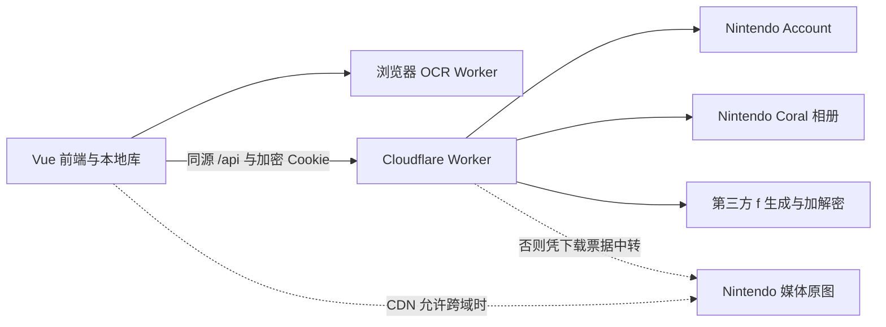

# Groove Archive · FP 成绩管理三期设计文档

> 版本：v3.3 草案
>
> 调研日期：2026-09-29；修订日期：2026-09-30、2026-10-13
>
> 状态：3A 本地实现已接入，尚未连接真实 Nintendo 账号或验证实际 Cloudflare 出口；3B / 3C 未开放
>
> 目标：未登录、未绑定时保持纯前端；Cloudflare 部署上可选绑定 Nintendo 账号，经同源 Worker 无状态中转读取相册，前端下载截图并 OCR；站内账号与多设备同步后续再做

## 1. 结论与实施建议

v3.2 按用户 2026-10-13 的决定确定三项架构选择：

1. 普通网页直连 Nintendo 接口已用正式站点 Origin 复测不可行（第 2.5 节），改为同源 Cloudflare Worker 无状态中转，撤销 v3.1 中“不新增后端相册代理”的约束
2. 实施顺序改为先做 Nintendo 相册同步，站内账号与云端数据库后续再加；未登录时绑定的 Nintendo 账号由加密 Cookie 保存，成绩仍写入本地库
3. 未登录且未绑定时保持纯前端，GitHub Pages 部署和不愿登录、绑定的用户照常使用现有功能

v3.3 根据同日审阅确认：FC/AP 未知统一为 false；非重复的低分截图保留本地历史，但不降低最佳成绩；相册截图的成绩、历史排序与趋势统一按拍摄时间；目前不做完整备份迁移。3A 即加入本地旧任务拦截，失败与拒绝仅采用第 7.5 节的简单恢复规则，当前优先验证真实账号取图、OCR、预览确认入库能否跑通。

执行链路为：**用户访问页面 → 前端请求同源 `/api` → Worker 用加密 Cookie 中的凭据读取相册，按 applicationId 筛选 GCFP 截图 → 前端取得原图（截图 CDN 允许跨域时直连，否则经 Worker 中转）→ 前端 OCR → 写入本地成绩库**。

| 使用形态 | 部署 | 成绩数据 | 网络 |
| --- | --- | --- | --- |
| 纯前端 | GitHub Pages；Cloudflare 部署上未绑定的用户 | 本地 IndexedDB | 日常浏览不请求 `/api`；Cloudflare 用户主动进入相册设置时可查询绑定状态 |
| 绑定 Nintendo、未登录 | 仅 Cloudflare 部署 | 本地 IndexedDB | 相册读取经 Worker，成绩不上传 |
| 站内账号（3C） | 仅 Cloudflare 部署 | 账号本地库与云端 | 成绩同步经后端 |

Worker 不使用数据库，不保存 Nintendo 凭据、相册列表、截图或成绩。长期凭据加密后由浏览器以 HttpOnly Cookie 保存，前端脚本读不到任何 Nintendo 凭据。OCR 继续在用户浏览器运行，服务端不识别。页面关闭后不执行相册任务。

nxapi 作为认证及协议参考，NSO-Album-Sync 作为授权、下载与去重参考。两者都不能直接作为 Worker 运行时的库使用，协议代码按第 6.4 节改写。

三期拆为三个可独立验收的交付：

1. **3A：Worker 中转、Nintendo 绑定与手动读取**，未登录可用；读取、下载、OCR 后预览确认再入库
2. **3B：访问时自动触发**，严格自动入库、待确认和断点恢复，不引入服务器定时轮询
3. **3C：站内账号与成绩同步**，游客迁移、多设备同步，未登录时完成的绑定迁入账号

开工前先用真实账号完成第 14.1 节 PoC，确认 GCFP applicationId、截图 CDN 跨域和 Cloudflare 出口可用性。

### 1.1 待定事项

以下事项尚未确定，实施到相关部分前确认：

| 事项 | 当前状态 |
| --- | --- |
| GitHub Pages 版的 Nintendo 相册入口 | 3A 暂时隐藏；是否引导到 Cloudflare 站点留待真实联调后决定 |
| 会话 Cookie 有效期 | 本地实现暂用 30 天，PoC 后复核 |
| 截图下载方式 | 由 PoC 的 CDN 跨域结果决定前端直连或 Worker 中转 |
| 3C 后端选型 | Workers + D1，或 v3.1 的 Node.js + SQLite，3C 开工前评估 |

## 2. 已确认的能力与边界

### 2.1 主机与云端相册

任天堂官方说明：Switch 2 可将截图上传到 Nintendo Switch App，也可在主机相册设置中启用自动上传；云端每个 Nintendo Account 最多保存 100 个文件，上传内容保存 30 天，部分软件不支持上传。离线时可排队等待联网上传。[官方上传说明](https://www.nintendo.com/en-gb/Support/Troubleshooting/How-to-Upload-Screenshots-and-Videos-from-Nintendo-Switch-2-to-the-Nintendo-Switch-App-2843767.html)

由此确定产品边界：

| 场景                                | 三期行为                                                       |
| ----------------------------------- | -------------------------------------------------------------- |
| Switch 2、截图已出现在官方 App 相册 | 可尝试自动读取；GCFP 的真实截图上传和识别仍须验证              |
| 只保存在主机或存储卡、没有上传      | 未上传的截图不在可读取的云端相册内                             |
| 原版 Switch / Lite / OLED           | 不纳入本方案的云端相册自动读取承诺；继续导出截图后使用现有 OCR |
| 超过云端可见窗口、已过期的文件      | 无法通过这些接口补回，用户需重新上传或手动导入                 |
| 上传到了其他 Nintendo 用户下        | 跳过读取                                                       |
| 视频、非 GCFP 图片                  | 不下载视频、不识别无关游戏截图                                 |

访问时更新只能读取当时仍可见的云端内容。长期未访问或短时间上传大量其他游戏内容可能漏图；此功能不作为相册备份，关页后不更新。

### 2.2 两个项目的具体复用方式

本次按以下提交核查源码，实施时应固定通过验证的版本，不能把浮动 `main` 当作稳定接口：

| 项目                                                                                                     | 核查提交                                   | 能力与定位                                                                                    |
| -------------------------------------------------------------------------------------------------------- | ------------------------------------------ | --------------------------------------------------------------------------------------------- |
| [nxapi](https://github.com/samuelthomas2774/nxapi/tree/47c9d35d9d51d33e62dd6d3733b616e0ad31b02b)         | `47c9d35d9d51d33e62dd6d3733b616e0ad31b02b` | TypeScript/JavaScript 库、CLI、桌面应用；可创建 Coral 会话、刷新认证、读取相册                |
| [NSO-Album-Sync](https://github.com/Dycool/NSO-Album-Sync/tree/4fc49154aa984b85e0c5d3f67a977021a81274b7) | `4fc49154aa984b85e0c5d3f67a977021a81274b7` | C++20 原生桌面托盘应用；授权、定期下载、文件归档与系统凭据存储，README 默认同步周期为 60 分钟 |

nxapi 的 `package.json` 在核查提交声明 `1.6.1`，这不证明 npm 同名版本已经包含该提交的全部改动。PoC 必须核对实际安装包是否具有相册与当前加密协议支持。[包声明](https://github.com/samuelthomas2774/nxapi/blob/47c9d35d9d51d33e62dd6d3733b616e0ad31b02b/package.json)

已核实的 nxapi 能力：

| 能力     | 源码 / 文档中的入口                    | 接入注意                                          |
| -------- | -------------------------------------- | ------------------------------------------------- |
| 初次认证 | `CoralApi.createWithSessionToken(...)` | 返回 `nso` 与认证 `data`                          |
| 恢复会话 | `CoralApi.createWithSavedToken(data)`  | 保存并复用认证数据，不应每次访问重新登录          |
| 续期     | `renewToken(...)` / `onTokenExpired`   | 持久化更新后的凭据，以当前类型及返回值为准        |
| 相册列表 | `nso.getMedia()`                       | 底层调用 `/v4/Media/List`，库返回值中读取 `media` |
| CLI 验证 | `nxapi nso album --json`               | 适合个人 PoC，不作为正式后端每次请求的子进程      |

依据：[Coral 库说明](https://github.com/samuelthomas2774/nxapi/blob/47c9d35d9d51d33e62dd6d3733b616e0ad31b02b/docs/lib/coral.md)、[Coral 实现](https://github.com/samuelthomas2774/nxapi/blob/47c9d35d9d51d33e62dd6d3733b616e0ad31b02b/src/api/coral.ts)、[相册 CLI](https://github.com/samuelthomas2774/nxapi/blob/47c9d35d9d51d33e62dd6d3733b616e0ad31b02b/src/cli/nso/album.ts)

相册媒体模型包含 `id`、`type`、`applicationId`、`appName`、`contentUri`、`contentLength`、`thumbnailUri`、`capturedAt`、`uploadedAt`、`expiresAt`。`type` 区分 `image` 和 `video`；缩略图类型注释为 320×180 JPEG，不能代替 OCR 原图。时间由适配层从上游秒统一转换为本项目毫秒。[媒体类型定义](https://github.com/samuelthomas2774/nxapi/blob/47c9d35d9d51d33e62dd6d3733b616e0ad31b02b/src/api/coral-types.ts#L513)

当前 `getMedia()` 没有暴露分页游标；虽然类型文件保留 `count: 100` 的参数声明，实际调用没有传该字段。NSO-Album-Sync 当前也发送空 `parameter`。设计为扫描当前可见集合，不虚构分页、历史回溯或服务端增量能力。[相册调用实现](https://github.com/Dycool/NSO-Album-Sync/blob/4fc49154aa984b85e0c5d3f67a977021a81274b7/src/coral.cpp#L661)

NSO-Album-Sync 值得参考的是：缓存凭据、校验下载地址与长度、临时文件完成后再改名、保留拍摄时间。其单用户状态、系统钥匙串和桌面回调不能直接套用到托管服务。[同步实现](https://github.com/Dycool/NSO-Album-Sync/blob/4fc49154aa984b85e0c5d3f67a977021a81274b7/src/sync.cpp)

### 2.3 外部认证依赖不是一个普通 Bearer API

当前源码包含第三方 `f` 生成，以及 Coral 请求加密和响应解密。NSO-Album-Sync 的 README 明确披露，相关服务会处理 Nintendo 身份信息、Coral token 和 API 请求/响应。不能只告诉用户“第三方收到一个临时签名参数”，也不能声称凭据始终只在用户设备或本项目服务器内。[数据披露](https://github.com/Dycool/NSO-Album-Sync/blob/4fc49154aa984b85e0c5d3f67a977021a81274b7/README.md#-nintendo-account--nxapi)、[nxapi 加密请求实现](https://github.com/samuelthomas2774/nxapi/blob/47c9d35d9d51d33e62dd6d3733b616e0ad31b02b/src/api/coral.ts#L828)

nxapi 文档要求库调用者注册自己的 nxapi-auth client，常见作用域为 `ca:gf ca:er ca:dr`；该凭据属于本项目接入第三方认证服务的身份，与 Nintendo 客户端 ID、站内用户会话不同。不可复制其他应用的 client 身份或依赖其私人代理。上游支持只用 client id 的公开客户端，以及使用 secret 或 client assertion 的机密客户端。本项目默认支持仅 Client ID 的方式，不把 Secret 作为必备项；若服务方实际提供 Secret，则通过 Worker secret 配置。作用域由程序在申请 token 时发送，注册页无需提供输入框；实际是否授权及额度仍需联调确认。[nxapi 认证说明](https://github.com/samuelthomas2774/nxapi#nxapi-auth-authentication)

nxapi 要求调用 imink、flapg 等非 Nintendo 接口时，在 User-Agent 中写明本项目名称和版本；未开源或不易查找的项目还需附联系方式。浏览器 fetch 不能可靠设置 User-Agent，Worker 可以设置，本项目附仓库地址。[User-Agent 要求](https://github.com/samuelthomas2774/nxapi/tree/47c9d35d9d51d33e62dd6d3733b616e0ad31b02b#user-agent-strings)

NSO-Album-Sync 的当前 Coral 源码还存在作者部署的 Worker `f` 生成路径。它不是项目可直接依赖的公共服务承诺，采用 nxapi 适配层时不照搬这条私有部署依赖。[Coral 源码](https://github.com/Dycool/NSO-Album-Sync/blob/4fc49154aa984b85e0c5d3f67a977021a81274b7/src/coral.cpp)

nxapi 文档认为账号因此被封禁的可能性极低，同时记录 2023-09 有少量用户被禁止访问 SplatNet 3，涉及的是与 nxapi 无关的应用。绑定说明如实告知风险，不承诺无风险。[封禁说明](https://github.com/samuelthomas2774/nxapi/tree/47c9d35d9d51d33e62dd6d3733b616e0ad31b02b#will-my-nintendo-accountnetwork-service-account-be-banned-for-using-this)

这些是非官方接口，更新可能导致授权或拉取失效。Nintendo 故障只影响绑定和相册任务，纯前端功能和手动导入应继续可用，3C 的站内登录与成绩同步同样不受影响。

### 2.4 许可证与调研可信度

nxapi 声明 `AGPL-3.0-or-later`，NSO-Album-Sync 为 MIT。正式采用前确定本项目源码发布方式、依赖分发和通知要求；不能因为把 nxapi 放进独立进程，就假定解决所有许可问题。[nxapi 许可证](https://github.com/samuelthomas2774/nxapi/blob/47c9d35d9d51d33e62dd6d3733b616e0ad31b02b/LICENSE)、[NSO-Album-Sync 许可证](https://github.com/Dycool/NSO-Album-Sync/blob/4fc49154aa984b85e0c5d3f67a977021a81274b7/LICENSE)

本项目为 GPL-3.0。GPL-3.0 第 13 节允许与 AGPL-3.0 代码组合，但移植进 Worker 的 nxapi 协议代码仍适用 AGPL 关于网络交互提供源码的要求；仓库已公开，部署时在页面提供源码链接与许可声明。这里记录依赖条件，不作具体法律适用结论。

按项目要求先使用 Context7 CLI 查询了两个项目，但返回的是无关库，没有可用索引，因此本节以固定提交的源码和任天堂官方资料为依据。2026-10-13 复核了固定提交的 nxapi README（nxapi-auth 客户端类型、User-Agent、封禁说明），并经 Context7 查询 Cloudflare Workers 静态资源路由与 Rate Limiting 绑定文档。已确认代码能力与产品边界，并进行了无真实凭据的跨域预检测试；真实账号授权、服务额度、GCFP application ID、媒体原图跨域和 Cloudflare 出口可用性仍未实测。

### 2.5 浏览器直连限制与当前验证结果

所核查的 nxapi Coral、Nintendo Account 和加解密源码依赖 `node:crypto`、`node:process`、`undici` 及 Buffer。这些入口是 Node 环境实现，不能直接认为 npm 安装后即可在网页或 Worker 中调用。[Coral 源码](https://github.com/samuelthomas2774/nxapi/blob/47c9d35d9d51d33e62dd6d3733b616e0ad31b02b/src/api/coral.ts)、[加解密源码](https://github.com/samuelthomas2774/nxapi/blob/47c9d35d9d51d33e62dd6d3733b616e0ad31b02b/src/api/f.ts)

2026-09-30 对公开端点做无凭据 OPTIONS 探测，Origin 为 `http://127.0.0.1:5173`，拟请求方法 POST、请求头 authorization/content-type：

| 端点 | HTTP 状态 | 本次返回的 CORS 许可头 |
| --- | --- | --- |
| Nintendo `/v4/Media/List` | 200 | 未见 Access-Control-Allow-Origin/Methods/Headers |
| Nintendo Account `/connect/1.0.0/api/token` | 405 | 未见上述许可头 |
| nxapi-znca-api `/api/znca/encrypt-request` | 401 | 未见上述许可头 |

同日补充真实 Edge 154.0.4258.37 验证：使用实际本地 HTTP 页面 `http://127.0.0.1:10718`，不拦截或模拟网络响应，不关闭浏览器跨域安全检查。页面 fetch 相册接口，方法 POST，请求头为 Authorization 和 `Content-Type: application/octet-stream`，使用无效测试凭据；浏览器发出的 OPTIONS 返回 200、无跨域许可头，控制台明确报告预检失败，CDP 错误为 `PreflightMissingAllowOriginHeader`，JavaScript 得到 `TypeError: Failed to fetch`。预检不携带实际 Authorization token，阻断发生在账号鉴权之前。[MDN CORS 说明](https://developer.mozilla.org/en-US/docs/Web/HTTP/Guides/CORS)

2026-10-13 以正式站点 Origin `https://himemiyatori.github.io` 复测命令行预检，拟请求方法 POST、请求头 authorization/content-type：

| 端点 | HTTP 状态 | CORS 许可头 |
| --- | --- | --- |
| Nintendo `/v4/Media/List` | 200 | 无 |
| Nintendo Account `/connect/1.0.0/api/session_token` | 405 | 无 |
| Nintendo Account `/connect/1.0.0/api/token` | 405 | 无 |
| nxapi-znca-api `/api/znca/f` | 401 | 无 |

绑定时交换 session token 的接口同样没有跨域许可，普通网页不只是读不到相册列表，连绑定也无法完成。Node polyfill 不会使上游响应增加 CORS 头，`no-cors` 返回的 opaque 响应也不能读取 JSON 或 Blob。结合 9 月 30 日的真实浏览器验证，普通网页直连不再作为实现路径，改由同源 Worker 中转（第 6 节）。

截图 CDN 的跨域情况仍需真实媒体 URL 验证。若 CDN 允许跨域，前端直接下载原图；否则由 Worker 中转。仅能在 img 标签显示不等于能读取像素用于 Canvas/OCR。

## 3. 与现有项目衔接

以 [二期设计](FP_B30_二期设计文档.md) 和当前代码为基线；本文件只扩展三期范围，不将二期待实现功能视为已完成。

| 现有模块 | 当前行为 | 三期调整 |
| --- | --- | --- |
| `vite.config.ts`、构建脚本 | GitHub Actions 构建使用 `/gcfp-b30/` base | 增加服务端能力构建开关，默认关闭（第 5.1 节） |
| `wrangler.jsonc` | 只部署静态资源 | 增加 Worker 入口，`/api/*` 先进入 Worker（第 5.2 节） |
| `src/db/database.ts` | 单个 Dexie 数据库 `groove-archive-fp-history`，本地数字自增 ID | 现有库作为游客库保留，不改名；`version(2)` 增加相册处理记录与谱面保护表；3C 另建账号库 |
| `src/db/scoreRepository.ts` | 本地增删改；OCR 每张事务提交，只与同谱面最近一条历史去重 | 新增带 mediaId 的相册入口，同一事务写成绩与处理记录；清空成绩不清相册记录与绑定 |
| `src/core/score/import.ts` | Excel 预览及事务合并 | 抽取共用合并规则，新增 `nso_ocr` 来源 |
| `src/core/ocr/parser.ts` | 字段解析、曲名匹配、页面校验 | 复用并补充候选、证据和待确认结果 |
| `src/core/ocr/recognizer.ts` | 浏览器 Worker、Canvas、WASM；先整张解码再检查尺寸 | 继续在浏览器运行；相册图片在读取数据流时先按字节上限截断 |
| `src/composables/useOcrImport.ts` | 页面任务取消、前台入库 | 复用识别能力；相册队列由应用级前端控制器维护 |
| `src/core/rating/`、`src/core/song/` | 本地规则和稳定曲库 ID | 3C 前后端共用版本；服务端校验并重算派生字段 |

继续遵守：Score 为 0～1,050,000 整数；FC/AP 未知或缺失统一为 false，不引入三态；Max Chain 可未知；AP 成立时 FC 成立；每用户每谱面一条当前成绩；BASIC / ADVANCED 独立 B30。同分自动合并仅补未知的 Max Chain，不自动改写 FC/AP。

三期需调整现有时间处理：相册截图按第 7.4 节使用拍摄时间；只改 Max Chain 不改变业务 `updatedAt`，3C 中仍须触发同步版本变化。当前 `edit()` 会更新 `updatedAt`，历史与趋势按 `importedAt` 排序，不能视为上述规则已经实现。

3C 起，现有 `rating` 为派生值，不能信任客户端上传结果。现有数字 `id` 仅用于设备内部，不作为跨设备主键。后端验证字段合法性、归属和合并规则，不证明前端识别结果来自真实 Nintendo 截图；三期是个人成绩管理，来源标签不承担排行榜认证。

## 4. 范围与架构

### 4.1 部署与职责



| 环节 | 执行位置 |
| --- | --- |
| 成绩存储、Rating、B30、Excel、手动 OCR | 前端本地，三种使用形态相同 |
| Nintendo 绑定、session token 交换、Coral 登录与续期 | Worker |
| 第三方 f 生成与请求加解密 | Worker，使用本项目 nxapi-auth client |
| 相册列表读取与 GCFP 筛选 | Worker，只返回必要字段 |
| 原图下载 | 前端直连 CDN；CDN 不允许跨域时经 Worker 凭下载票据中转 |
| 尺寸检查、hash、OCR、预览、入库 | 前端 |
| 访问触发、冷却、进度、重试、多标签页协调 | 前端 |
| 站内账号、成绩同步（3C） | 后端 |

静态前端与 Worker 部署在同一个 Cloudflare Worker，`/api` 与页面同源。Worker 无状态，不绑定数据库、KV 或图片存储；凭据由浏览器以加密 Cookie 保存，每次请求解密使用，Worker 重启或换节点不影响绑定状态。GitHub Pages 部署不含 Worker，只提供纯前端功能。

不新增相册调度进程、服务器任务队列、图片存储、无头 Chromium 和服务端 OCR。Worker 只在用户页面发出请求时执行，不定时读取 Nintendo 相册。

### 4.2 范围与页面生命周期

三期包含纯前端模式维持、绑定/解绑、手动读取、访问时更新、导入记录、待确认及错误恢复；3C 再加入账号登录、游客迁移、多设备同步和离线编辑。

自动更新以用户访问为条件，默认不设置整天运行的相册轮询，也不使用 Service Worker 承诺关页后持续识别。应用内部切换成绩页、B30 或设置页可继续当前批次；切出网站后台时不启动新扫描，并允许正在执行的工作被暂停或中断。下一次可见访问恢复未完成任务。

好友、排行榜、完整游玩历史、相册备份、视频识别和服务端代操作主机不纳入。主题、语言继续设备本地保存。

## 5. 部署形态与纯前端模式

### 5.1 构建开关

- 服务端能力由构建时环境变量开启（例如 `VITE_SERVER=1`），默认关闭。Cloudflare 构建设置该变量，GitHub Actions 不设置
- 默认关闭的原因：漏设只会看不到 Nintendo 功能；若默认开启，GitHub Pages 版会请求 `himemiyatori.github.io/api/...`，该路径位于账号根路径之下，可能命中其他仓库
- Nintendo 相关前端模块全部动态导入，开关关闭时由构建剔除，不进入 GitHub Pages 产物
- 本地 `yarn dev` 默认为纯前端，现有浏览器验收继续覆盖该路径；Worker 路径使用 `wrangler dev` 单独验收

### 5.2 同源部署

`wrangler.jsonc` 增加 `main` 与 `assets.binding`，`assets.run_worker_first` 设为 `["/api/*"]`，其余请求仍直接返回静态资源。[Cloudflare 静态资源路由](https://developers.cloudflare.com/workers/static-assets/binding/)

前端放在 GitHub Pages、Worker 放在 workers.dev 的跨站组合不可用：HttpOnly Cookie 会成为第三方 Cookie，Safari、Firefox 默认拦截。Nintendo 相册功能只在 Cloudflare 部署提供。

### 5.3 未绑定时日常浏览不请求 API

HttpOnly Cookie 前端读不到，前端无法自行判断是否已绑定。localStorage 保存不含凭据的“已绑定”标记：有标记才请求绑定状态与相册；接口返回未绑定或 Cookie 已过期时清除标记。Cloudflare 部署上从未绑定的用户不访问 Worker，行为与 GitHub Pages 版一致。

用户主动打开设置页的 Nintendo 相册区域时查询一次绑定状态，用于在标记丢失时恢复。这是未绑定用户不请求 API 的明确例外；仅访问普通设置页面而未进入相册区域不查询。

### 5.4 两个部署的数据不互通

GitHub Pages 与 Cloudflare 部署是不同 Origin，IndexedDB 各自独立。用户从 GitHub Pages 转到 Cloudflare 部署只能经 Excel 迁移，而 Excel 只交换当前最佳成绩，历史与 Rating 趋势不会迁入（二期第 9 节），原站点数据仍保留。目前不做完整备份导出、导入或迁移，迁移说明明确此限制。GitHub Pages 版的入口形式见第 1.1 节待定事项。

### 5.5 降级

绑定用户遇到 Worker 故障、离线、Cookie 过期或上游变化时，本地成绩、B30、Excel 与手动 OCR 完整可用，错误只显示在 Nintendo 相册状态区域，不遮挡首页和 B30。

## 6. Worker 无状态中转与凭据

### 6.1 绑定流程

两个参考项目使用原生应用认证流程：Nintendo 客户端为 `71b963c1b7b6d119`，回调为 `npf71b963c1b7b6d119://auth`，结果是 session_token_code，配合 state 与 S256 challenge。不能直接替换为本站 HTTPS callback。[授权实现](https://github.com/Dycool/NSO-Album-Sync/blob/4fc49154aa984b85e0c5d3f67a977021a81274b7/src/nintendo_auth.cpp)

1. 用户阅读并同意第三方处理说明（第 6.4 节）与封禁风险说明
2. Worker 生成 state 与 PKCE verifier，加密写入 10 分钟有效的流程 Cookie，返回授权链接
3. 用户在 Nintendo 官网登录，按实测可用的方式复制原生回调链接并粘贴提交
4. Worker 校验 scheme、host、state 与期限，交换 session token，读取 Nintendo 账号 ID 与昵称
5. Worker 写入带新 bindingId 的会话 Cookie，清除流程 Cookie 与旧 Coral 缓存；前端写入已绑定标记
6. 前端发起第一次相册读取；空相册是合法结果

登录回调能否复制，以及手机是否被官方 App 接管，仍须实测；不要求用户上传其他软件的凭据文件。

流程完成后清除 Cookie 不等于服务端具备一次性消费记录。无状态方案依赖上游拒绝重复兑换 session_token_code，PoC 必须实测重放及并发兑换，不能仅凭清 Cookie 宣称防重放已通过；不满足时先调整方案再开放绑定。

### 6.2 加密 Cookie

| Cookie | 内容 | 有效期 |
| --- | --- | --- |
| 会话 | session token、Nintendo 账号 ID、bindingId、昵称、keyVersion、签发与过期时间 | 3A 暂用 30 天，PoC 后复核 |
| Coral 缓存 | Nintendo 账号 ID、bindingId、Coral 短期 token 与到期时间 | 按上游 expiresIn |
| 绑定流程 | state、PKCE verifier、过期时间 | 10 分钟，完成后清除；重放边界见第 6.1 节 |

- 全部使用 `__Host-` 前缀与 `HttpOnly; Secure; SameSite=Strict; Path=/`，不设 Domain
- 内容使用 AES-GCM 加密，主密钥来自 Worker secret，按 keyVersion 轮换；Cookie 名称作为附加认证数据，不同 Cookie 的密文不能互换
- 单个 Cookie 按 4 KB 上限设计，会话与 Coral 缓存分开保存；PoC 记录实际体积
- Coral 缓存避免每次检查都重新执行账号 token、f 生成和 Coral 登录，减少耗时与第三方额度消耗
- 使用 Coral 缓存前必须核对 Nintendo 账号 ID 与 bindingId 均匹配当前会话；不匹配则丢弃缓存，不能跨账号或跨次绑定复用

无状态的代价是服务端无法吊销已签发的 Cookie。解绑只清除当前浏览器的 Cookie；Cookie 被复制时在过期或密钥轮换前一直可用，因此会话 Cookie 必须带过期时间。轮换主密钥会使全部绑定失效，用户需重新绑定。

前端不持有任何 Nintendo 凭据，比 v3.1 中“前端持有 Coral 短期 token”的暴露面更小。XSS 无法取走凭据，但页面打开期间可借用户 Cookie 调用中转接口，因此接口范围按第 6.3 节最小化。

### 6.3 接口最小化

- 只提供相册读取和原图中转两类上游操作；不透传 Coral 接口，不读取好友、在线状态或其他游戏服务
- 相册列表由 Worker 按 applicationId 白名单筛选 GCFP 图片，只返回 mediaId、拍摄时间、尺寸或长度、到期时间与下载方式所需字段；`appName` 仅显示，不用模糊名称自动入库
- CDN 允许跨域时，列表直接返回 contentUri 供前端下载，签名 URL 只在当前页面内存中使用
- CDN 不允许跨域时，原图中转不接受客户端提交的 URL。列表为每张图附带 Worker 加密的短期下载票据，内含 Worker 自己取得的 contentUri、mediaId 和过期时间；前端原样回传，Worker 解密校验后下载
- 中转下载只访问验证过的媒体 HTTPS 主机，不自动跟随重定向，跳转目标同样校验；读取数据流时按 20 MiB 截断，不只相信 contentLength，只流式转发不缓存
- 写请求与中转请求校验 `Origin`，配合 SameSite=Strict 防止跨站请求；响应一律 `Cache-Control: no-store`

### 6.4 上游与第三方

- **协议移植**：nxapi 的 Coral、Nintendo Account 与加解密实现依赖 `undici`、`node:crypto` 等 Node 接口，在 Worker 中改写为基于 fetch 与 WebCrypto 的实现，不直接导入 nxapi 全库；固定参考提交，协议变化时对照更新
- **协议参数**：Nintendo Switch App 更新后，旧版本号请求可能被拒绝。版本号等协议参数放在 Worker 环境变量或远程配置中，不发版也能更新
- **nxapi-auth**：使用本项目注册的 Client ID，支持公开客户端；可选 client secret 存于 Worker secret。Worker 申请 token 时发送作用域 `ca:gf ca:er ca:dr`；User-Agent 带本项目名称、版本和仓库地址
- **共用出口与额度**：所有用户的请求从 Cloudflare 出口 IP 发出，并共用本项目 nxapi-auth client 的额度。Nintendo 是否限制数据中心 IP、第三方额度多少，须 PoC 实测并向服务方确认
- **限流**：客户端冷却见第 7.1 节。Worker 用 Rate Limiting 绑定按 Nintendo 账号 ID 与 IP 做整体限制；该绑定按单个 Cloudflare 节点计数，周期只能为 10 或 60 秒，只用于防滥用，不作精确额度。[Rate Limiting 绑定](https://developers.cloudflare.com/workers/runtime-apis/bindings/rate-limit/)
- **日志**：Worker 日志与错误信息不得包含 Cookie、token、授权码、生日和签名 URL；上游错误响应先脱敏再记录，不整包输出
- **告知与同意**：绑定前说明 Cloudflare 在传输中经手 Nintendo 凭据与相册列表，截图中转时也经手图片；nxapi-znca-api 会收到 Nintendo id_token（有效 15 分钟）、Coral token 及加密前后的请求和响应内容；本项目不保存这些数据

### 6.5 续期、状态与解绑

- 仅在页面请求时续期 Coral token，闲置账号不后台刷新；确认过期后最多续期一次再重试
- session token 失效时返回 `reauth_required`，前端停止读取并提示重新绑定
- 未登录阶段状态为 `unbound / active / paused / reauth_required / error`；`paused` 由前端本地保存，表示关闭访问时自动更新
- 解绑清除会话、Coral 缓存 Cookie 与本地标记，取消当前批次并释放图片；已导入成绩保留，相册处理记录保留，避免重新绑定同一账号后重复导入
- 绑定、解绑与可能续期的相册请求共用跨标签页凭据操作锁；解绑或换绑先阻止新请求并等待已发出的凭据请求结束，再执行清 Cookie 或新绑定。不能只依赖 AbortSignal，因为忽略旧响应的业务结果不能撤销浏览器处理的 Set-Cookie。相册请求只更新 Coral 缓存，不重写长期会话 Cookie；旧 bindingId 的缓存不能恢复绑定或用于新账号
- 3C 登录时，Worker 读取会话 Cookie，将认证数据加密写入账号绑定表后清除 Cookie；会话 Cookie 保留 Nintendo 账号 ID 供迁移使用

## 7. 访问触发、取图与 OCR

### 7.1 触发规则和用户体验

已绑定且未暂停时，页面先显示本地成绩，再异步检查相册，不阻塞首页和 B30。

- 首次进入网站，距离最近成功检查至少 5 分钟时自动检查一次
- 标签页重新可见时按相同 5 分钟冷却规则检查
- 页面内导航不重新检查；页面一直停留不周期轮询
- 提供“立即更新”，初始冷却为 60 秒；上游限流和既有退避优先
- 无新图片时不初始化 OCR；有图时显示发现数量、逐张进度与实际成绩更新数

5 分钟和 60 秒是本项目建议配置，不是上游允许额度。冷却时间存于 IndexedDB 由各标签页共享，用 `navigator.locks` 保证同一时间只有一个标签页扫描。未登录阶段没有跨设备协调，各设备分别检查。

用户长期未访问时不读取。当前云端容量和 30 天窗口内的图片仍可补读，已不可见图片需重新上传或手动导入；设置页说明该取舍。

### 7.2 相册读取和取图

1. 前端取得标签页锁，检查本地冷却
2. 前端请求 Worker 读取相册；Worker 续期凭据、调用 Coral、按 applicationId 筛选后返回 GCFP 图片
3. 前端与本地相册处理记录对照，跳过已处理 mediaId；新图片按拍摄时间从早到晚排队
4. 前端下载原图：CDN 允许跨域时直连 contentUri，否则凭下载票据请求 Worker 中转
5. 前端检查类型、长度、像素和内容 hash，执行 OCR
6. 前端在同一 Dexie 事务写入成绩与处理记录终态

GCFP applicationId 尚未验证，PoC 从真实媒体确认允许集合。每次读取当前完整可见列表，不按“拍摄时间大于上次”跳过，因为旧截图可以晚上传；不虚构上游分页或历史回溯。

初始边界为 20 MiB、约 1600 万像素及既有完整 16:9 要求。读流时强制大小上限，不能只相信 contentLength；现有 `recognize()` 先整张解码再检查尺寸，相册图片须在解码前完成字节上限检查。下载结果必须是可读 Blob，下载并发保持很小，有界缓冲，不把所有原图同时留在内存。

签名 URL 与下载票据仅用于当前页面任务，不进持久化、日志或埋点。失效时前端重新读列表；媒体已不存在时标记 expired，不把失败当作成功处理。

### 7.3 复用现有前端 OCR

继续使用 `src/core/ocr/recognizer.ts` 的 Worker、Canvas、WASM、日文模型与 ROI，不新增服务端识别器。模型仅有新图片时按需加载，同一页面会话内复用；首张图冷启动和手机性能通过实测优化。

新增应用级相册导入控制器，内部页面切换时继续处理并展示统一进度。现有本地手动导入的关闭/取消行为保留；它与相册队列协调同一识别资源，首版识别并发 1，避免同时加载多个模型。

Worker 的目标是让页面可继续操作，不是保证浏览器后台常驻执行。页面隐藏时停止派发新工作，正在执行的步骤允许被浏览器中断；重新可见后恢复。解绑和显式取消触发 AbortSignal，超时销毁模型实例，下次需要时重建。

刷新/关闭后只保留处理记录、已识别候选和待写入结果。未识别原图需要重新拉取，不保存图片备份；已识别未写入的结果优先重试写入，不重复 OCR。

### 7.4 本地去重与入库

未登录阶段相册结果写入现有游客库，与手动 OCR 走同一 `scoreRepository`：

- **持久化已处理 mediaId**：每次检查读取当前全部可见截图，而现有入库只与同谱面最近一条历史比较。不记录 mediaId 时，结果与最近历史不同的旧截图每次访问都会再插入一条历史。处理记录以 Nintendo 账号 ID + mediaId 为键，另存内容 hash，用于同图重传去重
- **谱面保护**：人工降分、纠正完成标记或删除历史后，为该谱面设置 `autoImportBlocked`，后续自动候选进入待确认，用户可明确解除保护。编辑后的不同图片可能绕过 hash，所以保护作用于谱面，不只作用于文件。保护记录放在独立表，因为 `scores` 每次重建都会整表清空重写
- **拒绝记录**：已处理或用户拒绝的 mediaId 持续记录；hash 命中原人工拒绝记录时仍进入待确认
- **清空成绩**：`clear()` 不清相册处理记录、谱面保护与绑定，同时关闭访问时自动导入；用户重新开启时选择从当前可见列表建立基线，还是重新审核历史截图
- **低分与同分**：非重复低分截图保留本地历史，但不降低最佳成绩；同分只补最佳成绩中未知的 Max Chain，不把 false 当成可补的未知 FC/AP。进度分别统计“新增历史”和“更新最佳成绩”，不能把低分已记录误报为未入库
- **时间**：相册截图以 `capturedAt` 作为业务时间，统一用于成绩 `updatedAt`、历史展示与排序、Rating 趋势。历史新增 `playedAt` 保存该时间，`importedAt` 仅保留实际入库时刻供处理记录使用，不作为截图成绩日期。既有历史及无法取得可靠拍摄时间的手动导入以原 `importedAt` 作为 `playedAt`，不猜测文件拍摄时间；相册候选缺失或含非法 `capturedAt` 时进入待确认，补正时间后才能入库
- **来源**：`source` 增加 `nso_ocr`，类型定义、Excel 导出与历史展示同步支持

清除站点数据后，成绩、处理记录与保护一起丢失，下次访问按当前可见截图重新导入；设置页说明该取舍。

历史重建与趋势按 `playedAt` 排序，同一时刻以本地历史 ID 稳定排序；旧截图晚上传时重新计算后续趋势，不追加到今天，也不按同次导入的 batchId 把不同拍摄时间合为一个点。对相册历史的人工纠错保留拍摄时间，另记 `correctedAt`；不改写为纠错时刻。

3A 起在 IndexedDB 持久化本地 `datasetEpoch` 与 `bindingGeneration`。创建任务或候选时记录两者及 Nintendo 账号 ID；清空成绩递增 datasetEpoch，解绑、换绑递增 bindingGeneration。最终写成绩与处理终态的同一事务中核对代次、当前账号和谱面保护，不匹配则取消旧任务，不能靠组件内 AbortSignal 保证安全。删除历史或人工纠错时同步设置谱面保护，使旧候选不能直接提交；重新审核须基于当前数据重新确认。跨标签页共用这些记录，3C 再扩展服务端校验。

### 7.5 候选判定与状态

自动候选要求白名单匹配、支持的完整页面、唯一谱面、合法分数和完成标记。非唯一曲名、疑似数字误读、未知谱面、关键字段冲突或谱面保护进入 needs_review。3A 先预览确认，真实样本验证后 3B 开放访问时自动写入。MISSION CLEAR / MISSON CLEAR、游玩中和未游玩占位继续跳过。

3A 所有有效候选先进入 needs_review。3B 初始仅允许规范化后精确匹配唯一曲名、谱面一致且关键字段无冲突的结果自动入库；曲名模糊匹配、数字 O/0 或 I/1 等修正、缺失或无法确认的完成标记均待确认。FC/AP 最终按 false 默认值保存不等于识别证据充分。候选保留原始字段文本、规范化结果和待确认原因即可，首版不引入复杂置信度评分。

本地状态为 `discovered → downloading → recognizing → needs_review / pending_commit`；确认或符合 3B 自动规则后提交，得到 imported / skipped，另有 retry_wait、failed、expired、canceled、rejected。仅媒体已发现、已下载或 OCR 已结束不能标记 imported，必须在成绩事务提交成功后标记；写入低分历史也算 imported。

首版恢复仅采用以下规则，不做复杂的自动重处理策略：

| 状态 / 场景 | 恢复规则 |
| --- | --- |
| retry_wait | 网络、5xx 或 OCR 超时自动重试最多 2 次，分别至少等待 1、5 分钟；仅在页面可见且再次触发时执行，429 以 Retry-After 为下限，达到上限转 failed |
| failed | 显示阶段和原因，用户点“重试”后重置次数；有效的已识别候选优先重试提交，否则重新取图识别 |
| needs_review / rejected | 待确认由用户修改、确认或拒绝；拒绝记为 rejected，同一 mediaId 不自动重试，仅明确重新审核后恢复；新 mediaId 的 hash 命中拒绝记录仍进入待确认 |
| expired | 未识别媒体已不可见时停止下载重试；已保存候选可显示原图不可用并供手动审核，不因图片消失丢弃候选 |
| canceled / 页面中断 | 显式取消不自动恢复，可手动重试；刷新或关闭留下的未完成任务下次访问恢复，先检查代次，过期代次不得复用 |
| imported / skipped | 自动扫描不重复处理；识别版本更新不自动翻查终态，必要时由用户明确重新审核 |

3C 起提交携带 mutationId、mediaId、hash、候选版本、epoch 和 generation，服务端在同一事务内记录回执、合并成绩和更新媒体终态；跨设备处理租约在 3C 引入。不能因前端标记“已校验”跳过服务端校验。

### 7.6 待确认与图片生命周期

前端识别完或取消后尽快释放 Blob、ImageBitmap 和对象 URL。Worker 中转时只流式转发，不缓存或存储截图。待确认保存候选和原因，不保存原图。

原图仍在当前会话内可直接预览；刷新后查看时重新读取相册下载。若 URL 过期则重新取列表，媒体已不可见时显示“原图不可用”，用户可重新上传或依据候选手动修改。

确认时重新比较最新成绩，拒绝项和谱面保护继续参与去重。用户删除/清空数据后旧候选不得恢复成绩。

## 8. 站内账号与设备隔离（3C）

本节在 3C 实施，后端选型见第 1.1 节。现有 `groove-archive-fp-history` 即游客库，未登录阶段的相册处理记录与谱面保护一起保留；未登录时完成的 Nintendo 绑定按第 6.5 节迁入账号。

### 8.1 登录方案

首版建议邮箱一次性验证码登录，省去密码找回和密码管理；邮箱服务是新增外部依赖，部署时配置发送服务和发信域名。若部署环境不适合邮件，3C 开工前替换为单一成熟身份提供方，成绩归属仍使用内部 `userId`，不与邮箱或第三方昵称绑定。

验证码仅存哈希，建议 10 分钟过期、一次有效、失败次数封顶；按邮箱和 IP 限制发送及验证频率，返回统一提示避免枚举账号。成功后发随机站内会话，数据库存会话摘要，浏览器使用 `HttpOnly + Secure + SameSite` Cookie。写请求校验 Origin 和 CSRF，账号切换及退出撤销当前会话。

站内会话、Nintendo 长期会话、Coral 短期凭据、nxapi-auth 应用凭据分开保存和命名。所有 API 从服务端会话确定 `userId`，不能信任请求体中用户自报的所有者。

### 8.2 游客迁移及退出

1. 首次登录先拉取云端快照，保留原游客数据
2. 若游客库有成绩，显示新增、可提升、同分补全、跳过数量，用户选择导入或暂不导入
3. 导入按第 10 节规则合并，整个迁移带唯一 `migrationId`，重复提交不能重复产生效果
4. 服务端确认后写入账号库；保留游客库作为迁移前副本，之后两者不自动双向同步
5. 退出后停止该账号的本地同步器并返回游客库；账号数据不作为游客数据显示

推荐每个账号独立 IndexedDB 命名空间，服务端 `userId` 映射只保存在站点本地；切换账号时先取消旧请求和订阅，晚到响应必须校验账号及会话代次。待同步操作始终绑定原账号，不能转发给下一个登录用户。退出时有未同步数据要提示并保留原账号队列；仅在用户明确选择后丢弃本机副本。

本地缓存清除与云端成绩清空拆成不同操作。清除本机缓存不会产生云端删除，云端清空需二次确认并走独立的同步协议。

## 9. 数据模型建议

以下是逻辑模型，不是已执行的数据库迁移。时间统一为 UTC 毫秒。

### 9.1 本地库（3A / 3B）

现有 `groove-archive-fp-history` 以 `version(2)` 增加：

| 本地表 | 关键字段 |
| --- | --- |
| `albumItems` | 主键 Nintendo 账号 ID + mediaId；applicationId、capturedAt、contentHash、datasetEpoch、bindingGeneration、阶段、重试次数与时间、识别版本、候选、原因或错误码、终态 |
| `chartProtections` | chartId 唯一；autoImportBlocked、设置原因与时间 |

本地以独立 `albumState` 表保存相册设置与任务代次记录（当前 Nintendo 账号 ID、bindingId、datasetEpoch、bindingGeneration、访问时自动更新开关、最近成功检查时间、冷却截止），不随清空成绩删除；清空时递增代次并关闭自动更新。截图只在浏览器内存中处理，不持久化到 IndexedDB。`capturedAt` 是上游拍摄时间；`lastCheckedAt` 与 `lastImportedAt` 分开，后者仅在成绩事务提交成功后更新，表示最近实际入库时刻。

同次 version(2) 迁移为 `scoreHistory` 增加 `playedAt` 及排序索引，既有记录回填 importedAt；Rating 快照以 playedAt 作为横轴并重建，历史查询同步调整。处理耗时、重试和同步版本时间仍使用实际发生时刻，与截图业务时间区分。

首版每个浏览器只绑定一个 Nintendo Account。重新绑定同一 Nintendo Account 复用处理记录。

### 9.2 后端（3C）

所有用户查询和唯一约束包含所有者。

| 后端表 | 关键字段和约束 |
| --- | --- |
| `users` | id、规范化唯一邮箱、createdAt、datasetEpoch、nextChangeSeq |
| `login_codes / sessions` | 验证码/会话摘要、过期时间、失败计数、所属 userId |
| `scores` | userId + chartId 唯一；score、boolean fc/ap（默认 false）、nullable maxChain、source、业务时间、revision、deletedAt、autoImportBlocked |
| `score_changes` | 用户内单调 seq、chartId、规范结果、revision、epoch、服务端变更时间 |
| `mutation_receipts` | userId + mutationId 唯一、请求摘要和结果；相同 ID 不同载荷拒绝 |
| `nintendo_bindings` | userId、NintendoAccountId、显示名、状态、同意版本、从会话 Cookie 迁入的加密认证数据、keyVersion、generation |
| `album_scan_sessions` | bindingId、deviceId、epoch、generation、leaseId、leaseUntil、nextAllowedAt、最后成功检查时间 |
| `album_items` | userId + NintendoAccountId + mediaId 唯一；applicationId、时间、内容 hash、终态、识别版本、候选、错误码和处理租约 |

登录后本地 `albumItems` 与 `chartProtections` 随游客迁移上报合并。后端不保存 contentUri、thumbnailUri、图片字节或图片文件引用；`album_items` 仅用于个人导入协调和去重。

`source` 扩充 `nso_ocr`。FC/AP 只存布尔值，完整导入中未知或缺失统一为 false；Max Chain 在 JSON 中用 `null` 表示未知，不能将 false、0 当空值。局部编辑中字段缺失表示不修改，FC/AP 用 false 清除标记，Max Chain 用显式 null 清空。

首版每站内账号只绑定一个 Nintendo Account；同一个 Nintendo Account 不同时绑定多个站内账号。

## 10. 成绩同步与冲突规则（3C）

### 10.1 传输协议

采用本地 outbox + 服务端变更日志，传输“操作”而非整库覆盖。操作含 `mutationId`、`deviceId`、`datasetEpoch`、chartId、动作、`baseRevision` 和业务字段；服务端事务内校验、写成绩、递增 seq、写变更及回执。

本地成绩和 outbox 在同一 Dexie 事务写入。一次最多提交 100 条操作；服务端逐操作返回成功、冲突或校验失败，网络超时后用原 mutationId 重试。客户端先拉取变化更新已确认基线，再把待提交操作叠加为本地视图，不能因拉取覆盖未上传编辑。

拉取使用不透明 cursor，返回按 seq 排序的 upsert 和 tombstone；应用变更与保存 cursor 是同一事务。首次快照返回一致性快照及对应 cursor。游标失效时下载新快照，保留 outbox，按原版本重新校验，禁止上传旧快照覆盖服务器。

首版登录、恢复联网、窗口重新可见时同步，页面可见期间建议每 30 秒拉取一次，有本地写入则短暂合并后立即提交。这里拉取的是本站成绩增量，不会触发 Nintendo 相册读取；相册仅按第 7.1 节的访问事件和冷却规则触发。

### 10.2 自动合并与显式编辑分开

| 操作                                | 规则                                                                       |
| ----------------------------------- | -------------------------------------------------------------------------- |
| 本地 OCR、Excel、游客迁移、相册 OCR | 最佳成绩高分更新、低分不覆盖；同分只补未知 Max Chain，不自动改写 FC/AP；本地相册非重复低分历史按第 7.4 节保留 |
| 手动新增已有谱面                    | 延续当前提示，引导编辑；多设备并发新增返回冲突                             |
| 手动编辑，包括降分和清空字段        | 必须匹配 `baseRevision`，降分还需明确确认；冲突时显示当前云端值和本机提案  |
| 删除                                | 匹配 revision 后生成墓碑，不能物理删除后让离线旧设备重新插回               |
| 云端清空全部                        | 事务递增 datasetEpoch，并更新同步状态；旧 epoch 的操作整体拒绝，不逐条复活 |

并发自动导入可在服务端重新比较最新值，但不能越过人工保护、删除墓碑或 datasetEpoch。两台设备同时手动修改不同字段，首版也走版本冲突确认，不实现复杂字段级合并。

例如：A 离线将成绩编辑为 990000，B 已在云端纠错为 980000。A 的旧 revision 必须进入冲突，不能以“更高分”为理由覆盖 B。反过来，两张可信自动截图分别为 980000 和 990000，则最终保留 990000。

### 10.3 防止旧截图恢复错误数据

第 7.4 节的本地规则在 3C 由服务端同样执行，另外规定：

- 云端清空成绩会关闭访问时自动导入，保留媒体处理记录；用户重新开启时选择从当前可见列表建立基线，还是重新审核历史截图
- 任务在创建时保存 epoch 和 binding generation，最终写成绩时再次检查；清空、解绑或换账号后的旧任务不能提交

同步日志、墓碑和回执首版不自动淘汰，先保正确性并监控体积。后续压缩时必须定义最旧有效游标、设备失效及强制快照流程，不能仅按日期删除墓碑。

## 11. API 与页面设计

### 11.1 3A / 3B 接口（Worker）

| 方法与路径 | 用途 |
| --- | --- |
| `POST /api/nintendo/auth/start` | 写入绑定流程 Cookie，返回授权链接 |
| `POST /api/nintendo/auth/complete` | 校验回调、交换 session token，写入会话 Cookie |
| `GET /api/nintendo/binding` | Nintendo 账号 ID、昵称和状态；无有效 Cookie 时返回 unbound |
| `DELETE /api/nintendo/binding` | 清除会话与 Coral 缓存 Cookie |
| `POST /api/album/media` | 读取并筛选 GCFP 截图，返回媒体描述与下载方式（contentUri 或下载票据） |
| `POST /api/album/content` | 凭下载票据中转原图，仅在 CDN 不允许跨域时启用 |

下载票据放在请求体，不放 URL，避免进入访问日志。上游限流返回 429 和重试时间；session token 失效返回明确的 `reauth_required`；所有响应 `Cache-Control: no-store`。

### 11.2 3C 接口

| 方法与路径 | 用途 |
| --- | --- |
| `POST /api/auth/code`、`POST /api/auth/verify` | 站内邮箱登录 |
| `GET /api/me`、`POST /api/auth/logout` | 当前账号与退出 |
| `POST /api/nintendo/binding/migrate` | 将会话 Cookie 中的绑定迁入当前账号并清除 Cookie |
| `GET /api/sync/snapshot`、`GET /api/sync/changes` | 一致性快照和增量 |
| `POST /api/sync/mutations`、`POST /api/scores/reset` | 幂等成绩操作和清空 |
| `PATCH /api/nintendo/binding` | 访问时自动更新开关 |
| `POST /api/album-scan-sessions`、`PATCH /api/album-scan-sessions/:id` | 跨设备冷却与扫描租约 |
| `POST /api/album-items/claims` | 按选中媒体 ID 查询已处理结果并申请处理租约 |
| `POST /api/album-items/commit` | 提交候选与处理结果，事务写入成绩和终态 |
| `GET /api/album-items` | 已处理和待确认元数据，不返回原图或上游 URL |
| `POST /api/album-items/:id/resolve` | 幂等确认、修改或拒绝 |

资源 ID 必须检查用户归属。编辑冲突返回 409 和当前规范值，频率限制返回 429 和重试时间，游标失效明确要求重新拉快照。

### 11.3 页面

设置页新增“Nintendo 相册”：绑定与第三方处理说明、访问时自动更新开关、立即更新、最近检查/入库时间、待确认和重新绑定。该区域只在开启服务端能力的构建中出现，GitHub Pages 版的入口形式见第 1.1 节。3C 再增加“账号与云同步”，显示待同步操作和冲突。

首页异步显示“正在检查相册”“发现 3 张新截图”“已更新 2 条成绩”。无新图不弹窗打断；更新失败不遮挡既有成绩。内部页面切换保持进度，解绑/取消时说明已保存和未处理数量。

## 12. 恢复、凭据保护与资源消耗

### 12.1 恢复与协调

| 情况 | 行为 |
| --- | --- |
| 页面刷新、关闭或后台挂起 | 保存处理记录与候选，不承诺继续执行；下次访问恢复 |
| 网络超时或 5xx | 按第 7.5 节保存重试次数与退避时间，最多自动重试 2 次；只有可见页面和新触发才重试，相册列表请求同样适用 |
| 上游 429 | 尊重 Retry-After，冷却跨标签页共享 |
| Coral 过期 | Worker 续期一次；session token 失效提示重新绑定 |
| Worker 不可用或 Cookie 失效 | 显示相册阶段错误，本地功能不受影响 |
| OCR 超时 | 释放图片/模型，按第 7.5 节有限重试；不重复成功项 |
| 上游结构变化或 CDN 跨域失败 | 显示具体阶段失败，不当作空相册 |
| 多标签页 | `navigator.locks` 保证单标签页扫描；未登录阶段不做跨设备协调 |
| 解绑或清空 | 取消本地工作，事务校验本地代次；凭据请求按第 6.5 节协调，防止晚到响应影响解绑或新绑定 |

3C 引入服务端租约、epoch/generation 与回执后，再处理跨设备重复处理和回执丢失。

### 12.2 凭据与个人数据

Worker 主密钥由部署 secret 提供，按 keyVersion 轮换；若使用 nxapi-auth client secret，同样存于 Worker secret，不打包进前端。前端不持有 Nintendo 凭据；签名 URL 与下载票据只在页面内存中使用。对授权码、Cookie、token、生日和签名 URL 脱敏，前端日志和错误上报同样适用，不能把上游原始响应整包上报。

3C 起后端长期 Nintendo 认证数据采用有认证加密存库并保存 keyVersion，主密钥与备份分开。删除账号先撤销会话、更新 generation 并清理租约，再清理成绩、绑定和处理元数据；用户设备的候选与队列同时清理。

### 12.3 消耗与观测

Worker 负担为绑定、凭据续期、相册列表读取与筛选；CDN 不允许跨域时截图也经 Worker 流式转发，此时图片流量经过 Cloudflare。OCR 计算在用户设备。静态 OCR 模型的首次下载仍占本站带宽，应缓存版本化资源。

相册检查量近似为“活跃绑定用户数 × 冷却后实际触发次数”，不是“全部绑定账号数 × 每日固定频率”。举例：1000 个绑定账号、100 个日活、每人每日两次有效触发，约 200 次相册检查；30 分钟全量轮询约为 48000 次。每次检查对上游的请求包括账号 token 续期、f 生成、Coral 登录（Coral 缓存命中时省略）、请求加解密与相册列表，PoC 记录实际请求数与耗时，并对照 Workers 套餐限制。

实测重点为首次模型加载、桌面/手机单图耗时、内存峰值、页面可操作性、Cloudflare 出口与认证耗时。客户端可上报脱敏耗时与数量，不上报截图、URL 或凭据。

## 13. 建议改动目录

```text
worker/
  index.ts              路由、Origin 校验与限流
  cookies.ts            Cookie 加解密与 keyVersion
  nintendo/             绑定、session token 交换、Coral 登录与续期、请求加解密
  album/                相册筛选、下载票据与原图中转
src/
  core/server.ts        服务端能力开关与已绑定标记
  core/album/           访问触发、取图队列、本地去重与恢复
  core/ocr/             复用既有浏览器 OCR
  db/                   version(2) 相册处理记录与谱面保护
  composables/          应用级相册进度
  pages/                设置页 Nintendo 相册
```

3C 再增加账号、同步与数据库迁移模块，以及共用校验、合并、评分和曲库版本的 `shared/`；`shared/` 不依赖 Dexie、DOM 和后端驱动。Worker 代码与前端分开编译，前端产物不引入 Node polyfill。

## 14. 验证门槛、里程碑与验收

### 14.1 PoC 与验证门槛

| 验证 | 通过标准 | 不通过时 |
| --- | --- | --- |
| 真实 GCFP 媒体 | 官方 App 可见，记录 applicationId、尺寸和时间单位 | 相册功能暂缓，纯前端不受影响 |
| Cloudflare 出口 | 从 Worker 完成账号 token、f 生成、Coral 登录与相册列表 | 评估其他部署或客户端形态 |
| 截图 CDN 跨域 | 真实浏览器直接 fetch 得到可读 Blob，能用于 createImageBitmap/Canvas/OCR | 启用 Worker 下载票据中转 |
| 协议移植 | Worker 运行时以 fetch 与 WebCrypto 完成完整链路 | 不直接导入 nxapi 全库 |
| 绑定和续期 | 回调复制、state、重放、Coral 缓存、过期恢复正确 | 不开启自动触发 |
| Cookie 体积 | 会话与 Coral 缓存 Cookie 均低于 4 KB | 调整内容拆分 |
| 第三方条件 | 确认本项目 nxapi-auth Client ID 可申请所需作用域、额度和 User-Agent 要求；Secret 可选 | 调整接入配置、冷却与限流 |
| 移动端与页面恢复 | 冷启动/热模型/多图可接受，切页继续，关页后重试不重复 | 调整队列及支持范围 |
| 许可与服务条件 | 明确源码提供方式、依赖通知和第三方接入权限 | 调整适配方案 |

PoC 可先用 Node 脚本以真实账号确认 applicationId 与 CDN 响应头，再在 `wrangler dev` 与实际 Cloudflare 部署中验证出口。CDN 跨域必须在真实浏览器中验证，命令行看到响应头不等于浏览器放行。普通网页直连已于 2026-09-30 与 2026-10-13 确认不可行，不再作为验证门槛。

### 14.2 交付里程碑

| 阶段 | 实现内容 | 完成标准 |
| --- | --- | --- |
| 3A | 构建开关、同源 Worker、绑定、加密 Cookie、相册读取与取图、前端 OCR、预览确认、本地代次与保护、拍摄时间入库 | 真实浏览器完整链路通过；GitHub Pages 无 `/api` 请求，Cloudflare 未绑定用户日常浏览无 `/api` 请求 |
| 3B | 访问时触发、模型复用、严格自动入库、谱面保护、待确认、恢复 | 打开页面自动更新；关页后停止，下次恢复不重复 |
| 3C | 账号登录、游客迁移、增量同步、冲突、绑定迁入账号 | 两设备/离线验证，删除清空不复活 |

主要不确定性是 Cloudflare 出口能否正常访问上游、第三方额度是否够用，其次是截图 CDN 跨域。未通过 3A 门槛前不承诺自动相册交付时间。

### 14.3 验收场景

纯前端：

- GitHub Pages 构建产物不含 Nintendo 模块，运行时无 `/api` 请求
- Cloudflare 部署上从未绑定的用户日常浏览无 `/api` 请求，主动进入相册设置时允许查询绑定状态；本地成绩、Excel、B30、手动 OCR 与 GitHub Pages 版一致
- Worker 不可用、Cookie 过期时本地功能完整可用

凭据与接口：

- 前端脚本读不到 Cookie 内容；页面内存、localStorage 和 IndexedDB 中没有 Nintendo 凭据
- 篡改、过期或换用到其他 Cookie 名称的密文被拒绝；轮换密钥后旧 Cookie 失效并提示重新绑定
- 原图中转拒绝伪造、过期的下载票据，不接受客户端提交的 URL；跨站 Origin 请求被拒绝
- Worker 日志中没有 Cookie、token、授权码和签名 URL

相册与入库：

- 页面打开先展示成绩，异步检查；无新图不初始化模型
- 页面内导航不重复扫描且批次继续；页面重新可见遵守冷却
- 多标签页同时打开只有一个在扫描；连续点击立即更新不重复处理
- 重复 mediaId、同图重传、旧图晚上传和乱序正确去重；重复访问不新增历史
- 非重复低分截图新增历史但不降低最佳成绩；FC/AP 未知保存为 false，同分自动合并只补未知 Max Chain
- 相册截图的成绩日期、历史排序和趋势使用拍摄时间；旧图晚上传重算趋势，不集中到导入当天
- 人工纠错后的旧图不再次覆盖；清空成绩后旧截图不重新导入
- 3A 即验证跨标签页清空、解绑和换绑后旧任务或候选不能提交；旧 Coral 缓存不能用于新绑定
- 非 GCFP、视频、MISSION CLEAR、游玩中和未游玩占位跳过
- CDN 跨域失败、空相册、Cookie 失效、URL 过期、超大图和 OCR 错误可区分
- 刷新/关闭/挂起在下载、OCR、入库各阶段均能下次恢复
- 关闭所有页面后无相册请求和 OCR；持续可见但无新访问事件也不周期轮询
- 解绑取消当前批次并清除 Cookie 与本地标记，已导入成绩保留

3C：

- 用户、绑定、元数据、候选严格隔离；跨用户资源请求被拒绝
- 游客迁移和超时重试不重复，手动编辑冲突与高分合并正确
- 仅改 Max Chain 可跨设备同步且业务更新时间不变
- 删除/清空后旧设备、旧 epoch、旧候选和旧批次不能恢复成绩
- 切换账号时旧回调和 outbox 不写入新账号；未登录时的绑定迁入账号后会话 Cookie 被清除
- 退出/解绑取消前端批次，旧 generation 的提交被拒绝

### 14.4 当前实现状态（2026-10-13）

3A 本地实现已接入：独立 Worker 编译与构建开关、授权回调、加密 Cookie、Coral 登录和一次过期恢复、媒体白名单和下载票据、浏览器串行 OCR、预览修改与逐张确认、本地媒体去重与拒绝记录、拍摄时间排序和趋势重建、谱面保护及跨标签页代次拦截。GitHub Pages 相册入口暂时隐藏；完整备份迁移不做。

用户尚未准备 nxapi-auth 客户端与 Cloudflare 部署，故游戏 ID 和媒体主机配置保持空白，不假设真实授权已成功。默认使用 Worker 原图中转，CDN 直连须实测后启用。当前验收以模拟外部账号服务、真实本地 HTTP、浏览器操作、真实截图 OCR 和持久化为主；不替代第 14.1 节的真实账号 PoC，未执行实际部署。

3B 严格自动候选、自动入库与首次开启基线选择，3C 账号及跨设备同步尚未实现。3A 的列表失败显示错误并允许用户重试；逐图临时失败采用两次重试，候选始终要求人工确认。优先观察完整手动链路能否在真实账号跑通，再开放后续阶段。

本地已通过前端与 Worker 类型检查、两种生产构建、Worker dry-run 打包及本地 workerd 启动；相册 HTTP 验收、真实图片浏览器 OCR（Bibbidiba BASIC HARD，1027499，FC）、过期票据恢复、预览与低分入库、拒绝恢复、跨标签页清空拦截、纯前端无 API 请求、schema 1 升级验收均通过。现有历史浏览器回归与 10 项 XLSX 文件验收通过。既有 21 张 OCR 标注样本未在当前工作区提供，未宣称完成该组回归。
