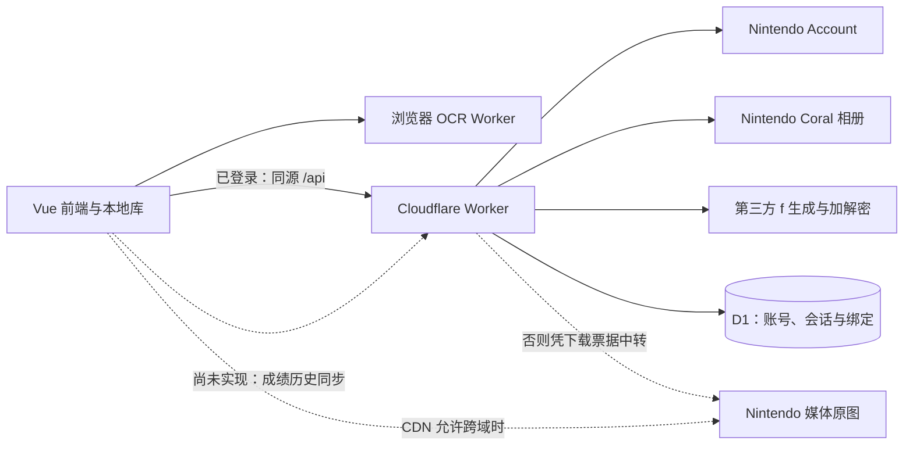

# Groove Archive · FP 成绩管理三期设计文档

> 版本：v3.18
>
> 调研日期：2026-09-29；修订日期：2026-09-30、2026-10-13、2026-10-14、2026-10-17、2026-10-19、2026-10-22、2026-10-23
>
> 状态：3A、3B 已通过用户实际使用验证；站内账号与 Nintendo 绑定已接入。成绩历史同步尚未实现，按第 8 至第 10 节实施
>
> 目标：未登录、未绑定时保持纯前端；Cloudflare 部署上可选读取 Nintendo 相册；3C 用 Workers + D1 同步当前成绩历史。当前最佳、Rating、B30 和每日快照／趋势在本地计算

## 1. 结论与实施建议

实施以正文为准。第 15 节只记录结论变化，不作为实施要求。

v3.13 把尚未实现的成绩同步收成下面这一套：

- 云端保存当前成绩历史、删除墓碑、幂等回执和相册去重键。不保存当前最佳、Rating、B30、每日趋势，不另建变更日志，也不做固定水位分页
- 每条历史上传时带客户端生成且不再更换的 `historyKey`。同一条比较 `updatedAt`，时间更新的覆盖另一份，时间相同保留云端已经接受的那份。没有相同 `historyKey` 的历史合并并存，不按曲目、分数或时间并成同一条
- `playedAt` 表示游玩或拍摄时间。内容变化时写入新的 `updatedAt`，包括只改 Max Chain，以及来源为 `nso_ocr` 的修改。删除使用执行删除时的 `updatedAt`。设备时钟超前的修改会覆盖另一台时间正常的修改，同步不校正时钟
- 每次同步拉取该账号当前代次的全部历史和墓碑。`updatedAt` 只用于覆盖比较，不用作增量游标。某一条时间超前时，按「大于上次时间」拉取会漏掉其他修改。只有完整成功的整份响应才能对齐；失败、超时或半截响应不改本地历史。云端没有、且本地已经同步过的记录，只在这种完整响应里才从本地删除
- 同步发生在登录成功、本地写入之后，以及页面重新可见时。页面隐藏时不拉取、不提交。设置页提供手动同步。空闲时不按间隔轮询
- 相册的云端记录只保留媒体 ID、内容 hash 和对应 `historyKey`。失败原因、重试和识别进度留在本机。两台设备可以各识别一次，重复提交不产生第二条历史
- 云端代次只存在该账号的 `account_state` 上，是一个数字。只有这个账号清空云端时才加一代。不记录代次更新时间，也不按成绩时间筛这一代的历史。本机只记住上次对齐的是哪个账号、对齐到第几代。同一账号先比较代次；代次变了只保留尚未接受的本地新录，再与响应里的全部历史合并，并清掉本机相册处理记录和每日趋势。换号不比较代次
- 换号或首次登录时，本机若有尚未归属账号的成绩：当前账号没有历史、也没有墓碑，且代次仍为 0，直接记入该账号并上传。该账号代次已经大于 0，或云端已有历史，由用户选择保留本地、保留云端或合并。已经对齐过的同一账号发现代次变大时不弹这个选择。保留本地会清空当前账号云端再上传；合并仍走同一提交接口。不单设游客迁移接口，也不再按账号拆开本地库
- 3C 业务请求携带 `X-App-Protocol-Version: 1`。缺失或不兼容时拒绝写入，并提示更新页面。待同步清单不保存协议版本，首版也不预做旧操作格式迁移

当前相册链路为：**已登录且已绑定的用户访问页面 → 前端请求同源 `/api` → Worker 用 D1 中加密保存的 Nintendo 凭据读取相册，按 applicationId 筛选 GCFP 截图 → 前端取得原图（截图 CDN 允许跨域时直连，否则经 Worker 中转）→ 前端 OCR → 写入这一份本地库并更新本地派生数据**。未登录不读取相册。成绩历史同步尚未接入，登录后不会上传操作或拉取历史变化。

| 使用形态                     | 部署                                        | 成绩数据                                       | 网络                                                |
| ---------------------------- | ------------------------------------------- | ---------------------------------------------- | --------------------------------------------------- |
| 纯前端                       | GitHub Pages；Cloudflare 部署上未登录的用户 | 本地库 `groove-archive-fp-history`             | 日常浏览不请求 `/api`；主动进入账号流程时可查询会话 |
| 站内账号，已绑定 Nintendo    | 仅 Cloudflare 部署                          | 同一份本地库，成绩不上传                       | 相册读取使用 D1 中的加密凭据，经 Worker             |
| 站内账号，成绩同步（未实现） | 仅 Cloudflare 部署                          | 同一份本地库。云端无历史且代次为 0 时未归属成绩直接上传，否则可选保留本地、云端或合并；同一账号内按 `updatedAt` 覆盖 | 登录、写入和页面重新可见时同步                      |

前端脚本读不到 Nintendo 凭据，原图不持久化，OCR 继续在用户浏览器运行，页面关闭后不执行相册任务。已登录后的长期凭据加密保存在 D1，见第 6.5 节。

nxapi 作为认证及协议参考，NSO-Album-Sync 作为授权、下载与去重参考。两者都不能直接作为 Worker 运行时的库使用，协议代码按第 6.4 节改写。

三期拆为三个可独立验收的交付：

1. **3A：Worker 中转、Nintendo 绑定与手动读取**，读取、下载、OCR 后直接入库，已通过用户实际使用验证。v3.9 起新绑定改为登录后进行
2. **3B：访问时自动触发**，自动入库、后台进度和断点恢复，不引入服务器定时轮询，已通过用户实际使用验证
3. **3C：站内账号与历史同步**。账号、会话和 Nintendo 绑定迁入已接入。成绩历史同步尚未实现，规则见第 8 至第 10 节

真实绑定、相册读取和录入链路已由用户实际使用验证；第 14.1 节继续作为协议变更和部署环境变化时的验证清单，CDN 直连仍需单独验证。

### 1.1 实施决定与外部前置

已经确定的选择继续沿用，外部条件在接入时核对：

| 事项                                | 当前状态                                                                                           |
| ----------------------------------- | -------------------------------------------------------------------------------------------------- |
| GitHub Pages 版的 Nintendo 相册入口 | 继续隐藏，引导入口另行提出时再做，不阻塞 3C                                                        |
| Nintendo 凭据保存                   | 新绑定加密存在已登录账号的 D1 记录中；浏览器里的旧 Cookie 只用于迁入，沿用 30 天，不与站内会话混用 |
| 截图下载方式                        | 当前使用 Worker 中转；CDN 直连单独验证后再启用                                                     |
| 3C 后端选型                         | 账号与绑定已使用 Workers + D1；成绩同步仍须先通过第 14.5 节的事务与一致快照验收                    |
| 成本约束                            | 当前不启用付费套餐或自动超额计费，按 Workers／D1 及外部服务免费额度设计；自有发信域名仍是接入前置  |
| 验证码发信                          | 已接入 Resend 免费档，并设本站日／月预算；真实送达按部署环境单独验收                               |
| 账号认证                            | 已采用 Better Auth 1.6.23，在现有 Worker 中使用 D1                                                 |

## 2. 已确认的能力与边界

### 2.1 主机与云端相册

任天堂官方说明：Switch 2 可将截图上传到 Nintendo Switch App，也可在主机相册设置中启用自动上传；云端每个 Nintendo Account 最多保存 100 个文件，上传内容保存 30 天，部分软件不支持上传。离线时可排队等待联网上传。[官方上传说明](https://www.nintendo.com/en-gb/Support/Troubleshooting/How-to-Upload-Screenshots-and-Videos-from-Nintendo-Switch-2-to-the-Nintendo-Switch-App-2843767.html)

由此确定产品边界：

| 场景                                | 三期行为                                                       |
| ----------------------------------- | -------------------------------------------------------------- |
| Switch 2、截图已出现在官方 App 相册 | GCFP 读取和识别已通过用户实际使用验证；协议变化时复测          |
| 只保存在主机或存储卡、没有上传      | 未上传的截图不在可读取的云端相册内                             |
| 原版 Switch / Lite / OLED           | 不纳入本方案的云端相册自动读取承诺；继续导出截图后使用现有 OCR |
| 超过云端可见窗口、已过期的文件      | 无法通过这些接口补回，用户需重新上传或手动导入                 |
| 上传到了其他 Nintendo 用户下        | 跳过读取                                                       |
| 视频、非 GCFP 图片                  | 不下载视频、不识别无关游戏截图                                 |

访问时更新只能读取当时仍可见的云端内容。长期未访问或短时间上传大量其他游戏内容可能漏图；此功能不作为相册备份，关页后不更新。

### 2.2 两个项目的具体复用方式

本次按以下提交核查源码，实施时应固定通过验证的版本，不能把浮动 `main` 当作稳定接口：

| 项目                                                                                                     | 核查提交                                   | 能力与定位                                                                                    |
| -------------------------------------------------------------------------------------------------------- | ------------------------------------------ | --------------------------------------------------------------------------------------------- |
| [nxapi](https://github.com/samuelthomas2774/nxapi/tree/47c9d35d9d51d33e62dd6d3733b616e0ad31b02b)         | `47c9d35d9d51d33e62dd6d3733b616e0ad31b02b` | TypeScript/JavaScript 库、CLI、桌面应用；可创建 Coral 会话、刷新认证、读取相册                |
| [NSO-Album-Sync](https://github.com/Dycool/NSO-Album-Sync/tree/4fc49154aa984b85e0c5d3f67a977021a81274b7) | `4fc49154aa984b85e0c5d3f67a977021a81274b7` | C++20 原生桌面托盘应用；授权、定期下载、文件归档与系统凭据存储，README 默认同步周期为 60 分钟 |

nxapi 的 `package.json` 在核查提交声明 `1.6.1`，这不证明 npm 同名版本已经包含该提交的全部改动。PoC 必须核对实际安装包是否具有相册与当前加密协议支持。[包声明](https://github.com/samuelthomas2774/nxapi/blob/47c9d35d9d51d33e62dd6d3733b616e0ad31b02b/package.json)

已核实的 nxapi 能力：

| 能力     | 源码 / 文档中的入口                    | 接入注意                                          |
| -------- | -------------------------------------- | ------------------------------------------------- |
| 初次认证 | `CoralApi.createWithSessionToken(...)` | 返回 `nso` 与认证 `data`                          |
| 恢复会话 | `CoralApi.createWithSavedToken(data)`  | 保存并复用认证数据，不应每次访问重新登录          |
| 续期     | `renewToken(...)` / `onTokenExpired`   | 持久化更新后的凭据，以当前类型及返回值为准        |
| 相册列表 | `nso.getMedia()`                       | 底层调用 `/v4/Media/List`，库返回值中读取 `media` |
| CLI 验证 | `nxapi nso album --json`               | 适合个人 PoC，不作为正式后端每次请求的子进程      |

依据：[Coral 库说明](https://github.com/samuelthomas2774/nxapi/blob/47c9d35d9d51d33e62dd6d3733b616e0ad31b02b/docs/lib/coral.md)、[Coral 实现](https://github.com/samuelthomas2774/nxapi/blob/47c9d35d9d51d33e62dd6d3733b616e0ad31b02b/src/api/coral.ts)、[相册 CLI](https://github.com/samuelthomas2774/nxapi/blob/47c9d35d9d51d33e62dd6d3733b616e0ad31b02b/src/cli/nso/album.ts)

相册媒体模型包含 `id`、`type`、`applicationId`、`appName`、`contentUri`、`contentLength`、`thumbnailUri`、`capturedAt`、`uploadedAt`、`expiresAt`。`type` 区分 `image` 和 `video`；缩略图类型注释为 320×180 JPEG，不能代替 OCR 原图。时间由适配层从上游秒统一转换为本项目毫秒。[媒体类型定义](https://github.com/samuelthomas2774/nxapi/blob/47c9d35d9d51d33e62dd6d3733b616e0ad31b02b/src/api/coral-types.ts#L513)

当前 `getMedia()` 没有暴露分页游标；虽然类型文件保留 `count: 100` 的参数声明，实际调用没有传该字段。NSO-Album-Sync 当前也发送空 `parameter`。设计为扫描当前可见集合，不虚构分页、历史回溯或服务端增量能力。[相册调用实现](https://github.com/Dycool/NSO-Album-Sync/blob/4fc49154aa984b85e0c5d3f67a977021a81274b7/src/coral.cpp#L661)

NSO-Album-Sync 值得参考的是：缓存凭据、校验下载地址与长度、临时文件完成后再改名、保留拍摄时间。其单用户状态、系统钥匙串和桌面回调不能直接套用到托管服务。[同步实现](https://github.com/Dycool/NSO-Album-Sync/blob/4fc49154aa984b85e0c5d3f67a977021a81274b7/src/sync.cpp)

### 2.3 外部认证依赖不是一个普通 Bearer API

当前源码包含第三方 `f` 生成，以及 Coral 请求加密和响应解密。NSO-Album-Sync 的 README 明确披露，相关服务会处理 Nintendo 身份信息、Coral token 和 API 请求/响应。不能只告诉用户“第三方收到一个临时签名参数”，也不能声称凭据始终只在用户设备或本项目服务器内。[数据披露](https://github.com/Dycool/NSO-Album-Sync/blob/4fc49154aa984b85e0c5d3f67a977021a81274b7/README.md#-nintendo-account--nxapi)、[nxapi 加密请求实现](https://github.com/samuelthomas2774/nxapi/blob/47c9d35d9d51d33e62dd6d3733b616e0ad31b02b/src/api/coral.ts#L828)

nxapi 文档要求库调用者注册自己的 nxapi-auth client，常见作用域为 `ca:gf ca:er ca:dr`；该凭据属于本项目接入第三方认证服务的身份，与 Nintendo 客户端 ID、站内用户会话不同。不可复制其他应用的 client 身份或依赖其私人代理。上游支持只用 client id 的公开客户端，以及使用 secret 或 client assertion 的机密客户端。本项目默认支持仅 Client ID 的方式，不把 Secret 作为必备项；若服务方实际提供 Secret，则通过 Worker secret 配置。作用域由程序在申请 token 时发送，注册页无需提供输入框；实际是否授权及额度仍需联调确认。[nxapi 认证说明](https://github.com/samuelthomas2774/nxapi#nxapi-auth-authentication)

nxapi 要求调用 imink、flapg 等非 Nintendo 接口时，在 User-Agent 中写明本项目名称和版本；未开源或不易查找的项目还需附联系方式。浏览器 fetch 不能可靠设置 User-Agent，Worker 可以设置，本项目附仓库地址。[User-Agent 要求](https://github.com/samuelthomas2774/nxapi/tree/47c9d35d9d51d33e62dd6d3733b616e0ad31b02b#user-agent-strings)

NSO-Album-Sync 的当前 Coral 源码还存在作者部署的 Worker `f` 生成路径。它不是项目可直接依赖的公共服务承诺，采用 nxapi 适配层时不照搬这条私有部署依赖。[Coral 源码](https://github.com/Dycool/NSO-Album-Sync/blob/4fc49154aa984b85e0c5d3f67a977021a81274b7/src/coral.cpp)

nxapi 文档认为账号因此被封禁的可能性极低，同时记录 2023-09 有少量用户被禁止访问 SplatNet 3，涉及的是与 nxapi 无关的应用。绑定说明如实告知风险，不承诺无风险。[封禁说明](https://github.com/samuelthomas2774/nxapi/tree/47c9d35d9d51d33e62dd6d3733b616e0ad31b02b#will-my-nintendo-accountnetwork-service-account-be-banned-for-using-this)

这些是非官方接口，更新可能导致授权或拉取失效。Nintendo 故障只影响绑定和相册任务，纯前端功能和手动导入应继续可用，3C 的站内登录与成绩同步同样不受影响。

### 2.4 许可证与调研可信度

nxapi 声明 `AGPL-3.0-or-later`，NSO-Album-Sync 为 MIT。正式采用前确定本项目源码发布方式、依赖分发和通知要求；不能因为把 nxapi 放进独立进程，就假定解决所有许可问题。[nxapi 许可证](https://github.com/samuelthomas2774/nxapi/blob/47c9d35d9d51d33e62dd6d3733b616e0ad31b02b/LICENSE)、[NSO-Album-Sync 许可证](https://github.com/Dycool/NSO-Album-Sync/blob/4fc49154aa984b85e0c5d3f67a977021a81274b7/LICENSE)

本项目为 GPL-3.0。GPL-3.0 第 13 节允许与 AGPL-3.0 代码组合，但移植进 Worker 的 nxapi 协议代码仍适用 AGPL 关于网络交互提供源码的要求；仓库已公开，部署时在页面提供源码链接与许可声明。这里记录依赖条件，不作具体法律适用结论。

按项目要求先使用 Context7 CLI 查询了两个项目，但返回的是无关库，没有可用索引，因此本节以固定提交的源码和任天堂官方资料为依据。2026-10-13 复核了固定提交的 nxapi README（nxapi-auth 客户端类型、User-Agent、封禁说明），并经 Context7 查询 Cloudflare Workers 静态资源路由与 Rate Limiting 绑定文档。当时只完成代码核查及无真实凭据的跨域预检；后来用户确认的真实链路结果见第 14.4 节，不能把早期未验证状态当作当前阻塞项。

### 2.5 浏览器直连限制与当前验证结果

所核查的 nxapi Coral、Nintendo Account 和加解密源码依赖 `node:crypto`、`node:process`、`undici` 及 Buffer。这些入口是 Node 环境实现，不能直接认为 npm 安装后即可在网页或 Worker 中调用。[Coral 源码](https://github.com/samuelthomas2774/nxapi/blob/47c9d35d9d51d33e62dd6d3733b616e0ad31b02b/src/api/coral.ts)、[加解密源码](https://github.com/samuelthomas2774/nxapi/blob/47c9d35d9d51d33e62dd6d3733b616e0ad31b02b/src/api/f.ts)

2026-09-30 对公开端点做无凭据 OPTIONS 探测，Origin 为 `http://127.0.0.1:5173`，拟请求方法 POST、请求头 authorization/content-type：

| 端点                                        | HTTP 状态 | 本次返回的 CORS 许可头                           |
| ------------------------------------------- | --------- | ------------------------------------------------ |
| Nintendo `/v4/Media/List`                   | 200       | 未见 Access-Control-Allow-Origin/Methods/Headers |
| Nintendo Account `/connect/1.0.0/api/token` | 405       | 未见上述许可头                                   |
| nxapi-znca-api `/api/znca/encrypt-request`  | 401       | 未见上述许可头                                   |

同日补充真实 Edge 154.0.4258.37 验证：使用实际本地 HTTP 页面 `http://127.0.0.1:10718`，不拦截或模拟网络响应，不关闭浏览器跨域安全检查。页面 fetch 相册接口，方法 POST，请求头为 Authorization 和 `Content-Type: application/octet-stream`，使用无效测试凭据；浏览器发出的 OPTIONS 返回 200、无跨域许可头，控制台明确报告预检失败，CDP 错误为 `PreflightMissingAllowOriginHeader`，JavaScript 得到 `TypeError: Failed to fetch`。预检不携带实际 Authorization token，阻断发生在账号鉴权之前。[MDN CORS 说明](https://developer.mozilla.org/en-US/docs/Web/HTTP/Guides/CORS)

2026-10-13 以正式站点 Origin `https://himemiyatori.github.io` 复测命令行预检，拟请求方法 POST、请求头 authorization/content-type：

| 端点                                                | HTTP 状态 | CORS 许可头 |
| --------------------------------------------------- | --------- | ----------- |
| Nintendo `/v4/Media/List`                           | 200       | 无          |
| Nintendo Account `/connect/1.0.0/api/session_token` | 405       | 无          |
| Nintendo Account `/connect/1.0.0/api/token`         | 405       | 无          |
| nxapi-znca-api `/api/znca/f`                        | 401       | 无          |

绑定时交换 session token 的接口同样没有跨域许可，普通网页不只是读不到相册列表，连绑定也无法完成。Node polyfill 不会使上游响应增加 CORS 头，`no-cors` 返回的 opaque 响应也不能读取 JSON 或 Blob。结合 9 月 30 日的真实浏览器验证，普通网页直连不再作为实现路径，改由同源 Worker 中转（第 6 节）。

截图 CDN 的跨域情况仍需真实媒体 URL 验证。若 CDN 允许跨域，前端直接下载原图；否则由 Worker 中转。仅能在 img 标签显示不等于能读取像素用于 Canvas/OCR。

## 3. 与现有项目衔接

以 [二期设计](FP_B30_二期设计文档.md) 和当前代码为基线；本文件只扩展三期范围，不将二期待实现功能视为已完成。

| 现有模块                                                | 当前行为                                                                  | 三期调整                                                             |
| ------------------------------------------------------- | ------------------------------------------------------------------------- | -------------------------------------------------------------------- |
| `vite.config.ts`、构建脚本                              | 普通 build 为纯前端，build:server 开启服务端能力；dev 默认启动本地 Worker | 延续两种构建，GitHub Pages 仍无账号与相册模块                        |
| `wrangler.jsonc`                                        | 已有 Worker、静态资源同源部署，以及账号用 D1 与邮件配置                   | 成绩历史表仍不增加第二套 Node 服务                                   |
| `src/db/database.ts`                                    | 本机只有 `groove-archive-fp-history`，schema 6；旧的账号分库会并入后删除  | 成绩同步时在这一份库上增加稳定历史键和同步表                         |
| `src/db/scoreRepository.ts`                             | 已有仓储工厂、历史投影、清空代次与相册提交                                | 注入当前账号数据上下文，各历史写入与 outbox 同事务，不同步本地最佳表 |
| `src/core/score/import.ts`                              | Excel 筛选及历史去重、最佳合并；含 `nso_ocr` 来源                         | 共享字段校验与历史去重规则，最佳投影继续由前端执行                   |
| `src/core/ocr/parser.ts`                                | 字段解析、曲名匹配、页面校验，成功直接录入                                | 沿用既有结果，不恢复待确认流程                                       |
| `src/core/ocr/recognizer.ts`                            | 浏览器 Worker、Canvas、WASM；先整张解码再检查尺寸                         | 继续在浏览器运行；相册图片在读取数据流时先按字节上限截断             |
| `src/core/ocr/importer.ts`、`src/stores/recognition.ts` | 首页上传与相册识别的应用级任务、后台进度和结果                            | 识别生命周期独立于页面与弹窗，成绩继续写入本地仓储                   |
| `src/core/rating/`、`src/core/song/`                    | 本地规则和稳定曲库 ID                                                     | 服务端只共享字段约束及曲库版本，Rating 与 B30 继续本地计算           |

继续遵守：Score 为 0～1,050,000 整数；FC/AP 未知或缺失统一为 false，不引入三态；Max Chain 可未知；AP 成立时 FC 成立；本地每谱面一条当前最佳、可有多条历史；BASIC / ADVANCED 独立 B30。同分最佳合并仅补未知的 Max Chain，不自动改写 FC/AP。

现有相册历史已按拍摄时间保存 `playedAt`。每日快照按本机当天更新，不按旧图拍摄时间回算过去日期。同一条历史哪一份保留，只比较 `updatedAt`。`playedAt` 不参与这比较。只改 Max Chain，以及来源为 `nso_ocr` 的修改，也要写入新的 `updatedAt`。当前本地编辑还会留住这两类修改原来的时间，接入同步时改掉。

3C 接口不接收或存储 `rating`、当前最佳、B30、快照／趋势和本地数字 ID；客户端从历史重算这些派生值。后端验证历史字段合法性、归属、版本与去重规则，不证明前端识别结果来自真实 Nintendo 截图；三期是个人成绩管理，来源标签不承担排行榜认证。

## 4. 范围与架构

### 4.1 部署与职责



| 环节                                                             | 执行位置                                               |
| ---------------------------------------------------------------- | ------------------------------------------------------ |
| 历史缓存、当前最佳、Rating、B30、每日快照／趋势、Excel、手动 OCR | 前端本地，三种使用形态相同                             |
| Nintendo 绑定、session token 交换、Coral 登录与续期              | Worker                                                 |
| 第三方 f 生成与请求加解密                                        | Worker，使用本项目 nxapi-auth client                   |
| 相册列表读取与 GCFP 筛选                                         | Worker，只返回必要字段                                 |
| 原图下载                                                         | 前端直连 CDN；CDN 不允许跨域时经 Worker 凭下载票据中转 |
| 尺寸检查、hash、OCR、预览、入库                                  | 前端                                                   |
| 访问触发、进度、重试、多标签页协调                               | 前端；已登录绑定的 10 秒冷却同时记在 D1                |
| 站内账号、会话、Nintendo 绑定与账号冷却                          | Workers + D1                                           |
| 成绩历史、墓碑、回执与相册去重键（尚未实现）                     | 计划使用 Workers + D1                                  |

静态前端与 Worker 部署在同一个 Cloudflare Worker，`/api` 与页面同源。当前 D1 保存账号、会话和 Nintendo 绑定，不保存成绩历史，也不保存图片。GitHub Pages 部署不含 Worker，只提供纯前端功能。

不新增相册调度进程、服务器任务队列、图片存储、无头 Chromium 和服务端 OCR。Worker 只在用户页面发出请求时执行，不定时读取 Nintendo 相册。

### 4.2 范围与页面生命周期

三期包含纯前端模式维持、绑定与解绑、手动读取、访问时更新、导入记录及错误恢复。3C 的账号登录和 Nintendo 绑定迁入已经接入。尚未实现的是多设备历史同步，以及离线编辑后的对齐。

自动更新以用户访问为条件，默认不设置整天运行的相册轮询，也不使用 Service Worker 承诺关页后持续识别。应用内部切换成绩页、B30 或设置页可继续当前批次；切出网站后台时不启动新扫描，并允许正在执行的工作被暂停或中断。下一次可见访问恢复未完成任务。

好友、排行榜、游戏全量游玩记录回溯、相册备份、视频识别和服务端代操作主机不纳入。本站已经录入的全部有效历史属于 3C 同步范围；主题、语言和每日趋势继续设备本地保存。

## 5. 部署形态与纯前端模式

### 5.1 构建开关

- 服务端能力由构建时环境变量开启（例如 `VITE_SERVER=1`），默认关闭。Cloudflare 构建设置该变量，GitHub Actions 不设置
- 默认关闭的原因：漏设只会看不到 Nintendo 功能；若默认开启，GitHub Pages 版会请求 `himemiyatori.github.io/api/...`，该路径位于账号根路径之下，可能命中其他仓库
- Nintendo 相关前端模块全部动态导入，开关关闭时由构建剔除，不进入 GitHub Pages 产物
- `yarn dev:local` 默认启动纯前端 Vite；`yarn dev` 构建服务端版本后启动本地 Worker，`yarn dev:server` 只启动已有构建的 Worker；浏览器验收按目标显式选择路径

### 5.2 同源部署

`wrangler.jsonc` 增加 `main` 与 `assets.binding`，`assets.run_worker_first` 设为 `["/api/*"]`，其余请求仍直接返回静态资源。[Cloudflare 静态资源路由](https://developers.cloudflare.com/workers/static-assets/binding/)

前端放在 GitHub Pages、Worker 放在 workers.dev 的跨站组合不可用：HttpOnly Cookie 会成为第三方 Cookie，Safari、Firefox 默认拦截。Nintendo 相册功能只在 Cloudflare 部署提供。

### 5.3 未绑定时日常浏览不请求 API

已登录且本地存有不含凭据的账号资料时，启动时恢复会话。未登录不读取相册。相册的已绑定标记按当前账号写在 localStorage，不含凭据；有标记才在会话恢复后请求绑定状态，接口返回未绑定时清除标记。未登录用户的日常浏览不请求相册接口。

### 5.4 两个部署的数据不互通

GitHub Pages 与 Cloudflare 部署是不同 Origin，IndexedDB 各自独立。用户从 GitHub Pages 转到 Cloudflare 部署只能经 Excel 迁移，而 Excel 只交换当前最佳成绩，历史与 Rating 趋势不会迁入（二期第 9 节），原站点数据仍保留。目前不做完整备份导出、导入或迁移，迁移说明明确此限制。GitHub Pages 版的入口形式见第 1.1 节待定事项。

### 5.5 降级

Worker 故障、离线或上游变化时，本机成绩、B30、Excel 与手动 OCR 仍可使用。登录和退出都继续使用这一份本地库。会话失效后保留这份库，不启动相册读取。成绩同步尚未实现，恢复联网后不会自动上传这段编辑。实现后在登录、本地写入和页面重新可见时同步，页面隐藏时不拉取。相册错误单独展示，不遮挡已有成绩。

## 6. Worker 无状态中转与凭据

### 6.1 绑定流程

两个参考项目使用原生应用认证流程：Nintendo 客户端为 `71b963c1b7b6d119`，回调为 `npf71b963c1b7b6d119://auth`，结果是 session_token_code，配合 state 与 S256 challenge。不能直接替换为本站 HTTPS callback。[授权实现](https://github.com/Dycool/NSO-Album-Sync/blob/4fc49154aa984b85e0c5d3f67a977021a81274b7/src/nintendo_auth.cpp)

1. 用户阅读并同意第三方处理说明（第 6.4 节）与封禁风险说明
2. Worker 生成 state 与 PKCE verifier，加密写入 10 分钟有效的流程 Cookie，返回授权链接
3. 用户在 Nintendo 官网登录，按实测可用的方式复制原生回调链接并粘贴提交
4. Worker 校验 scheme、host、state 与期限，交换 session token，读取 Nintendo 账号 ID 与昵称
5. Worker 将长期凭据加密写入当前账号的 D1 绑定，清除流程 Cookie，以及浏览器中的旧 Nintendo 会话和 Coral Cookie；前端写入已绑定标记
6. 前端发起第一次相册读取；空相册是合法结果

真实账号回调复制已随 3A、3B 通过用户实际使用验证；特定手机是否被官方 App 接管仍需按设备实测，不要求上传其他软件的凭据文件。

流程完成后清除 Cookie 不等于服务端具备一次性消费记录。无状态方案依赖上游拒绝重复兑换 session_token_code，协议回归仍须验证重放及并发兑换；当前主链路通过实际使用确认，不等于所有重放边界已单独实测。

### 6.2 加密 Cookie

已登录绑定的长期凭据和 Coral 缓存加密存在 D1，不放在浏览器会话 Cookie 里。下表的会话与 Coral 缓存只适用于尚未迁入的旧 Cookie。授权过程仍使用 10 分钟流程 Cookie。

| Cookie     | 内容                                                                         | 有效期                                   |
| ---------- | ---------------------------------------------------------------------------- | ---------------------------------------- |
| 会话       | session token、Nintendo 账号 ID、bindingId、昵称、keyVersion、签发与过期时间 | 旧的未登录绑定沿用 30 天，只作为迁入来源 |
| Coral 缓存 | Nintendo 账号 ID、bindingId、Coral 短期 token 与到期时间                     | 按上游 expiresIn                         |
| 绑定流程   | state、PKCE verifier、过期时间                                               | 10 分钟，完成后清除；重放边界见第 6.1 节 |

- 全部使用 `__Host-` 前缀与 `HttpOnly; Secure; SameSite=Strict; Path=/`，不设 Domain
- 内容使用 AES-GCM 加密，主密钥来自 Worker secret，按 keyVersion 轮换；Cookie 名称作为附加认证数据，不同 Cookie 的密文不能互换
- 单个 Cookie 按 4 KB 上限设计，会话与 Coral 缓存分开保存；PoC 记录实际体积
- Coral 缓存避免每次检查都重新执行账号 token、f 生成和 Coral 登录，减少耗时与第三方额度消耗
- 使用 Coral 缓存前必须核对 Nintendo 账号 ID 与 bindingId 均匹配当前会话；不匹配则丢弃缓存，不能跨账号或跨次绑定复用

旧 Cookie 无法由服务端吊销。解绑当时只清除当前浏览器的 Cookie；Cookie 被复制时，在过期或密钥轮换前仍可能读相册。已迁入 D1 的绑定可以在服务端清除，解绑后各设备的后续相册请求失败。轮换主密钥会使全部绑定失效，用户需重新绑定。

前端不持有任何 Nintendo 凭据，比 v3.1 中“前端持有 Coral 短期 token”的暴露面更小。XSS 无法取走凭据，但页面打开期间可借用户 Cookie 调用中转接口，因此接口范围按第 6.3 节最小化。

### 6.3 接口最小化

- 只提供相册读取和原图中转两类上游操作；不透传 Coral 接口，不读取好友、在线状态或其他游戏服务
- 相册列表由 Worker 按 applicationId 白名单筛选 GCFP 图片，只返回 mediaId、拍摄时间、尺寸或长度、到期时间与下载方式所需字段；`appName` 仅显示，不用模糊名称自动入库
- CDN 允许跨域时，列表直接返回 contentUri 供前端下载，签名 URL 只在当前页面内存中使用
- CDN 不允许跨域时，原图中转不接受客户端提交的 URL。列表为每张图附带 Worker 加密的短期下载票据，内含 Worker 自己取得的 contentUri、mediaId 和过期时间；前端原样回传，Worker 解密校验后下载
- 中转下载只访问验证过的媒体 HTTPS 主机，不自动跟随重定向，跳转目标同样校验；读取数据流时按 20 MiB 截断，不只相信 contentLength，只流式转发不缓存
- 写请求与中转请求校验 `Origin`，配合 SameSite=Strict 防止跨站请求；响应一律 `Cache-Control: no-store`

### 6.4 上游与第三方

- **协议移植**：nxapi 的 Coral、Nintendo Account 与加解密实现依赖 `undici`、`node:crypto` 等 Node 接口，在 Worker 中改写为基于 fetch 与 WebCrypto 的实现，不直接导入 nxapi 全库；固定参考提交，协议变化时对照更新
- **协议参数**：Nintendo Switch App 更新后，旧版本号请求可能被拒绝。版本号等协议参数放在 Worker 环境变量或远程配置中，不发版也能更新
- **nxapi-auth**：使用本项目注册的 Client ID，支持公开客户端；可选 client secret 存于 Worker secret。Worker 申请 token 时发送作用域 `ca:gf ca:er ca:dr`；User-Agent 带本项目名称、版本和仓库地址
- **共用出口与额度**：所有用户的请求从 Cloudflare 出口 IP 发出，并共用本项目 nxapi-auth client 的额度。Nintendo 是否限制数据中心 IP、第三方额度多少，须 PoC 实测并向服务方确认
- **限流**：客户端冷却见第 7.1 节。Worker 用 Rate Limiting 绑定按 Nintendo 账号 ID 与 IP 做整体限制；该绑定按单个 Cloudflare 节点计数，周期只能为 10 或 60 秒，只用于防滥用，不作精确额度。[Rate Limiting 绑定](https://developers.cloudflare.com/workers/runtime-apis/bindings/rate-limit/)
- **日志**：Worker 日志与错误信息不得包含 Cookie、token、授权码、生日和签名 URL；上游错误响应先脱敏再记录，不整包输出
- **告知与同意**：绑定前说明 Cloudflare 在传输中经手 Nintendo 凭据与相册列表，截图中转时也经手图片；nxapi-znca-api 会收到 Nintendo id_token（有效 15 分钟）、Coral token 及加密前后的请求和响应内容。未登录中转不保存这些内容。已登录后，Nintendo 长期 session token 与 Coral 缓存加密保存在该账号的绑定记录中，见第 6.5 节

### 6.5 续期、状态与解绑

- 仅在页面请求时续期 Coral token，闲置账号不后台刷新；确认过期后最多续期一次再重试
- session token 失效时返回 `reauth_required`。已登录绑定保留在账号上，前端停止读取并提示重新授权，不因此解除其他设备的绑定
- 新绑定只在站内登录后进行，接口返回 `unbound / active`。浏览器里的旧 Cookie 不再作为新的未登录入口，只按下面的迁移处理。重新授权与其他错误另行展示；绑定后按访问规则自动更新，当前没有暂停开关
- 解绑清除该账号保存在 D1 的凭据和 Coral 缓存，并清除本机 Cookie 与本地标记，取消当前批次并释放图片。其他设备之后的相册请求失败。已导入成绩保留，本机相册处理记录保留，避免重新绑定同一账号后重复导入
- 绑定、解绑与可能续期的相册请求共用跨标签页凭据操作锁；解绑或换绑先阻止新请求并等待已发出的凭据请求结束，再执行清 Cookie 或新绑定。不能只依赖 AbortSignal，因为忽略旧响应的业务结果不能撤销浏览器处理的 Set-Cookie。相册请求更新当前绑定的 Coral 缓存，头像补全时可按原期限重写同一会话；旧 bindingId 的缓存不能恢复绑定或用于新账号
- 3C 登录后，用户同意账号绑定的服务端加密存储说明，再由 Worker 读取游客 Nintendo 会话 Cookie，事务写入账号绑定并记录迁移结果；成功后清除游客会话与 Coral Cookie。响应丢失时以同一迁移标识重试，不先清 Cookie 再存库
- 迁移发现账号已有不同绑定，或该 Nintendo Account 已属于另一站内账号时返回冲突，不自动覆盖或转移归属。退出站内账号不会把云端绑定重新复制成游客 Cookie；重新登录后恢复账号绑定

## 7. 访问触发、取图与 OCR

### 7.1 触发规则和用户体验

已绑定时，页面先显示本地成绩，再异步检查相册，不阻塞首页和 B30。

- 打开网页时，距离最近成功检查至少 3 分钟才自动检查一次；页面在后台打开时等到首次可见再检查
- 标签页重新可见不重新检查
- 页面内导航不重新检查；页面一直停留不周期轮询
- 提供“更新成绩”，自动与手动更新共用 10 秒冷却，从发起请求起计算；上游限流和既有退避优先
- 无新图片时不初始化 OCR；有图时显示发现数量、逐张进度与实际成绩更新数

3 分钟和 10 秒是本项目配置，不是上游允许额度。本机冷却存于 IndexedDB，由各标签页共享，并用 `navigator.locks` 保证同一时间只有一个标签页扫描。已登录绑定时，服务端另按该绑定记录 10 秒冷却，各设备共用。相册去重键尚未写入云端，另一台设备恢复绑定后仍可能再次识别同一张截图。成绩同步接入后，成功录入的媒体 ID 和内容 hash 随历史提交写入，其他设备可以据此跳过。

用户长期未访问时不读取。当前云端容量和 30 天窗口内的图片仍可补读，已不可见图片需重新上传或手动导入；设置页说明该取舍。

### 7.2 相册读取和取图

1. 前端取得标签页锁，检查本地冷却
2. 前端请求 Worker 读取相册；Worker 续期凭据、调用 Coral、按 applicationId 筛选后返回 GCFP 图片
3. 前端与本地相册处理记录对照，跳过已处理 mediaId；新图片按拍摄时间从早到晚排队
4. 前端下载原图：CDN 允许跨域时直连 contentUri，否则凭下载票据请求 Worker 中转
5. 前端检查类型、长度、像素和内容 hash，执行 OCR
6. 前端在同一 Dexie 事务写入成绩与处理记录终态

GCFP applicationId 已配置，并随 3A、3B 通过用户实际使用验证；协议或部署变化时复核允许集合。每次读取当前完整可见列表，不按“拍摄时间大于上次”跳过，因为旧截图可以晚上传；不虚构上游分页或历史回溯。

初始边界为 20 MiB、约 1600 万像素及既有完整 16:9 要求。读流时强制大小上限，不能只相信 contentLength；现有 `recognize()` 先整张解码再检查尺寸，相册图片须在解码前完成字节上限检查。下载结果必须是可读 Blob，下载并发保持很小，有界缓冲，不把所有原图同时留在内存。

签名 URL 与下载票据仅用于当前页面任务，不进持久化、日志或埋点。失效时前端重新读列表；媒体已不存在时标记 expired，不把失败当作成功处理。

### 7.3 复用现有前端 OCR

继续使用 `src/core/ocr/recognizer.ts` 的 Worker、Canvas、WASM、日文模型与 ROI，不新增服务端识别器。模型仅有新图片时按需加载，同一页面会话内复用；首张图冷启动和手机性能通过实测优化。

现有应用级相册控制器和首页导入器通过 Pinia 展示独立批次，内部页面切换或关闭弹窗后继续处理。两种来源共用串行识别引擎，只有明确取消才停止当前批次。

浏览器 Worker 让页面在识别时继续操作，不保证后台常驻。后台打开网页时等到首次可见再扫描，不因重新可见重复发起扫描；已有任务可能被浏览器暂停或中断。解绑和显式取消触发 AbortSignal，超时销毁模型实例，下次需要时重建。

刷新/关闭后只保留处理记录、已识别候选和待写入结果。未识别原图需要重新拉取，不保存图片备份；已识别未写入的结果优先重试写入，不重复 OCR。

### 7.4 本地去重与入库

未登录阶段相册结果写入 `groove-archive-fp-history`，与手动 OCR 走同一 `scoreRepository`：

- **持久化已处理 mediaId**：每次检查读取当前全部可见截图，而现有入库只与同谱面最近一条历史比较。不记录 mediaId 时，结果与最近历史不同的旧截图每次访问都会再插入一条历史。处理记录以 Nintendo 账号 ID + mediaId 为键，另存内容 hash，用于同图重传去重
- **直接录入**：沿用 v3.4，成功识别即保存历史，不提供待确认、拒绝或谱面保护；旧表、旧状态仅为 schema 兼容保留
- **清空成绩**：未登录清空本机，以及已登录清空云端的执行设备，本机删除同一范围：历史、当前最佳、每日趋势、相册处理记录和最近识别结果，并递增 `datasetEpoch`。`albumState` 里的绑定与冷却保留。旧代次任务不能写回。处理记录删除后，当前仍可见的截图可以重新录入。其他设备读到新云端代次后，丢掉已同步的旧成绩，保留尚未被云端接受的新录，并清掉本机相册处理记录和每日趋势，递增本机 `datasetEpoch`。`albumState` 里的绑定与冷却仍保留。当前不提供关闭后重新开启自动导入或重审历史截图的流程
- **低分与同分**：非重复低分截图保留本地历史，但不降低最佳成绩；同分只补最佳成绩中未知的 Max Chain，不把 false 当成可补的未知 FC/AP。进度分别统计“新增历史”和“更新最佳成绩”，不能把低分已记录误报为未入库
- **时间**：相册截图以有效的 `capturedAt` 保存 `playedAt` 和业务 `updatedAt`，`importedAt` 保存实际录入时刻；拍摄时间缺失或异常时按录入时间记录。既有历史及手动导入继续原有时间口径，不猜测文件拍摄时间。Rating 变化记录在本机录入或应用同步的当天，不回算过去快照
- **来源**：`source` 增加 `nso_ocr`，类型定义、Excel 导出与历史展示同步支持

清除站点数据后，本地成绩、处理记录和趋势一起丢失；游客重新绑定后可能从当前可见截图重新导入。3C 账号可恢复云端历史和相册去重键，因此换设备后可以跳过已经录入的截图。不能恢复未上传历史、截图或旧的本机趋势。失败和重试状态只留在本机。

历史重放按 `playedAt` 排序，同一时刻当前以本地历史 ID 稳定排序。同步后改为 `(playedAt, importedAt, historyKey)`，见第 10.2 节。旧图晚上传只重放相关谱面并按规则更新今天的快照，过去日期保持冻结。对相册历史的人工纠错保留拍摄时间，另记 `correctedAt`。

3A 起在 IndexedDB 持久化本地 `datasetEpoch` 与 `bindingGeneration`。创建任务或待提交结果时记录两者及 Nintendo 账号 ID；清空成绩递增 datasetEpoch，解绑、换绑递增 bindingGeneration。最终写历史与处理终态的同一事务中核对代次和当前账号，不匹配则取消旧任务，不能只靠组件内 AbortSignal。跨标签页共用这些记录，3C 再扩展服务端校验，不新增谱面保护。

### 7.5 识别判定与状态

相册复用首页 OCR 的页面、曲名、谱面及字段校验，成功即直接录入；无法得到合法成绩时显示识别失败并允许重试，不新增待确认或置信度审核。MISSION CLEAR / MISSON CLEAR、游玩中和未游玩占位继续跳过，FC/AP 未知统一按 false。

当前主流程为 `discovered → downloading → recognizing → pending_commit → imported / skipped`，另有 retry_wait、failed、expired、canceled。旧 `needs_review / rejected` 只兼容既有记录，不作为新交互。仅媒体已发现、已下载或 OCR 已结束不能标记 imported，必须在历史事务提交成功后标记；写入低分历史也算 imported。

首版恢复仅采用以下规则，不做复杂的自动重处理策略：

| 状态 / 场景         | 恢复规则                                                                                                                                   |
| ------------------- | ------------------------------------------------------------------------------------------------------------------------------------------ |
| retry_wait          | 网络、5xx 或 OCR 超时自动重试最多 2 次，分别至少等待 1、5 分钟；仅在页面可见且再次触发时执行，429 以 Retry-After 为下限，达到上限转 failed |
| failed              | 显示阶段和原因，用户点“重试”后重置次数；有效的已识别候选优先重试提交，否则重新取图识别                                                     |
| expired             | 未识别媒体已不可见时停止下载；已有合法待提交结果继续尝试入库，不因图片消失丢弃结果                                                         |
| canceled / 页面中断 | 显式取消停止当前批次；后续更新或手动重试恢复未完成项时先检查代次，过期代次不得复用                                                         |
| imported / skipped  | 后续扫描不重复处理；识别版本更新不自动翻查终态                                                                                             |

3C 起相册结果与其他来源共用第 10.1 节的 outbox 和 `POST /api/sync/mutations`。`append_history` 携带 mutationId、historyKey、云端代次、`updatedAt`，以及媒体 ID、内容 hash 和绑定 generation。服务端在同一个 `batch()` 里写入当前历史、幂等回执和去重键。不上传识别版本、失败原因或重试次数。服务端仍校验字段、归属、代次和去重，不因前端已经录入就跳过。当前最佳仍由各设备从历史计算。

登录且联网时，新识别批次开始前先完成一次历史对齐，再按当前媒体 ID 查询云端去重键，跳过已经录入的截图。不为每张图片重复拉取整份历史。查询失败时照常识别，提交时由唯一约束收口。离线或同步暂不可用时，手动 OCR 仍可保存本机并排队。两台设备可以各做一次 OCR。重复提交返回已有 `historyKey`，不建立跨设备任务领取、心跳、续租或接管。

### 7.6 结果与图片生命周期

前端识别完或取消后尽快释放原图 Blob、ImageBitmap 和对象 URL。Worker 中转只流式转发，不缓存或存储截图。相册待提交结果保存字段及原因，不保存原图、签名 URL 或下载票据。

首页与相册分别在本机保留最近一次识别结果及缩略图，供刷新后查看；这类本机展示数据不纳入 3C 云端同步。未识别相册项在下一次更新时重新取图，首页未完成图片需重新上传。

清空或换账号后，旧批次不得写回历史、相册终态或最近识别结果；同步删除按第 10 节针对具体历史记录执行。

## 8. 站内账号与设备隔离（3C）

本节在 3C 用 Workers + D1 实施。本机成绩库就是 `groove-archive-fp-history`，登录前后共用。成绩历史、相册处理记录及本机趋势都写在这一份库里；未登录时完成的 Nintendo 绑定按第 6.5 节迁入账号。

### 8.1 登录方案

当前使用 **Better Auth 1.6.23 + Cloudflare Workers／D1 + Resend 免费档**。默认邮箱和密码登录，也可切换邮箱验证码登录。注册先验证邮箱，再填写可选昵称及密码，提交后创建账号并登录。用户、会话和认证方法按该版本生成迁移，业务统一关联认证层的稳定 userId，不以邮箱或 Nintendo ID 为主键。历史同步仍由本站按第 10 节实现。同一条历史按 `updatedAt` 覆盖，不提供逐条选择。尚未归属账号的成绩在换号或首次登录时按第 8.2 节选择。Nintendo 绑定与业务授权已由本站实现。[数据库与迁移](https://better-auth.com/docs/concepts/database)、[Email OTP](https://better-auth.com/docs/plugins/email-otp)

Better Auth 在自己的 Worker 中运行，账号及会话保存在自己的 D1。Resend 免费档为每月 3,000 封、每日 100 封，需验证自有发件域名，重发同样消耗额度。[Resend 价格](https://resend.com/pricing)、[Workers 接入](https://resend.com/docs/send-with-cloudflare-workers)

除邮箱与 IP 限流外，服务端在发送前原子预占全站日／月发信预算，包含注册、登录、重发与受控测试邮件；预算按供方实际周期及免费额度配置，并预留共用账号和运维消耗。并发请求不能分别读到余量后同时超发；发送超时、结果不明时保守保留占用。预算不足或供方限额时返回稳定错误码，页面提示暂时无法发送及可确定的恢复时间，不把验证码排队到次日发送，不自动升级付费；已经有效的验证码仍可验证，已有会话及本地功能继续使用。

验证码参数为 6 位数字、10 分钟有效、单次消费、连续验证失败最多 5 次；重发至少间隔 60 秒，按邮箱与 IP 配置额度。验证码以摘要存储，限流使用适合多实例的数据库存储。Cookie 保持独立的 `HttpOnly + Secure + SameSite`，写请求校验 Origin 与 CSRF；公开响应不泄露账号是否存在。

站内会话、Nintendo 长期会话、Coral 短期凭据、nxapi-auth 应用凭据分开保存和命名。所有 API 从服务端会话确定 `userId`，不能信任请求体中用户自报的所有者。

站内登录在本地保存不含凭据的显示资料。有这份资料时恢复会话；当前不因此启动历史同步。未登录用户日常浏览仍不请求 API。主动打开登录流程可以查询当前会话，标记丢失不通过后台轮询恢复。会话过期时提示重新登录，本机成绩仍留在原来的那一份库里。

### 8.2 登录对齐与退出

本机只有一份成绩库。登录、退出和更换站内账号都不换库，退出后仍显示退出前的成绩。登录之后新录入的成绩记入当前账号。未登录时录入的成绩没有账号归属。

云端代次存在该账号的 `account_state` 上，和这个账号的成绩历史一样只跟账号走。创建时代次为 0。尚无这一行时视为代次 0、没有历史。只有清空这个账号的云端才加一，包括用户选择保留本地而清空云端。不记录代次更新时间，也不按成绩的 `playedAt`、`importedAt` 或 `updatedAt` 判断它属不属于这一代。清空已经删掉旧行，响应里剩下的历史全部参与合并。若按清空时刻丢掉时间更早的成绩，退出后、清空前新录、清空后才上传的记录会在其他设备上丢失。本机 `syncState` 只记录上次对齐的账号和当时的云端代次，不从本机成绩推断代次，也不因为换成另一个账号就当作代次冲突。

登录后按下面的情况走一支：

1. 换成另一个账号时，上一账号尚未提交的修改丢掉，不上传到新账号，再登回也不再提交。已经在上一账号云端的成绩留在那个账号，从本机工作集拿掉，不上传到新账号。这一步不比较代次。然后若本机还有尚未归属的成绩，走第 2 步；没有则走第 4 步
2. 换号之后，或这台设备还没对齐过当前账号时，本机若还有尚未归属的成绩：当前账号没有历史、也没有墓碑，且代次仍为 0，不弹选择，把这些成绩记入该账号，再按第 10 节提交，云端代次不变。当前账号的代次已经大于 0，或云端已经有历史，请用户选择。这里的代次大于 0 指该账号曾经被清空过，不是这次同步发现代次变大。选择的两边是这些尚未归属的成绩和当前账号的云端成绩：
   - 保留本地：清空当前账号云端，该账号代次加一，再上传这些成绩并记入当前账号。本机改为这份数据
   - 保留云端：删掉这些尚未归属的成绩，本机改为当前账号的云端成绩。云端代次不变
   - 合并：这些成绩与当前账号云端按第 10 节合并，并记入当前账号。云端代次不变
3. `syncState` 就是当前账号时，先比较代次，不弹出选择。代次相同：退出后新录入、尚未归属的成绩记入该账号，再按第 10 节合并，未提交的修改继续。云端代次更大，表示这个账号的云端被清空过：丢掉已同步的旧成绩及其未提交修改，只保留尚未被云端接受的本地新录；再与这一代云端成绩合并，并把这些新录记入当前账号后上传。已同步的旧成绩不写回
4. 没有尚未归属的成绩，且这台设备还没对齐过当前账号：写入该账号的云端成绩，记下此时的云端代次。本地没有代次不算云端被清空
5. 每日趋势不上传，也不参与保留本地、保留云端或合并。同一账号的云端代次变大时，本机清掉每日趋势和相册处理记录，并递增本机 `datasetEpoch`，进行中的旧任务不能写回。`albumState` 里的绑定与冷却保留。换号不比较代次，不因此清掉这两项
6. 退出只停止同步并撤销当前设备会话，不换库。未提交修改仍留在本机，仅在换成别的账号时丢掉

三项选择不由代次变大触发。`syncState` 已是当前账号时，发现云端代次比本机记下的更大，走第 3 步，不弹选择。

切号仍要取消进行中的相册读取和识别，并核对晚到回调的账号与本地任务代次。识别模型可复用，任务、预览和结果按当前登录状态清理。失效会话不把操作写成另一个账号的云端历史。

未登录只提供清空本机数据，不向云端发送删除。已登录提供清空云端：保留账号和 Nintendo 绑定，清空其余云端成绩数据。两种清空在执行设备上的本机范围相同，见第 7.4 节。其他设备在下一次同步读到新代次后，按第 8.2 节保留尚未接受的新录，不把已同步的旧成绩写回，并清掉本机相册处理记录和每日趋势。

## 9. 数据模型

以下是成绩同步的实施设计。账号、会话、注册和 Nintendo 绑定已有 D1 迁移。成绩历史、回执、相册去重键和 outbox 尚未建表。本地成绩库仍是 schema 6，不在同步实现之前改版。

事件时间统一保存为自 Unix epoch 起的 UTC 毫秒，传输原值，展示时按设备当前本地时区格式化，不在保存时加减时区偏移。例如同一时刻的香港 20:00 与 UTC 12:00 对应同一个时间戳。

UTC 统一的是时间表示，不修正设备时钟。`playedAt` 表示游玩或拍摄时间，`importedAt` 表示录入时间，`updatedAt` 表示这条历史内容的更新时间，也是同一条 `historyKey` 的覆盖依据。时钟超前的设备，其修改会覆盖时钟正常的设备。同步不另做校正。每日快照的 `day` 仍是设备本地日期，按第 9.4 节冻结，不改成 UTC 日期，也不重分组旧快照。

### 9.1 本地库

本机唯一成绩库 `groove-archive-fp-history` 当前为 schema 6：

| 本地表             | 关键字段                                                                                                                      |
| ------------------ | ----------------------------------------------------------------------------------------------------------------------------- |
| `scoreHistory`     | 本地数字 id；songId、chartId、score、完成信息、source、playedAt、importedAt、updatedAt、batchId、correctedAt；本地缓存 rating |
| `scores`           | 每谱面一条派生最佳，historyId 引用本地历史；可从历史重建                                                                      |
| `ratingSnapshots`  | 每个本地 day 一条 `{ day, recordedAt, basic, advanced }`；过去日期冻结                                                        |
| `albumItems`       | Nintendo 账号 ID + mediaId；hash、任务代次、识别结果、重试和终态，不保存原图                                                  |
| `albumState`       | 当前绑定、任务代次、冷却、最近检查／录入时刻和可见媒体数                                                                      |
| `recognitionRuns`  | 首页与相册各自最近一次结果及缩略图，仅本机展示                                                                                |
| `metadata`         | 本地曲库与 Rating 计算版本                                                                                                    |
| `chartProtections` | 仅兼容旧 schema，不再新增或参与录入                                                                                           |

`albumState` 不随清空成绩删除，清空时递增代次。相册处理记录随第 7.4 节的本机清空范围删除。旧 `autoImport` 字段不代表已有暂停开关，不沿用旧文档中关闭后重审的交互。`lastCheckedAt` 与 `lastImportedAt` 分开，后者仅在历史事务提交成功后更新。

schema 6 已按本地日期合并旧快照，并增加历史查询索引；不重建过去日期的 Rating。首版每个浏览器只绑定一个 Nintendo Account，重新绑定同一账号复用处理记录。

### 9.2 同步字段

同步字段加在同一份 `groove-archive-fp-history` 上，不另建账号库。成绩同步实现后再增加：

| 本地数据     | 职责                                                                                                                                                          |
| ------------ | ------------------------------------------------------------------------------------------------------------------------------------------------------------- |
| 历史同步字段 | `historyKey` 为 UUID，生成后不更换。本地数字 id 仍只用于本机引用。另记归属账号（未登录录入为空）和这条是否已被云端接受                                         |
| `outbox`     | 待同步清单。mutationId、归属账号、创建时看到的该账号云端代次、historyKey、动作、业务字段和提交状态。相册新增可带 mediaId、contentHash、bindingGeneration。与本地历史同一事务保存。不保存协议版本 |
| `syncState`  | 上次对齐的 userId、该账号当时的云端代次、最近成功时间。只和同一个 userId 的云端代次比较                                                                        |

`scores`、历史中的本地 rating、B30 和 `ratingSnapshots` 不进入 outbox。同一条历史按 `updatedAt` 覆盖，不另建选择清单。未登录时不发同步请求。

本地 `datasetEpoch` 继续拦截本机旧的相册和识别任务。云端代次只记在 `account_state`，不写进每条历史。两个数字不必相等。凡按第 7.4 节清空本机成绩，都递增本地代次，使进行中的旧任务不能写回。

### 9.3 后端（3C）

账号、会话、验证、发信预算和 Nintendo 绑定已经建表。成绩同步新增下面这些记录，不改认证表的职责，也不把最佳、Rating、B30 或每日趋势存进 D1：

| 后端记录            | 关键字段和约束                                                                                                                                                                      |
| ------------------- | ----------------------------------------------------------------------------------------------------------------------------------------------------------------------------------- |
| `account_state`     | userId 主键、datasetEpoch。创建时代次为 0。尚无这一行时视为代次 0、没有历史。只有该账号清空云端时加一。清空后这一行仍在。不记录代次更新时间。代次不从本机成绩计算，也不随换号变化 |
| `score_history`     | userId + historyKey 唯一；songId、chartId、score、fc/ap、nullable maxChain、source、playedAt、importedAt、updatedAt、batchId、correctedAt、deletedAt。每谱面可有多条 |
| `mutation_receipts` | userId + mutationId 唯一、请求摘要和结果。相同 ID、不同载荷拒绝                                                                                                                     |
| `album_items`       | userId + Nintendo 账号 + mediaId 唯一；同一绑定下的内容 hash 唯一；historyKey。不存识别版本、待提交字段、错误码、上游 URL 或图片                                                    |

去重键中的 Nintendo 账号必须属于该用户当前绑定。不能把客户端报来的其他账号的媒体并入。后端不保存 contentUri、thumbnailUri、图片字节或文件引用。不上传旧谱面保护、最近识别缩略图、失败原因和重试次数。

`historyKey` 由客户端生成并一直复用。userId 从站内会话取得。服务端不改写 `playedAt`、`importedAt`、`updatedAt`，也不把它们换成拉取或上传的时刻。上传时缺少 `playedAt` 的旧历史用 `importedAt` 填上。

已登录的清空在 `account_state` 上递增代次，并删除该账号的 `score_history`、`mutation_receipts` 和 `album_items`。不写入清空时间。账号、会话和 Nintendo 绑定保留。outbox 记录的是创建操作时看到的云端代次。

不另设内容版本号，也不设账号变更流水号。媒体是否同一张图，只看媒体 ID 和内容 hash。

相册 10 秒冷却仍由绑定记录的 nextAllowedAt 和最后成功检查时间维护，放在现有相册读取接口里。不记录哪台设备占有识别任务，不新建扫描会话或租约。

`source` 包含 `nso_ocr`。FC/AP 只存布尔值，未知或缺失为 false。Max Chain 在 JSON 中用 `null` 表示未知，不用 false 或 0 代替。局部编辑里，字段缺失表示不修改。FC/AP 用 false 清除标记。Max Chain 用显式 null 清空。

首版每个站内账号只绑定一个 Nintendo Account。同一个 Nintendo Account 不同时属于多个站内账号。

### 9.4 本地派生数据与趋势边界

- 本机历史就是当前视图。尚未被云端接受的修改留在这条历史上，并记入 outbox。云端 `updatedAt` 更新或相同时，丢掉这份未提交修改。所有有效历史参与本地最佳重建：高分优先，同分只补未知 Max Chain。BASIC 与 ADVANCED 分别计算 B30
- Rating 规则或曲库版本变化只重算本机历史 rating、最佳与 B30，不上传计算结果，不生成历史编辑。服务端保留曲库校验版本，不兼容时要求更新客户端
- 每台设备沿用本地日期 `day`、每天最多一条和过去冻结规则。应用拉取、编辑、删除或规则升级后，仅按既有规则建立或更新本机今天的快照
- 新设备、首次同步后的本机库或已清除的本机缓存，在历史对齐后有有效历史时从当天建立趋势基线。空库不建点。不按远端历史反复补写今天，也不从 `playedAt` 倒推过去快照
- 过去每日 Rating 不跨设备同步，账号之间也不拼接快照。代次未变时，已有设备保留自己的过去趋势。同一账号代次变大时，这台设备清掉本机趋势。新设备可恢复云端历史与当前 B30，不能恢复其他设备曾经冻结的趋势
- 未登录清空本机不产生云端删除，本机仍按第 7.4 节清除，包括相册处理记录和这台设备的趋势。清空云端只递增云端代次。执行设备按第 7.4 节清除。其他设备按第 8.2 节丢掉已同步旧成绩，保留尚未接受的新录，与响应里的全部历史合并，并清掉本机相册处理记录和每日趋势。已同步成绩上的旧修改不再上传

## 10. 成绩同步与覆盖规则（3C）

### 10.1 传输协议

采用本地 outbox 和云端当前历史。outbox 保存在 IndexedDB：本机保存一条成绩时，同一事务记下待发送操作。服务端确认后移出队列。断网、刷新或请求超时后，用原来的 mutationId 和载荷重试。它不是第二份成绩库。

`GET /api/sync/history` 返回该账号的云端代次，以及这一代的全部 `score_history`，包括仍保留的墓碑。一次返回整份，不分页。不用客户端 `updatedAt` 做游标，也不返回代次更新时间。某一条的 `updatedAt` 若明显超前，按「大于上次见到的时间」拉取会漏掉其他时间更早的修改。以后单次响应过大时，再增加服务端单调序号。首版不建这个序号，也不建变更日志。失败、超时，或响应没接收完、正文无法解析成一份历史时，不改本地历史、相册处理记录、每日趋势和 `syncState`。只有完整成功的整份响应，才把云端没有、且本地已经同步过的 `historyKey` 从本地删除，也才在代次变大时清理本机。

`POST /api/sync/mutations` 传输 `append_history`、`edit_history`、`delete_history`。操作包含 mutationId、云端代次、historyKey、动作和业务字段，其中包含 `updatedAt`。相册新增另附 mediaId、contentHash、bindingGeneration。不附协议版本或迁移批次号。

手动新增、编辑、历史删除、Excel、首页 OCR 和相册都通过同一数据上下文写历史及 outbox，不监听 `scores` 表补传。一次请求最多 5 条，JSON 最多 16 KiB。超出则整请求拒绝，不写入。按本机顺序发送。每一条单独用 D1 `batch()` 提交历史、回执和可选去重键。不把多条包成一个跨操作事务。

网络超时沿用原 mutationId 与载荷。同一 ID、同一载荷返回原来的结果。同一 ID、不同载荷拒绝。不能为重试重新生成 `historyKey`。结果尚未确认时，不把后续修改并进这条载荷。同一条历史连续多次修改、且都还没发送时，发送前合并成最后一次操作。

登录时先按第 8.2 节处理换号、尚未归属的成绩和代次。代次比较只在 `syncState.userId` 就是当前账号时进行。通过之后，以及登录状态下的写入、重新可见和手动同步，客户端顺序是：

1. 读取该账号的云端代次和整份历史。响应不完整时停在这里，本地保持原样。先比较代次。云端代次大于本机记下的代次时，丢掉已同步的旧成绩及其未提交修改，只保留尚未被云端接受的本地新录，再与响应里的全部历史合并，然后清掉本机相册处理记录和每日趋势，递增本机 `datasetEpoch`，并记下新代次。已同步的旧成绩不写回
2. 代次相同时，把整份结果与当前账号的本地历史对齐。云端没有、且本地已经同步过的 `historyKey`，从本地删除；这一步只在完整成功的整份响应上做。云端有、本地没有的，写入本地。同一条上本地有未提交修改时比较 `updatedAt`：本地更新则保留并等待提交；云端更新或时间相同，则丢掉本地修改并采用云端
3. 只存在于本地、且从未被云端接受、并已记入当前账号的记录保留并提交
4. 再发送当前账号的 outbox。相册重复时，响应给出已有 `historyKey`。客户端去掉尚未被接受的临时记录，改为这条已有历史

提交响应使用稳定结果：`applied` 表示云端已采用这次内容；`superseded` 表示云端时间更新或相同，响应带上云端当前行；`duplicate_media` 表示媒体已存在，响应带已有 `historyKey`；`rejected` 表示校验失败、代次过期或载荷不一致。代次过期不写入。

D1 使用参数化 SQL。单条操作、回执和去重键放在同一个 `batch()`。清空也放在同一个 `batch()`：递增云端代次，删除该账号的历史、回执和去重键。多个 `await` 顺序排列不算原子。不靠读副本拼这份历史。

触发时机是登录成功、本地写入经过短暂合并、页面从隐藏变为可见，以及设置页的手动同步。页面隐藏时不拉取、不提交。网络错误和 5xx 按指数退避并加入抖动，等到下一次触发再试。429 遵守 Retry-After。页面仍可见且时间已到时可以再试。登录失效则暂停并保留队列。这里同步的是本站成绩，不触发 Nintendo 相册读取。

同一浏览器的可见页面用 `navigator.locks` 申请同步锁。页面隐藏、关闭或切换账号时放弃锁，其他可见页面再取得。其他页面完成本地写入后通知持锁页面尽快提交。锁由浏览器在放弃或页面关闭时释放，不另做执行者交接。

### 10.2 历史操作与本地最佳投影

| 操作                         | 规则                                                                                                                                                                                       |
| ---------------------------- | ------------------------------------------------------------------------------------------------------------------------------------------------------------------------------------------ |
| 首页 OCR、Excel、相册 OCR    | 新增合法且未重复的历史，非重复低分也同步。Excel 仍先按现有规则选择文件内各谱面最高分。云端不保存最佳行，各设备自行重放历史                                                                 |
| 登录对齐                     | 换号或首次登录且本机有未归属成绩时，按第 8.2 节处理：云端没有历史且代次仍为 0 则直接上传，否则选择保留本地、保留云端或合并。同一账号先比较代次。代次未变时，新录记入该账号，只在一边的有效历史直接上传或下载，同一条按 `updatedAt` 覆盖。代次变了则只保留尚未接受的本地新录，与响应里的全部历史合并，并清掉本机相册处理记录和每日趋势 |
| 手动新增已有谱面             | 延续当前提示，引导编辑。该谱面已有未删除历史时，服务端拒绝再次手动新增。并发时只有先被接受的一条成功                                                                                       |
| 手动编辑，包括降分和清空字段 | 修改这条 `historyKey`，并写入新的 `updatedAt`。降分仍需明确确认。云端 `updatedAt` 更新或相同时，这次修改不覆盖云端。编辑目标保持原来的 `historyKey`，不改绑到后来成为最佳的另一条         |
| 删除单条历史                 | 以执行删除的时间作为 `updatedAt`，写入墓碑。该时间新于云端当前内容时删除生效。云端时间更新或相同时保留云端内容。本机从剩余有效历史重选最佳，删光才退出该谱面的 B30。不为整个谱面另写删除 |
| 云端清空全部                 | 同一 `batch()` 递增云端代次，删除该账号的历史、墓碑、回执和相册去重键。不写入清空时间。保留账号和 Nintendo 绑定。旧代次操作拒绝。执行设备按第 7.4 节清除本机。其他设备按第 8.2 节保留尚未接受的新录，并清掉本机相册处理记录和每日趋势 |

普通新增仍与同谱面最近一条未删除历史比较。最近按 `importedAt`，同一时刻再按 `historyKey`。同步之后各设备保存相同的 `importedAt` 和 `historyKey`，比较结果一致。设备时钟不同，可能使两条内容相同的新历史都保留下来。它们是两条 `historyKey`，不并成一条。最佳成绩仍按全部有效历史重算。不能按 chartId 加分数全局唯一，否则会丢掉 A→B→A。

相册另以当前绑定下的 mediaId 和内容 hash 去重。去重键和历史放在同一个 `batch()`。两台设备可以同时识别，不要求只下载或识别一次。上传已有历史时保留原来的 `source`，不改写成这次相册识别。旧记录里超过当前上限的 Max Chain 可以原样上传。新的普通新增和后续编辑仍按当前谱面上限校验，不因此拒绝整份已有历史。

本机重放按 `(playedAt, importedAt, historyKey)` 排序，不再用本地数字 id 决定同分先后。尚未收到回执的记录也按已有字段参与这个顺序。

自动新增使用新的 `historyKey`，不覆盖已有的另一条。同一条上的修改和删除才按 `updatedAt` 比较。较新的修改可以覆盖较早的删除，较新的删除也可以覆盖较早的修改。删除一条历史之后，仍可以录入另一条新历史。

代次不同时按第 10.3 节处理，不把旧操作重新提交。

例如：A 离线把同一 `historyKey` 改为 990000，B 已改为 980000。谁的 `updatedAt` 更新，同步后就留下谁的那份。若是两张不同的新截图，分别为 980000 和 990000，则两条历史都保留，本地最佳选 990000。删除 990000 那条之后，若剩余历史只有 980000，本地最佳回到 980000。

### 10.3 旧操作、清空与绑定隔离

第 7.4 节的本地规则在云端同样执行：

- 墓碑对应具体 `historyKey`，留在 `score_history` 中，带 `deletedAt` 和删除时的 `updatedAt`。同一条上 `updatedAt` 更新的修改可以去掉这个墓碑并恢复内容。另一条新历史按新增处理，不改这条墓碑
- 云端清空保留账号和 Nintendo 绑定，删除成绩历史、墓碑、回执和相册去重键，只递增云端代次。已清除的去重键不再阻止当前仍可见的截图重新录入。不宣称能识别所有从未登记过的旧截图
- 不新增暂停、重审或谱面保护。相册仍按访问触发。任务创建时记录 userId、云端代次、binding generation 和前端会话代次。提交时再核对。清空、解绑或切号后的旧任务不能提交
- 未登录清空本机不产生云端删除，执行设备的本机清理范围与清空云端相同，见第 7.4 节。云端代次变化后，其他设备丢掉已同步的旧成绩及其修改，保留尚未接受的新录，与响应里的全部历史合并，并清掉本机相册处理记录和每日趋势。已同步成绩上的旧修改不再提交
- 代次是该账号 `account_state` 上的一个数字。提交时核对的是这个账号的云端代次，不是本机是否刚换过账号。旧代次即使 mutationId 曾经成功，也不能在该账号清空之后再次写入。当前代次内响应丢失时，同一 mutationId 和同一载荷返回原来的结果
- 回执只用于重试对账，留到该代次被清空时随历史一起删除。同一代次内的墓碑保留，避免较旧的离线修改把已删除记录重新插回。不按日期做压缩

### 10.4 请求协议版本与客户端兼容

用户已确认请求携带协议版本号。3C 自有业务 API 统一携带 `X-App-Protocol-Version: 1`。首版只实现协议 1。协议版本独立于应用发布号、曲库版本和云端代次。旧页面可能来自长期打开的标签页、离线数日后恢复的设备，以及缓存中的入口文件。

服务端维护支持的协议范围。缺失或不兼容时，在业务处理前返回 `client_update_required` 和支持版本，不写入历史、去重键或清空。客户端暂停提交，保留本地历史和 outbox，并提示更新页面。界面、文案或样式更新不递增协议号。

待同步操作不保存协议版本。已经发出但结果不明的操作仍遵守原 mutationId 和载荷不可变。将来协议不兼容时，随那一次升级再定义迁移，首版不预建多套接口。入口 HTML 联网加载时重新验证。带内容哈希的静态资源继续复用缓存。更新页面不清除成绩库或待同步清单。

### 10.5 账号生命周期

站内会话按当前实现：有效期 30 天。打开已登录页面时，距上次续期超过一天则续期。退出只撤销当前设备。修改密码撤销其他设备的会话，当前设备换用新的会话继续登录。会话过期后仍使用原来的那一份本地库，重新登录前不启动相册读取。

注销只删除该账号的全部云端数据，清理顺序见第 12.2 节。不改动各设备上的本地成绩库。

## 11. API 与页面设计

### 11.1 3A / 3B 接口（Worker）

| 方法与路径                         | 用途                                                                  |
| ---------------------------------- | --------------------------------------------------------------------- |
| `POST /api/nintendo/auth/start`    | 写入绑定流程 Cookie，返回授权链接                                     |
| `POST /api/nintendo/auth/complete` | 校验回调、交换 session token，写入会话 Cookie                         |
| `GET /api/nintendo/binding`        | Nintendo 账号 ID、昵称和状态；无有效 Cookie 时返回 unbound            |
| `DELETE /api/nintendo/binding`     | 清除会话与 Coral 缓存 Cookie                                          |
| `POST /api/album/media`            | 读取并筛选 GCFP 截图，返回媒体描述与下载方式（contentUri 或下载票据） |
| `POST /api/album/content`          | 凭下载票据中转原图，仅在 CDN 不允许跨域时启用                         |

下载票据放在请求体，不放 URL，避免进入访问日志。上游限流返回 429 和重试时间；session token 失效返回明确的 `reauth_required`；所有响应 `Cache-Control: no-store`。

### 11.2 3C 接口

站内登录、资料、头像和 Nintendo 绑定已按 Better Auth 与第 6.5 节接入，路径和字段见 `docs/账号系统配置.md`。绑定迁入也已接入。下面的成绩同步接口尚未实现：

| 方法与路径                 | 用途                                                                                   |
| -------------------------- | -------------------------------------------------------------------------------------- |
| `GET /api/sync/history`    | 返回该账号当前代次，以及这一代的全部有效历史和墓碑。不返回代次更新时间                 |
| `POST /api/sync/mutations` | 幂等新增、修改、删除历史。相册新增附媒体 ID 和内容 hash，并在同一 `batch()` 写入去重键 |
| `POST /api/history/reset`  | 递增云端代次，删除该账号的成绩历史、墓碑、回执和相册去重键。不写入清空时间             |
| `POST /api/album/seen`     | 按当前媒体 ID 查询已经录入的去重键，用于跳过识别。不返回失败和重试状态                 |

3C 自有业务接口携带第 10.4 节的协议版本请求头，先核对支持范围。相册账号冷却在现有 `POST /api/album/media` 内校验。资源 ID 必须检查用户归属。覆盖结果在提交响应里返回已经采用的历史。频率限制返回 429 和重试时间。代次不一致时拒绝旧操作，客户端改拉整份历史。

这些接口只返回历史事实、删除状态、去重键和必要元数据。不提供上传或下载最佳表、B30、每日趋势的接口，也不增加待确认或拒绝接口。

### 11.3 页面

当前服务端构建的「账号与设置」已包含站内登录、资料、头像，以及 Nintendo 账号、绑定说明、更新成绩、最近检查／录入时间、失败重试与重新绑定。手动和自动更新均先显示右下角进度提示，由用户主动打开识别弹窗。同一条 `historyKey` 按 `updatedAt` 自动覆盖，页面不提供逐条选择。换号或首次登录时，若本机有尚未归属账号的成绩，按第 8.2 节处理：云端没有历史且代次仍为 0 时直接上传，否则选择保留本地、保留云端或合并。成绩同步接入后，设置页提供手动同步。页面隐藏时不自动拉取。未登录只显示清空本机数据。已登录显示清空云端。两者在执行设备上的本机清理范围相同，见第 7.4 节。其他设备下一次同步读到新代次后按第 8.2 节：丢掉已同步的旧成绩，保留尚未被云端接受的新录，并清掉本机相册处理记录和每日趋势。最近识别结果留在该设备上。发信额度不足时展示可重试提示。纯前端构建仍为「偏好设置」。

首页异步显示“正在检查相册”“发现 3 张新截图”“已更新 2 条成绩”。无新图不弹窗打断；更新失败不遮挡既有成绩。内部页面切换保持进度，解绑/取消时说明已保存和未处理数量。

## 12. 恢复、凭据保护与资源消耗

### 12.1 恢复与协调

| 情况                        | 行为                                                                                                      |
| --------------------------- | --------------------------------------------------------------------------------------------------------- |
| 页面刷新、关闭或后台挂起    | 保存处理记录与候选，不承诺继续执行；下次访问恢复                                                          |
| 网络超时或 5xx              | 按第 7.5 节保存重试次数与退避时间，最多自动重试 2 次；只有可见页面和新触发才重试，相册列表请求同样适用    |
| 上游 429                    | 尊重 Retry-After，冷却跨标签页共享                                                                        |
| Coral 过期                  | Worker 续期一次；session token 失效提示重新绑定                                                           |
| Worker 不可用或 Cookie 失效 | 显示相册阶段错误，本地功能不受影响                                                                        |
| OCR 超时                    | 释放图片/模型，按第 7.5 节有限重试；不重复成功项                                                          |
| 上游结构变化或 CDN 跨域失败 | 显示具体阶段失败，不当作空相册                                                                            |
| 多标签页                    | `navigator.locks` 保证单标签页扫描；已登录相册的 10 秒冷却按第 7.1 节在服务端共用。去重键尚未上云；同步后成功录入的媒体写入云端，失败和重试仍留在本机 |
| 账号多标签页同步（3C）      | 可见页面用 `navigator.locks` 做同步。隐藏、关闭或切号时放弃锁。空闲时不轮询，见第 10.1 节                |
| 解绑或清空                  | 取消本地工作，事务校验本地代次；凭据请求按第 6.5 节协调，防止晚到响应影响解绑或新绑定                     |

3C 用云端代次、binding generation 和操作回执拦截旧提交。重复入库靠媒体 ID、内容 hash 和回执。两台设备可以同时识别。响应丢失后按已有回执或去重键恢复，不引入服务端处理租约。

### 12.2 凭据与个人数据

Worker 主密钥由部署 secret 提供，按 keyVersion 轮换；若使用 nxapi-auth client secret，同样存于 Worker secret，不打包进前端。前端不持有 Nintendo 凭据；签名 URL 与下载票据只在页面内存中使用。对授权码、Cookie、token、生日和签名 URL 脱敏，前端日志和错误上报同样适用，不能把上游原始响应整包上报。

3C 起后端长期 Nintendo 认证数据采用有认证加密存库并保存 keyVersion，主密钥与备份分开。注销先撤销该账号的全部会话，再删除成绩历史、墓碑、回执、相册去重键、绑定迁移记录、Nintendo 绑定、资料和账号本身。不清理各设备的本地成绩库。其他设备恢复联网后会话已失效，不得继续提交。

### 12.3 消耗与观测

Worker 负担为绑定、凭据续期、相册列表读取与筛选；CDN 不允许跨域时截图也经 Worker 流式转发，此时图片流量经过 Cloudflare。OCR 计算在用户设备。静态 OCR 模型的首次下载仍占本站带宽，应缓存版本化资源。

相册检查量近似为“活跃绑定用户数 × 冷却后实际触发次数”，不是“全部绑定账号数 × 每日固定频率”。举例：1000 个绑定账号、100 个日活、每人每日两次有效触发，约 200 次相册检查；30 分钟全量轮询约为 48000 次。每次检查对上游的请求包括账号 token 续期、f 生成、Coral 登录（Coral 缓存命中时省略）、请求加解密与相册列表，PoC 记录实际请求数与耗时，并对照 Workers 套餐限制。

实测重点为首次模型加载、桌面/手机单图耗时、内存峰值、页面可操作性、Cloudflare 出口与认证耗时。客户端可上报脱敏耗时与数量，不上报截图、URL 或凭据。

3C 免费运行预算覆盖站内登录、邮件发送、历史同步和相册。当前 Workers Free 每日 100,000 次请求、每次请求 CPU 10 ms；D1 免费档每日读取 5,000,000 行、写入 100,000 行，单库最大 500 MB。会话、限流、当前历史、墓碑、回执、去重键及索引都占用预算。[Workers 限制](https://developers.cloudflare.com/workers/platform/limits/)、[D1 价格](https://developers.cloudflare.com/d1/platform/pricing/)、[D1 限制](https://developers.cloudflare.com/d1/platform/limits/)

成绩同步不在页面空闲时轮询。请求发生在登录、本地写入、页面重新可见和手动同步。整份历史按该账号读取。例如 100 名日活、每人每天 5 次同步、每人 2,000 条历史，大约 1,000,000 行读取，仍在上述免费额度内。查询按 userId、historyKey 和 chartId 建索引。鉴权和会话检查每次同步都要计入。

观测每类接口的请求量、CPU、D1 rows_read／rows_written、库体积和可用发信预算。额度耗尽时提示云端服务暂不可用，不自动升级或启用超额计费，不清除本机成绩或 outbox。本机查看、录入和编辑继续可用。额度与会话恢复后，在下一次登录、写入或重新可见时再同步。同一代次内的墓碑和回执都留到清空。空间告警不触发按日期删除历史。

## 13. 建议改动目录

```text
worker/
  index.ts              路由、Origin 校验与限流
  cookies.ts            Cookie 加解密与 keyVersion
  nintendo.ts           现有绑定、Coral 登录与续期、请求加解密
  types.ts              当前接口模型与错误；3C 绑定类型改由 Wrangler 生成
src/
  core/album/           访问触发、取图队列、本地去重与恢复
  core/ocr/             复用既有浏览器 OCR
  db/                   当前 schema 6 历史、快照、相册与识别结果
  stores/recognition.ts 首页与相册的全局识别任务
  components/recognition/ 共用识别弹窗与右下角进度提示
  pages/                设置页 Nintendo 相册
```

3C 再增加 `src/core/account/` 数据上下文、`src/core/sync/` outbox 与历史对齐、Worker 成绩同步路由及 D1 迁移。共用的 `shared/` 保存历史 DTO、错误码、字段与曲库约束、版本及去重规则，不依赖 Vue、Pinia、i18n、Dexie、DOM 或后端驱动；本地最佳投影、Rating、B30 与趋势继续留在前端。错误通过稳定代码在界面翻译，不把当前全局 i18n 导入服务端。

新增或修改 D1 等绑定时由 Wrangler 生成 Env 类型，区分未登录与已登录能力；Resend API key 等服务凭据存 Worker secret，不进入前端。Worker 与前端分开编译，兼容标志按所选认证框架配置。数据库迁移随代码版本管理，生产迁移先在独立测试库验收，不能让预览环境连接正式历史库。

## 14. 验证门槛、里程碑与验收

### 14.1 PoC 与验证门槛

| 验证             | 通过标准                                                                              | 不通过时                     |
| ---------------- | ------------------------------------------------------------------------------------- | ---------------------------- |
| 真实 GCFP 媒体   | 官方 App 可见，记录 applicationId、尺寸和时间单位                                     | 相册功能暂缓，纯前端不受影响 |
| Cloudflare 出口  | 从 Worker 完成账号 token、f 生成、Coral 登录与相册列表                                | 评估其他部署或客户端形态     |
| 截图 CDN 跨域    | 真实浏览器直接 fetch 得到可读 Blob，能用于 createImageBitmap/Canvas/OCR               | 启用 Worker 下载票据中转     |
| 协议移植         | Worker 运行时以 fetch 与 WebCrypto 完成完整链路                                       | 不直接导入 nxapi 全库        |
| 绑定和续期       | 回调复制、state、重放、Coral 缓存、过期恢复正确                                       | 不开启自动触发               |
| Cookie 体积      | 会话与 Coral 缓存 Cookie 均低于 4 KB                                                  | 调整内容拆分                 |
| 第三方条件       | 确认本项目 nxapi-auth Client ID 可申请所需作用域、额度和 User-Agent 要求；Secret 可选 | 调整接入配置、冷却与限流     |
| 移动端与页面恢复 | 冷启动/热模型/多图可接受，切页继续，关页后重试不重复                                  | 调整队列及支持范围           |
| 许可与服务条件   | 明确源码提供方式、依赖通知和第三方接入权限                                            | 调整适配方案                 |

本节保留协议或部署变化时的回归清单，已通过用户实际验证的 3A、3B 主链路不重新列为 3C 开工阻塞。CDN 跨域仍须在真实浏览器中验证，命令行看到响应头不等于浏览器放行；未验证时继续 Worker 中转。普通网页直连已于 2026-09-30 与 2026-10-13 确认不可行。

### 14.2 交付里程碑

| 阶段 | 实现内容                                                                                            | 完成标准                                                                                               |
| ---- | --------------------------------------------------------------------------------------------------- | ------------------------------------------------------------------------------------------------------ |
| 3A   | 构建开关、同源 Worker、绑定、加密 Cookie、相册读取与取图、前端 OCR 直接入库、本地代次、拍摄时间入库 | 用户实际使用正常；GitHub Pages 无 `/api` 请求，Cloudflare 未绑定用户日常浏览无 `/api` 请求             |
| 3B   | 访问时触发、模型复用、自动入库、Pinia 全局任务、后台进度、失败重试与恢复                            | 用户实际使用正常；切页继续，关页后停止，下次恢复不重复                                                 |
| 3C-0 | 字段约束、账号数据上下文、当前历史表与 D1 条件写入验收                                              | 本机仍是一份成绩库；切换会话可释放全部旧任务；一条历史、回执和去重键一起成功或失败                     |
| 3C-1 | 邮箱登录、会话恢复                                                                                  | 已接入。真实发信按部署环境验收；未登录仍可纯本地使用；本机不按账号拆库                                 |
| 3C-2 | 全来源统一 outbox、整份历史拉取、按 `updatedAt` 覆盖、本地派生                                      | 两设备离线后收敛；同一条按 `updatedAt` 覆盖；删除后最佳回退；每日趋势仅本机；空闲时不轮询               |
| 3C-3 | 相册去重键、账号冷却、重复提交防重                                                                  | 绑定迁入已接入。已处理图片可跳过；重复提交不重复保存；失败和重试不上云；退出、解绑、清空拦截旧提交；不要求跨设备只识别一次 |

当前外部前置主要是验证码在正式环境的域名、额度与送达。同步实现前置是当前历史表和 D1 条件写入。账号、会话和 Nintendo 凭据迁入已接入。相册去重键尚未上云。第三方额度与 Nintendo 协议继续监测，CDN 直连作为独立优化推进。

### 14.3 验收场景

纯前端：

- GitHub Pages 构建产物不含 Nintendo 模块，运行时无 `/api` 请求
- Cloudflare 部署上未登录且从未绑定的用户日常浏览无 `/api` 请求，主动进入账号流程时允许查询状态；本地成绩、Excel、B30、手动 OCR 与 GitHub Pages 版一致
- Worker 不可用、Cookie 过期时本地功能完整可用

凭据与接口：

- 前端脚本读不到 Cookie 内容；页面内存、localStorage 和 IndexedDB 中没有 Nintendo 凭据
- 篡改、过期或换用到其他 Cookie 名称的密文被拒绝；轮换密钥后旧 Cookie 失效并提示重新绑定
- 原图中转拒绝伪造、过期的下载票据，不接受客户端提交的 URL；跨站 Origin 请求被拒绝
- Worker 日志中没有 Cookie、token、授权码和签名 URL

相册与入库：

- 页面打开先展示成绩，异步检查；无新图不初始化模型
- 页面内导航不重复扫描且批次继续；页面重新可见遵守冷却
- 多标签页同时打开只有一个在扫描；连续点击立即更新不重复处理
- 重复 mediaId、同图重传、旧图晚上传和乱序正确去重；重复访问不新增历史
- 非重复低分截图新增历史但不降低最佳成绩；FC/AP 未知保存为 false，同分自动合并只补未知 Max Chain
- 相册截图的成绩日期、历史排序使用拍摄时间；补录、编辑与删除只按既有规则更新本机今天的快照，过去日期冻结
- 同一 mediaId 或已成功处理 hash 不重复。清空后旧代次任务不能写回；相册处理记录已删除，当前仍可见的截图可以重新录入。不增加人工保护或待确认
- 3A 即验证跨标签页清空、解绑和换绑后旧任务或候选不能提交；旧 Coral 缓存不能用于新绑定
- 非 GCFP、视频、MISSION CLEAR、游玩中和未游玩占位跳过
- CDN 跨域失败、空相册、Cookie 失效、URL 过期、超大图和 OCR 错误可区分
- 刷新/关闭/挂起在下载、OCR、入库各阶段均能下次恢复
- 关闭所有页面后无相册请求和 OCR；持续可见但无新访问事件也不周期轮询
- 解绑取消当前批次并清除 Cookie 与本地标记，已导入成绩保留

3C：

- 用户、绑定及待提交结果严格隔离。跨用户资源请求被拒绝。未登录日常浏览仍不请求账号 API
- 云端代次只存在于该账号的 `account_state`，没有代次更新时间。换号、以及本机还没对齐过当前账号时，不因为代次不同而清空。同一账号先比较代次；代次变大时丢掉已同步旧成绩，只保留尚未接受的本地新录，再与响应里的全部历史合并，并清掉本机相册处理记录和每日趋势
- 换号丢掉上一账号未提交的修改，已在其云端的成绩不上传到新账号。换号或尚未对齐过当前账号，且本机有尚未归属的成绩时：当前账号没有历史、也没有墓碑，且代次仍为 0，直接记入该账号并上传。该账号代次已经大于 0，或云端已有历史时，可选保留本地、保留云端或合并。已经对齐过的同一账号发现代次变大时不弹这个选择，按第 8.2 节保留尚未接受的新录。保留本地会清空当前账号云端再上传。登录之后的新成绩记入当前账号
- 同一账号且代次未变时，对齐包含全部有效历史及低分历史。只在一边存在的记录直接并入。同一条按 `updatedAt` 覆盖，时间相同保留云端已接受的那份。代次未变时，每日趋势仍只留在本机
- 拉取失败、超时或半截响应时，本地历史、相册处理记录、每日趋势和 `syncState` 保持原样。只有完整成功的整份响应，才把云端没有、且本地已经同步过的 `historyKey` 从本地删除
- 两台独立浏览器通过页面录入、修改、删除并断网恢复。同毫秒历史按 `(playedAt, importedAt, historyKey)` 得到相同最佳与 B30，不按设备数字 ID 排序
- 两个来源的新历史并存。同一条离线修改在提交前按 `updatedAt` 决定覆盖或丢弃。设备时钟超前的修改会留下，同步不校正时钟
- 同一条分别验收较新修改覆盖云端、较新云端覆盖本地未提交修改、较新修改覆盖较早删除、较新删除覆盖较早修改，以及更新时间相同时保留云端。旧代次不因本地时间较新而自动恢复
- 手动、Excel、首页 OCR 和相册共用同步队列。只存在于本机的旧历史也走这个队列，不单设迁移接口。识别前可查询去重键。查询失败时仍可识别。提交响应丢失或重复发送后只保留一条历史。不验收跨设备同时启动时只执行一次 OCR
- UTC 时间戳在不同时区显示正确。过去本地日期快照不重新归组，也不上传
- HTTP 验收超出批次或字节上限时明确拒绝且不写入。可见页面持有同步锁，隐藏或关闭后其他可见页面可以取得。页面停留且无写入时不按间隔拉取。重新可见、登录和本地写入会触发同步。网络错误退避，429 遵守 Retry-After
- 只改 Max Chain 写入新的 `updatedAt` 并可跨设备同步。来源为 `nso_ocr` 的修改同样写入新的 `updatedAt`
- 删除最佳关联历史后两设备均从剩余历史回退，删光后该谱面退出 B30。墓碑不阻止用户录入另一条新的 `historyKey`
- 云端清空后，执行设备按第 7.4 节清除本机数据，包括相册处理记录和每日趋势。其他设备丢掉已同步旧成绩，保留尚未接受的新录，与响应里的全部历史合并，并清掉本机相册处理记录和每日趋势。已同步成绩上的旧修改不能写回。未登录清空本机不会向云端发送删除，执行设备的本机清理范围相同
- 云端请求、响应及 D1 表不保存 rating、当前最佳、B30 或每日趋势。新设备从首次同步当天建立基线。代次未变时，原设备过去快照保持冻结。代次变大时该设备清掉本机趋势
- 清空用一个 `batch()` 递增代次，并删除该账号的历史、回执和去重键。单条修改用自己的 `batch()`。响应丢失和重复提交不产生两条历史。相册重复提交返回已有 `historyKey`。云端不保存失败原因和重试次数
- 切换账号释放旧订阅和图片预览。旧回调和 outbox 不写入新账号。未登录绑定迁移成功后，游客凭据 Cookie 被清除
- 退出或解绑取消前端批次。旧 generation 的提交被拒绝。已有不同绑定时显示冲突，不自动转移归属
- 验证码通过受控真实邮箱验收发送与登录，模拟超时、退信和额度限制。过期、失败次数、重发与并发消费通过公开 HTTP 接口验收
- 模拟全站发信预算临界值的并发请求、预算耗尽与发送超时。页面给出对应提示，且不把验证码排队到次日。云端额度耗尽时保留本机历史和待同步操作，恢复后在下一次登录、写入或重新可见时继续
- HTTP 与页面验收携带正确、缺失及不兼容的协议版本。不兼容请求无业务写入。页面提示更新，本地历史和待同步操作保留

### 14.4 当前实现状态（2026-10-22）

用户于 2026-10-17 确认 3A、3B 实际使用正常。绑定、加密 Cookie、相册读取与下载、浏览器 OCR、直接录入、10 秒冷却、3 分钟访问触发、失败重试与未完成任务恢复均已接入。游戏 ID、媒体主机和 nxapi-auth Client ID 已配置，当前默认 Worker 原图中转，CDN 直连须单独实测后启用。

首页与相册识别统一接入 `src/stores/recognition.ts`，共享任务展示和串行模型；关闭弹窗或站内切页继续处理，右下角进度提示可重新打开当前批次。任一识别或相册读取任务运行期间首页禁用上传并改为查看详情，相册仍保留跨标签页扫描锁、冷却和绑定代次校验。两种来源保存独立的最近识别结果及缩略图。

待确认、拒绝与谱面保护按 v3.4 移除，旧 `chartProtections` 表仅兼容既有 schema；相册低分记录保留历史，最佳成绩保持最高分，历史使用拍摄时间，Rating 变化记在录入当天。完整备份迁移不做，GitHub Pages 相册入口暂时隐藏。

2026-10-19 已补齐本文件的历史同步、设备本地派生与邮箱接入设计；Excel 文件验收显式准备缺失 combo、普通上限和超过 2000 的三类样本，并在结束后还原曲库对象，6 项验收全部通过。本轮审阅的类型检查、两种构建、Node／Workerd HTTP 验收及历史／每日趋势浏览器验收已通过；不代表重新执行真实 Nintendo 联调或完成 CDN 直连验证。

2026-10-22 的 `feat-account` 已接入站内账号、会话、资料、头像，以及登录后的 Nintendo 绑定、旧 Cookie 迁入和账号级相册冷却。本机成绩固定在 `groove-archive-fp-history`，登录和退出不换库。云端成绩历史尚未实现。真实邮件送达和真实 Nintendo 授权续期仍按部署环境单独验收。

v3.13 确定成绩同步只保存当前历史：按 `updatedAt` 覆盖，整份拉取，相册只留去重键，同步发生在登录、写入和页面重新可见时。更早的逐条选择、变更日志、水位快照、游客迁移接口和空闲轮询不再实施，记录见第 15 节。v3.15 起代次只跟账号的云端清空走，换号改为对尚未归属的成绩做保留本地、保留云端或合并。v3.16 曾让代次更新记录时间，并用该时间筛选合并范围。v3.17 起不记录、不使用这个时间；代次变了时保留尚未接受的本地新录，与响应里的全部历史合并。云端没有历史且代次仍为 0 时，尚未归属的成绩直接上传，不弹选择。其他设备看到代次增加时清掉本机相册处理记录和每日趋势。只有完整成功的整份响应，才把云端没有的已同步历史从本地删除。其他设备读到新代次后按第 8.2 节处理，不整份删除本机历史。代码尚未实现同步。

本机 `clear()` 目前仍保留相册处理记录。v3.14 起未登录清空改为与清空云端同一本机范围，代码尚未跟上。

### 14.5 开工前置与回归门槛

1. **数据上下文**：本机成绩只有 `groove-archive-fp-history`。登录刷新页面以切换会话，不换库。成绩同步前补上 `historyKey`、outbox 和 `syncState`，不建选择清单，也不建变更日志
2. **共享约束**：抽取历史 DTO、错误码、字段校验、历史去重和曲库版本，前端翻译及 Rating 计算继续留在原职责层；不要复制两套规则
3. **D1 原型**：通过真实本地 HTTP 与 D1 运行时验收并发修改只留下 `updatedAt` 更新的一份，时间相同保留已接受的云端行；同谱面手动首次新增只有一次成功；同 mutationId 重试；同 ID 不同载荷拒绝；失败回滚；清空后旧代次不写回；媒体重复提交不产生第二条历史。一条历史、它的回执和去重键必须一起成功或失败。条件更新未命中不能产生成功回执。整份拉取包含墓碑。不验收变更日志和固定水位分页。以每批最多 5 条、16 KiB 起步，在实际免费 Worker 的独立测试部署观测数据库调用、扫描行数及 CPU 后确定安全批次
4. **认证与发信接入**：Better Auth 与 Resend 适配已接入，开发验收模拟外部发信。正式环境的域名、额度与真实送达单独验收，不为联调自动升级付费或启用超额计费
5. **CI**：当前 GitHub Actions 仍只做纯前端构建。3C-0 补文件验收、Worker 类型／HTTP 运行时验收、纯前端及服务端构建门槛，服务端构建不能覆盖最后上传的 GitHub Pages 产物；双设备／断网／切号作为浏览器验收加入

沿用 AGENTS.md：不新增内部计算、解析、私有状态或调用次数单元测试；新增验收围绕真实 HTTP、文件读写、资源加载、页面操作与浏览器持久化，允许模拟外部失败准备场景。

## 15. 修订记录

以下只保留结论变化，方便查看取舍从哪一版开始。实施以正文为准。

| 版本  | 日期       | 结论                                                                                                       |
| ----- | ---------- | ---------------------------------------------------------------------------------------------------------- |
| v3.2  | 2026-10-13 | 相册改为同源 Worker 中转。未登录且未绑定时保持纯前端                                                       |
| v3.3  | 2026-10-13 | FC/AP 未知为 false。低分保留历史但不降低最佳。相册按拍摄时间。不做完整备份迁移                             |
| v3.4  | 2026-10-14 | 识别成功直接录入。去掉待确认、拒绝和谱面保护。打开页面满 3 分钟更新，并与手动更新共用 10 秒冷却           |
| v3.5  | 2026-10-17 | 3A、3B 经实际使用确认。首页与相册共用识别任务，关闭弹窗后继续                                               |
| v3.6  | 2026-10-19 | 云端只保存历史事实。最佳、Rating、B30 和每日趋势在本地计算。后端用现有 Workers 与 D1                       |
| v3.7  | 2026-10-19 | 各来源共用待同步清单和小批次提交。时间用 UTC 毫秒。当时曾规定逐条选择和空闲轮询，已由后续版本取代         |
| v3.8  | 2026-10-19 | 不协调两台设备同时识别，去掉处理租约。业务请求携带协议版本头                                               |
| v3.9  | 2026-10-22 | 接入 Better Auth、会话和登录后的 Nintendo 绑定。当时本机按账号分库，已由 v3.10 取代                        |
| v3.10 | 2026-10-22 | 本机只保留 `groove-archive-fp-history`。登录、退出和换号都不换库                                           |
| v3.11 | 2026-10-22 | 没有相同 historyKey 的两套历史合并。注销只删云端。清空云端时各设备清空成绩相关数据                         |
| v3.12 | 2026-10-22 | 同一条历史按 updatedAt 覆盖，不提供逐条选择                                                                |
| v3.13 | 2026-10-22 | 去掉内容版本号、变更日志、水位快照、游客迁移接口和空闲轮询。云端相册只留去重键。同步改在登录、写入和重新可见时进行 |
| v3.14 | 2026-10-23 | 未登录清空与清空云端的本机范围相同，包括相册处理记录。历史行不存代次。回执留到代次清空。登录只保留已接入的 Better Auth 与 Resend |
| v3.15 | 2026-10-23 | 云端代次只跟账号的清空走，换号不比较代次。换号丢掉上一账号未提交修改。未归属成绩可选择保留本地、保留云端或合并 |
| v3.16 | 2026-10-23 | 代次更新记录服务器时间。同一账号先比较代次；代次变了只保留尚未接受的本地新录，再与该时间之后的云端成绩合并。已由 v3.17 取代 |
| v3.17 | 2026-10-23 | 代次只保留数字，不按清空时间筛成绩。空账号且代次为 0 时未归属成绩直接上传。代次增加时其他设备清掉本机相册处理记录和每日趋势。缺行删除只在完整成功的整份响应上执行 |
| v3.18 | 2026-10-23 | 其他设备读到新代次后按第 8.2 节，不整份清空本机历史。三项选择只用于尚未对齐时的未归属成绩；已对齐设备发现代次变大时不弹选择 |
