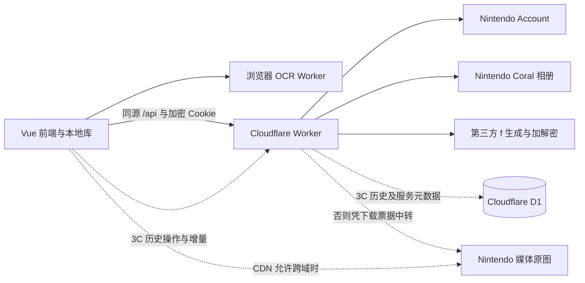

# Groove Archive · FP 成绩管理三期设计文档

> 版本：v3.8
>
> 调研日期：2026-09-29；修订日期：2026-09-30、2026-10-13、2026-10-14、2026-10-17、2026-10-19
>
> 状态：3A、3B 已通过用户实际使用验证；3C 按历史记录同步方案准备，尚未实现或开放
>
> 目标：未登录、未绑定时保持纯前端；Cloudflare 部署上可选读取 Nintendo 相册；3C 用 Workers + D1 同步成绩历史，当前最佳、Rating、B30 和每日快照／趋势均在本地计算

## 1. 结论与实施建议

v3.2～v3.7 段落保留当时的决策过程；当前实施以 v3.8 和已整理的正文章节为准，旧版预览、保护、趋势回算方式和相册处理租约不再作为实施要求。

v3.2 按用户 2026-10-13 的决定确定三项架构选择：

1. 普通网页直连 Nintendo 接口已用正式站点 Origin 复测不可行（第 2.5 节），改为同源 Cloudflare Worker 无状态中转，撤销 v3.1 中“不新增后端相册代理”的约束
2. 实施顺序改为先做 Nintendo 相册同步，站内账号与云端数据库后续再加；未登录时绑定的 Nintendo 账号由加密 Cookie 保存，成绩仍写入本地库
3. 未登录且未绑定时保持纯前端，GitHub Pages 部署和不愿登录、绑定的用户照常使用现有功能

v3.3 根据同日审阅确认：FC/AP 未知统一为 false；非重复的低分截图保留本地历史，但不降低最佳成绩；相册截图的成绩、历史排序与趋势统一按拍摄时间；目前不做完整备份迁移。3A 即加入本地旧任务拦截，失败与拒绝仅采用第 7.5 节的简单恢复规则，当前优先验证真实账号取图、OCR、预览确认入库能否跑通。

v3.4 按用户 2026-10-14 的决定调整页面与入库方式，与本文其余章节冲突时以本段为准：

- 设置页在服务端构建中改为「账号与设置」，顶部单列「账号」区域；纯前端构建没有账号功能，仍为「偏好设置」
- 绑定在独立弹窗中进行：先确认非官方接入、数据经手方、凭据保存与读取范围，勾选同意后进入登录步骤；登录链接自动生成，点击「前往登录」在新标签页打开，弹窗按登录、复制链接、回来粘贴三步说明
- 识别复用首页 OCR，成功即直接录入，不再逐张预览确认；去掉待确认列表、拒绝操作与谱面保护，人工改过的谱面同样直接录入；拍摄时间缺失或异常时按录入时间记录
- 打开网页且距上次更新满 3 分钟时自动更新，3 分钟内重复打开不更新；手动「更新成绩」与自动更新共用 10 秒冷却
- 手动更新有新截图时弹出首页同款识别进度弹窗，关闭弹窗在后台继续；自动更新只显示进度条，完成后通知
- 绑定后显示 Nintendo 昵称、相册中可见的 GCFP 截图数、已录入的相册成绩数与最近更新时间；识别失败的截图在设置页显示原因并可重试

v3.5 按用户 2026-10-17 的确认与决定补充，与旧章节冲突时以此处为准：

- 3A、3B 已通过用户实际使用验证，后续三期主体为 3C 站内账号、游客迁移、多设备同步和绑定迁移
- 首页手动截图与 Nintendo 相册统一由 Pinia 管理识别任务，共用串行 OCR 引擎、识别弹窗和右下角进度提示；两种来源分别保留批次、取消和结果
- 关闭弹窗、按 Escape 或切换站内页面后继续识别；右下角提示、首页识别入口和账号识别入口可以重新打开对应弹窗，只有明确取消才停止任务
- 相册手动与自动更新均先显示右下角进度提示，由用户主动打开识别弹窗；首页上传后打开弹窗，可选择后台识别。相册读取、截图下载或任一识别任务进行中，首页录入区改为「查看详情」，暂停选择和拖入截图及 Excel，任务结束或取消后恢复录入
- 成绩、相册处理记录及最近识别结果继续使用 IndexedDB；原图不持久化。刷新或关页后停止任务，相册未完成项下次更新恢复，首页未完成图片重新上传
- 清空成绩时递增本地代次，首页与相册旧任务都不能重新写入成绩或最近识别记录

v3.6 按用户 2026-10-19 的决定与当前代码补齐 3C 方案，正文已同步整理：

- 云端的成绩数据只保存历史事实及其版本、删除标记，不保存当前最佳、Rating、B30、每日快照或趋势；账号、会话、绑定、幂等回执和相册协调记录仍是必要的服务元数据
- 每条历史增加跨设备稳定的 `historyKey`，本地数字 ID 继续用于本机引用；同步新增、修改和删除历史，低分历史同样同步，不能只监听当前最佳表上传
- 每台设备从历史重建最佳、Rating 和 B30；每日快照沿用设备本地日期及过去冻结规则，不上传、不跨设备复制，新设备首次同步后从当天建立基线
- 后端选定沿用现有 Cloudflare Workers，并以 D1 保存历史与服务元数据；开工验收必须包含条件写入、变更日志、回执原子提交及一致快照，不直接把本地仓储搬到服务端
- 首版继续采用邮箱一次性验证码；用户随后明确暂不付费，发信优先候选改为 Resend 免费档，账号认证优先候选为 Better Auth + D1，最终框架选型尚未确认，见第 8.1 节
- 不恢复待确认、拒绝和谱面保护；相册成功即录入历史，删除以历史记录为单位，清空以数据代次为边界

v3.7 按用户 2026-10-19 的审阅反馈补充，正文同步调整：

- 本地 outbox 是持久化的待同步清单；手动录入、Excel、首页 OCR 与相册统一队列及历史提交接口，相册新增仅附带媒体去重和租约信息，不再另发一次普通历史上传
- 首版每次历史提交最多 5 条、JSON 请求体最多 16 KiB；实际安全批次还受数据库调用及线上免费 Worker CPU 预算约束
- 事件时间统一保存为 UTC 毫秒，按设备本地时区显示；时区统一不校正设备时钟，账号去重与同步先后使用服务端序号，过去每日趋势仍遵守本地日期冻结规则
- 同一历史的版本冲突只提供「使用本地版本」「使用云端版本」两种选择，按用户选择覆盖该条历史，不做字段级自动合并
- 登录账号的历史同步采用单标签页协调、空闲轮询逐步退避、隐藏页面暂停及全站发信预算，免费额度耗尽时保留本机数据与待同步清单
- 客户端协议兼容的最小方案及账号会话／注销细节仍为待确认建议，见第 10.4 节，不视为用户已经确认的新增交付范围

v3.8 按用户同日进一步反馈收紧范围，正文同步调整：

- 去重保留媒体 ID／内容 hash、成绩字段比较及 mutationId 回执；识别前同步及查询已处理标记减少重复工作，提交时仍执行基础防重
- 首版不协调两台设备同时识别时的任务归属，不要求同图只做一次 OCR；移除处理租约、续租、任务领取及超时接管。账号冷却、本地多标签页锁及云端重复入库保护继续保留
- seq 是账号历史变更流水号，服务于增量同步、一致快照与规范顺序；createdSeq 复用首次新增时的 seq，不维护另一套计数器，保留这些字段不以支持同时识别为前提
- 用户已确认请求需要携带协议版本号，3C 自有业务请求统一使用 `X-App-Protocol-Version: 1`，不兼容时暂停提交并提示更新页面；账号会话与注销细节仍见第 10.5 节待确认

当前相册链路为：**用户访问页面 → 前端请求同源 `/api` → Worker 用加密 Cookie 中的凭据读取相册，按 applicationId 筛选 GCFP 截图 → 前端取得原图（截图 CDN 允许跨域时直连，否则经 Worker 中转）→ 前端 OCR → 写入本地历史并更新本地派生数据**。3C 登录后另由历史同步器上传操作、拉取历史变化。

| 使用形态              | 部署                                        | 成绩数据                                       | 网络                                                                   |
| --------------------- | ------------------------------------------- | ---------------------------------------------- | ---------------------------------------------------------------------- |
| 纯前端                | GitHub Pages；Cloudflare 部署上未绑定的用户 | 本地 IndexedDB                                 | 日常浏览不请求 `/api`；Cloudflare 用户主动进入相册设置时可查询绑定状态 |
| 绑定 Nintendo、未登录 | 仅 Cloudflare 部署                          | 本地 IndexedDB                                 | 相册读取经 Worker，成绩不上传                                          |
| 站内账号（3C）        | 仅 Cloudflare 部署                          | 云端同步历史；账号本地库保存历史缓存及派生数据 | 历史同步经后端                                                         |

3A、3B 的 Worker 不使用数据库，长期凭据加密后由浏览器以 HttpOnly Cookie 保存。3C 才引入 D1，登录账号的 Nintendo 绑定按第 6.5 节迁入账号。两种阶段前端脚本都读不到 Nintendo 凭据，原图不持久化，OCR 继续在用户浏览器运行，页面关闭后不执行相册任务。

nxapi 作为认证及协议参考，NSO-Album-Sync 作为授权、下载与去重参考。两者都不能直接作为 Worker 运行时的库使用，协议代码按第 6.4 节改写。

三期拆为三个可独立验收的交付：

1. **3A：Worker 中转、Nintendo 绑定与手动读取**，未登录可用；读取、下载、OCR 后直接入库，已通过用户实际使用验证
2. **3B：访问时自动触发**，自动入库、后台进度和断点恢复，不引入服务器定时轮询，已通过用户实际使用验证
3. **3C：站内账号与历史同步**，游客历史迁移、多设备同步、本地重建派生数据，未登录时完成的绑定迁入账号

真实绑定、相册读取和录入链路已由用户实际使用验证；第 14.1 节继续作为协议变更和部署环境变化时的验证清单，CDN 直连仍需单独验证。

### 1.1 实施决定与外部前置

已经确定的选择继续沿用，外部条件在接入时核对：

| 事项                                | 当前状态                                                                                                       |
| ----------------------------------- | -------------------------------------------------------------------------------------------------------------- |
| GitHub Pages 版的 Nintendo 相册入口 | 继续隐藏，引导入口另行提出时再做，不阻塞 3C                                                                    |
| Nintendo 会话 Cookie 有效期         | 未登录绑定沿用当前 30 天；不与 3C 站内会话混用                                                                 |
| 截图下载方式                        | 当前使用 Worker 中转；CDN 直连单独验证后再启用                                                                 |
| 3C 后端选型                         | 已确定 Workers + D1；事务与一致快照实现通过第 14.5 节验收后进入同步开发                                        |
| 成本约束                            | 当前不启用付费套餐或自动超额计费，按 Workers／D1 及外部服务免费额度设计；自有发信域名仍是接入前置              |
| 验证码发信                          | 优先候选 Resend 免费档，Brevo 作为备选；核对已验证发信域名、日／月额度及实际送达，尚未配置或发送邮件           |
| 账号认证                            | 优先候选 Better Auth，在现有 Worker 中运行并使用 D1；Clerk／Supabase Auth 作为托管替代，尚未最终选定或安装依赖 |

## 2. 已确认的能力与边界

### 2.1 主机与云端相册

任天堂官方说明：Switch 2 可将截图上传到 Nintendo Switch App，也可在主机相册设置中启用自动上传；云端每个 Nintendo Account 最多保存 100 个文件，上传内容保存 30 天，部分软件不支持上传。离线时可排队等待联网上传。[官方上传说明](https://www.nintendo.com/en-gb/Support/Troubleshooting/How-to-Upload-Screenshots-and-Videos-from-Nintendo-Switch-2-to-the-Nintendo-Switch-App-2843767.html)

由此确定产品边界：

| 场景                                | 三期行为                                                       |
| ----------------------------------- | -------------------------------------------------------------- |
| Switch 2、截图已出现在官方 App 相册 | GCFP 读取和识别已通过用户实际使用验证；协议变化时复测          |
| 只保存在主机或存储卡、没有上传      | 未上传的截图不在可读取的云端相册内                             |
| 原版 Switch / Lite / OLED           | 不纳入本方案的云端相册自动读取承诺；继续导出截图后使用现有 OCR |
| 超过云端可见窗口、已过期的文件      | 无法通过这些接口补回，用户需重新上传或手动导入                 |
| 上传到了其他 Nintendo 用户下        | 跳过读取                                                       |
| 视频、非 GCFP 图片                  | 不下载视频、不识别无关游戏截图                                 |

访问时更新只能读取当时仍可见的云端内容。长期未访问或短时间上传大量其他游戏内容可能漏图；此功能不作为相册备份，关页后不更新。

### 2.2 两个项目的具体复用方式

本次按以下提交核查源码，实施时应固定通过验证的版本，不能把浮动 `main` 当作稳定接口：

| 项目                                                                                                     | 核查提交                                   | 能力与定位                                                                                    |
| -------------------------------------------------------------------------------------------------------- | ------------------------------------------ | --------------------------------------------------------------------------------------------- |
| [nxapi](https://github.com/samuelthomas2774/nxapi/tree/47c9d35d9d51d33e62dd6d3733b616e0ad31b02b)         | `47c9d35d9d51d33e62dd6d3733b616e0ad31b02b` | TypeScript/JavaScript 库、CLI、桌面应用；可创建 Coral 会话、刷新认证、读取相册                |
| [NSO-Album-Sync](https://github.com/Dycool/NSO-Album-Sync/tree/4fc49154aa984b85e0c5d3f67a977021a81274b7) | `4fc49154aa984b85e0c5d3f67a977021a81274b7` | C++20 原生桌面托盘应用；授权、定期下载、文件归档与系统凭据存储，README 默认同步周期为 60 分钟 |

nxapi 的 `package.json` 在核查提交声明 `1.6.1`，这不证明 npm 同名版本已经包含该提交的全部改动。PoC 必须核对实际安装包是否具有相册与当前加密协议支持。[包声明](https://github.com/samuelthomas2774/nxapi/blob/47c9d35d9d51d33e62dd6d3733b616e0ad31b02b/package.json)

已核实的 nxapi 能力：

| 能力     | 源码 / 文档中的入口                    | 接入注意                                          |
| -------- | -------------------------------------- | ------------------------------------------------- |
| 初次认证 | `CoralApi.createWithSessionToken(...)` | 返回 `nso` 与认证 `data`                          |
| 恢复会话 | `CoralApi.createWithSavedToken(data)`  | 保存并复用认证数据，不应每次访问重新登录          |
| 续期     | `renewToken(...)` / `onTokenExpired`   | 持久化更新后的凭据，以当前类型及返回值为准        |
| 相册列表 | `nso.getMedia()`                       | 底层调用 `/v4/Media/List`，库返回值中读取 `media` |
| CLI 验证 | `nxapi nso album --json`               | 适合个人 PoC，不作为正式后端每次请求的子进程      |

依据：[Coral 库说明](https://github.com/samuelthomas2774/nxapi/blob/47c9d35d9d51d33e62dd6d3733b616e0ad31b02b/docs/lib/coral.md)、[Coral 实现](https://github.com/samuelthomas2774/nxapi/blob/47c9d35d9d51d33e62dd6d3733b616e0ad31b02b/src/api/coral.ts)、[相册 CLI](https://github.com/samuelthomas2774/nxapi/blob/47c9d35d9d51d33e62dd6d3733b616e0ad31b02b/src/cli/nso/album.ts)

相册媒体模型包含 `id`、`type`、`applicationId`、`appName`、`contentUri`、`contentLength`、`thumbnailUri`、`capturedAt`、`uploadedAt`、`expiresAt`。`type` 区分 `image` 和 `video`；缩略图类型注释为 320×180 JPEG，不能代替 OCR 原图。时间由适配层从上游秒统一转换为本项目毫秒。[媒体类型定义](https://github.com/samuelthomas2774/nxapi/blob/47c9d35d9d51d33e62dd6d3733b616e0ad31b02b/src/api/coral-types.ts#L513)

当前 `getMedia()` 没有暴露分页游标；虽然类型文件保留 `count: 100` 的参数声明，实际调用没有传该字段。NSO-Album-Sync 当前也发送空 `parameter`。设计为扫描当前可见集合，不虚构分页、历史回溯或服务端增量能力。[相册调用实现](https://github.com/Dycool/NSO-Album-Sync/blob/4fc49154aa984b85e0c5d3f67a977021a81274b7/src/coral.cpp#L661)

NSO-Album-Sync 值得参考的是：缓存凭据、校验下载地址与长度、临时文件完成后再改名、保留拍摄时间。其单用户状态、系统钥匙串和桌面回调不能直接套用到托管服务。[同步实现](https://github.com/Dycool/NSO-Album-Sync/blob/4fc49154aa984b85e0c5d3f67a977021a81274b7/src/sync.cpp)

### 2.3 外部认证依赖不是一个普通 Bearer API

当前源码包含第三方 `f` 生成，以及 Coral 请求加密和响应解密。NSO-Album-Sync 的 README 明确披露，相关服务会处理 Nintendo 身份信息、Coral token 和 API 请求/响应。不能只告诉用户“第三方收到一个临时签名参数”，也不能声称凭据始终只在用户设备或本项目服务器内。[数据披露](https://github.com/Dycool/NSO-Album-Sync/blob/4fc49154aa984b85e0c5d3f67a977021a81274b7/README.md#-nintendo-account--nxapi)、[nxapi 加密请求实现](https://github.com/samuelthomas2774/nxapi/blob/47c9d35d9d51d33e62dd6d3733b616e0ad31b02b/src/api/coral.ts#L828)

nxapi 文档要求库调用者注册自己的 nxapi-auth client，常见作用域为 `ca:gf ca:er ca:dr`；该凭据属于本项目接入第三方认证服务的身份，与 Nintendo 客户端 ID、站内用户会话不同。不可复制其他应用的 client 身份或依赖其私人代理。上游支持只用 client id 的公开客户端，以及使用 secret 或 client assertion 的机密客户端。本项目默认支持仅 Client ID 的方式，不把 Secret 作为必备项；若服务方实际提供 Secret，则通过 Worker secret 配置。作用域由程序在申请 token 时发送，注册页无需提供输入框；实际是否授权及额度仍需联调确认。[nxapi 认证说明](https://github.com/samuelthomas2774/nxapi#nxapi-auth-authentication)

nxapi 要求调用 imink、flapg 等非 Nintendo 接口时，在 User-Agent 中写明本项目名称和版本；未开源或不易查找的项目还需附联系方式。浏览器 fetch 不能可靠设置 User-Agent，Worker 可以设置，本项目附仓库地址。[User-Agent 要求](https://github.com/samuelthomas2774/nxapi/tree/47c9d35d9d51d33e62dd6d3733b616e0ad31b02b#user-agent-strings)

NSO-Album-Sync 的当前 Coral 源码还存在作者部署的 Worker `f` 生成路径。它不是项目可直接依赖的公共服务承诺，采用 nxapi 适配层时不照搬这条私有部署依赖。[Coral 源码](https://github.com/Dycool/NSO-Album-Sync/blob/4fc49154aa984b85e0c5d3f67a977021a81274b7/src/coral.cpp)

nxapi 文档认为账号因此被封禁的可能性极低，同时记录 2023-09 有少量用户被禁止访问 SplatNet 3，涉及的是与 nxapi 无关的应用。绑定说明如实告知风险，不承诺无风险。[封禁说明](https://github.com/samuelthomas2774/nxapi/tree/47c9d35d9d51d33e62dd6d3733b616e0ad31b02b#will-my-nintendo-accountnetwork-service-account-be-banned-for-using-this)

这些是非官方接口，更新可能导致授权或拉取失效。Nintendo 故障只影响绑定和相册任务，纯前端功能和手动导入应继续可用，3C 的站内登录与成绩同步同样不受影响。

### 2.4 许可证与调研可信度

nxapi 声明 `AGPL-3.0-or-later`，NSO-Album-Sync 为 MIT。正式采用前确定本项目源码发布方式、依赖分发和通知要求；不能因为把 nxapi 放进独立进程，就假定解决所有许可问题。[nxapi 许可证](https://github.com/samuelthomas2774/nxapi/blob/47c9d35d9d51d33e62dd6d3733b616e0ad31b02b/LICENSE)、[NSO-Album-Sync 许可证](https://github.com/Dycool/NSO-Album-Sync/blob/4fc49154aa984b85e0c5d3f67a977021a81274b7/LICENSE)

本项目为 GPL-3.0。GPL-3.0 第 13 节允许与 AGPL-3.0 代码组合，但移植进 Worker 的 nxapi 协议代码仍适用 AGPL 关于网络交互提供源码的要求；仓库已公开，部署时在页面提供源码链接与许可声明。这里记录依赖条件，不作具体法律适用结论。

按项目要求先使用 Context7 CLI 查询了两个项目，但返回的是无关库，没有可用索引，因此本节以固定提交的源码和任天堂官方资料为依据。2026-10-13 复核了固定提交的 nxapi README（nxapi-auth 客户端类型、User-Agent、封禁说明），并经 Context7 查询 Cloudflare Workers 静态资源路由与 Rate Limiting 绑定文档。当时只完成代码核查及无真实凭据的跨域预检；后来用户确认的真实链路结果见第 14.4 节，不能把早期未验证状态当作当前阻塞项。

### 2.5 浏览器直连限制与当前验证结果

所核查的 nxapi Coral、Nintendo Account 和加解密源码依赖 `node:crypto`、`node:process`、`undici` 及 Buffer。这些入口是 Node 环境实现，不能直接认为 npm 安装后即可在网页或 Worker 中调用。[Coral 源码](https://github.com/samuelthomas2774/nxapi/blob/47c9d35d9d51d33e62dd6d3733b616e0ad31b02b/src/api/coral.ts)、[加解密源码](https://github.com/samuelthomas2774/nxapi/blob/47c9d35d9d51d33e62dd6d3733b616e0ad31b02b/src/api/f.ts)

2026-09-30 对公开端点做无凭据 OPTIONS 探测，Origin 为 `http://127.0.0.1:5173`，拟请求方法 POST、请求头 authorization/content-type：

| 端点                                        | HTTP 状态 | 本次返回的 CORS 许可头                           |
| ------------------------------------------- | --------- | ------------------------------------------------ |
| Nintendo `/v4/Media/List`                   | 200       | 未见 Access-Control-Allow-Origin/Methods/Headers |
| Nintendo Account `/connect/1.0.0/api/token` | 405       | 未见上述许可头                                   |
| nxapi-znca-api `/api/znca/encrypt-request`  | 401       | 未见上述许可头                                   |

同日补充真实 Edge 154.0.4258.37 验证：使用实际本地 HTTP 页面 `http://127.0.0.1:10718`，不拦截或模拟网络响应，不关闭浏览器跨域安全检查。页面 fetch 相册接口，方法 POST，请求头为 Authorization 和 `Content-Type: application/octet-stream`，使用无效测试凭据；浏览器发出的 OPTIONS 返回 200、无跨域许可头，控制台明确报告预检失败，CDP 错误为 `PreflightMissingAllowOriginHeader`，JavaScript 得到 `TypeError: Failed to fetch`。预检不携带实际 Authorization token，阻断发生在账号鉴权之前。[MDN CORS 说明](https://developer.mozilla.org/en-US/docs/Web/HTTP/Guides/CORS)

2026-10-13 以正式站点 Origin `https://himemiyatori.github.io` 复测命令行预检，拟请求方法 POST、请求头 authorization/content-type：

| 端点                                                | HTTP 状态 | CORS 许可头 |
| --------------------------------------------------- | --------- | ----------- |
| Nintendo `/v4/Media/List`                           | 200       | 无          |
| Nintendo Account `/connect/1.0.0/api/session_token` | 405       | 无          |
| Nintendo Account `/connect/1.0.0/api/token`         | 405       | 无          |
| nxapi-znca-api `/api/znca/f`                        | 401       | 无          |

绑定时交换 session token 的接口同样没有跨域许可，普通网页不只是读不到相册列表，连绑定也无法完成。Node polyfill 不会使上游响应增加 CORS 头，`no-cors` 返回的 opaque 响应也不能读取 JSON 或 Blob。结合 9 月 30 日的真实浏览器验证，普通网页直连不再作为实现路径，改由同源 Worker 中转（第 6 节）。

截图 CDN 的跨域情况仍需真实媒体 URL 验证。若 CDN 允许跨域，前端直接下载原图；否则由 Worker 中转。仅能在 img 标签显示不等于能读取像素用于 Canvas/OCR。

## 3. 与现有项目衔接

以 [二期设计](FP_B30_二期设计文档.md) 和当前代码为基线；本文件只扩展三期范围，不将二期待实现功能视为已完成。

| 现有模块                                                | 当前行为                                                                  | 三期调整                                                             |
| ------------------------------------------------------- | ------------------------------------------------------------------------- | -------------------------------------------------------------------- |
| `vite.config.ts`、构建脚本                              | 普通 build 为纯前端，build:server 开启服务端能力；dev 默认启动本地 Worker | 延续两种构建，GitHub Pages 仍无账号与相册模块                        |
| `wrangler.jsonc`                                        | 已有 Worker 与静态资源同源部署，`/api/*` 先进入 Worker                    | 3C 新增 D1 绑定与邮件服务配置，不增加第二套 Node 服务                |
| `src/db/database.ts`                                    | 游客库 `groove-archive-fp-history`，schema 6，本地数字自增 ID             | 保留游客库名称与旧记录；新增账号命名空间、稳定历史键和同步表         |
| `src/db/scoreRepository.ts`                             | 已有仓储工厂、历史投影、清空代次与相册提交                                | 注入当前账号数据上下文，各历史写入与 outbox 同事务，不同步本地最佳表 |
| `src/core/score/import.ts`                              | Excel 筛选及历史去重、最佳合并；含 `nso_ocr` 来源                         | 共享字段校验与历史去重规则，最佳投影继续由前端执行                   |
| `src/core/ocr/parser.ts`                                | 字段解析、曲名匹配、页面校验，成功直接录入                                | 沿用既有结果，不恢复待确认流程                                       |
| `src/core/ocr/recognizer.ts`                            | 浏览器 Worker、Canvas、WASM；先整张解码再检查尺寸                         | 继续在浏览器运行；相册图片在读取数据流时先按字节上限截断             |
| `src/core/ocr/importer.ts`、`src/stores/recognition.ts` | 首页上传与相册识别的应用级任务、后台进度和结果                            | 识别生命周期独立于页面与弹窗，成绩继续写入本地仓储                   |
| `src/core/rating/`、`src/core/song/`                    | 本地规则和稳定曲库 ID                                                     | 服务端只共享字段约束及曲库版本，Rating 与 B30 继续本地计算           |

继续遵守：Score 为 0～1,050,000 整数；FC/AP 未知或缺失统一为 false，不引入三态；Max Chain 可未知；AP 成立时 FC 成立；本地每谱面一条当前最佳、可有多条历史；BASIC / ADVANCED 独立 B30。同分最佳合并仅补未知的 Max Chain，不自动改写 FC/AP。

现有相册历史已按拍摄时间保存 `playedAt`；只改 Max Chain 已保留业务 `updatedAt`。3C 进一步使用独立 `revision` 表示历史内容变化，不能把业务时间当作同步版本。每日快照按本机当天更新，不按旧图拍摄时间回算过去日期。

3C 接口不接收或存储 `rating`、当前最佳、B30、快照／趋势和本地数字 ID；客户端从历史重算这些派生值。后端验证历史字段合法性、归属、版本与去重规则，不证明前端识别结果来自真实 Nintendo 截图；三期是个人成绩管理，来源标签不承担排行榜认证。

## 4. 范围与架构

### 4.1 部署与职责



| 环节                                                             | 执行位置                                               |
| ---------------------------------------------------------------- | ------------------------------------------------------ |
| 历史缓存、当前最佳、Rating、B30、每日快照／趋势、Excel、手动 OCR | 前端本地，三种使用形态相同                             |
| Nintendo 绑定、session token 交换、Coral 登录与续期              | Worker                                                 |
| 第三方 f 生成与请求加解密                                        | Worker，使用本项目 nxapi-auth client                   |
| 相册列表读取与 GCFP 筛选                                         | Worker，只返回必要字段                                 |
| 原图下载                                                         | 前端直连 CDN；CDN 不允许跨域时经 Worker 凭下载票据中转 |
| 尺寸检查、hash、OCR、预览、入库                                  | 前端                                                   |
| 访问触发、冷却、进度、重试、多标签页协调                         | 前端                                                   |
| 站内账号、历史事实与同步版本、相册已处理记录及账号冷却（3C）     | Workers + D1                                           |

静态前端与 Worker 部署在同一个 Cloudflare Worker，`/api` 与页面同源。3A、3B 的 Worker 无数据库；3C 的 Worker 通过 D1 保存历史与服务元数据，不依赖进程内状态，不保存图片。GitHub Pages 部署不含 Worker，只提供纯前端功能。

不新增相册调度进程、服务器任务队列、图片存储、无头 Chromium 和服务端 OCR。Worker 只在用户页面发出请求时执行，不定时读取 Nintendo 相册。

### 4.2 范围与页面生命周期

三期包含纯前端模式维持、绑定/解绑、手动读取、访问时更新、导入记录及错误恢复；3C 再加入账号登录、游客历史迁移、多设备同步和离线编辑。

自动更新以用户访问为条件，默认不设置整天运行的相册轮询，也不使用 Service Worker 承诺关页后持续识别。应用内部切换成绩页、B30 或设置页可继续当前批次；切出网站后台时不启动新扫描，并允许正在执行的工作被暂停或中断。下一次可见访问恢复未完成任务。

好友、排行榜、游戏全量游玩记录回溯、相册备份、视频识别和服务端代操作主机不纳入。本站已经录入的全部有效历史属于 3C 同步范围；主题、语言和每日趋势继续设备本地保存。

## 5. 部署形态与纯前端模式

### 5.1 构建开关

- 服务端能力由构建时环境变量开启（例如 `VITE_SERVER=1`），默认关闭。Cloudflare 构建设置该变量，GitHub Actions 不设置
- 默认关闭的原因：漏设只会看不到 Nintendo 功能；若默认开启，GitHub Pages 版会请求 `himemiyatori.github.io/api/...`，该路径位于账号根路径之下，可能命中其他仓库
- Nintendo 相关前端模块全部动态导入，开关关闭时由构建剔除，不进入 GitHub Pages 产物
- `yarn dev:local` 默认启动纯前端 Vite；`yarn dev` 构建服务端版本后启动本地 Worker，`yarn dev:server` 只启动已有构建的 Worker；浏览器验收按目标显式选择路径

### 5.2 同源部署

`wrangler.jsonc` 增加 `main` 与 `assets.binding`，`assets.run_worker_first` 设为 `["/api/*"]`，其余请求仍直接返回静态资源。[Cloudflare 静态资源路由](https://developers.cloudflare.com/workers/static-assets/binding/)

前端放在 GitHub Pages、Worker 放在 workers.dev 的跨站组合不可用：HttpOnly Cookie 会成为第三方 Cookie，Safari、Firefox 默认拦截。Nintendo 相册功能只在 Cloudflare 部署提供。

### 5.3 未绑定时日常浏览不请求 API

HttpOnly Cookie 前端读不到，前端无法自行判断是否已绑定。localStorage 保存不含凭据的“已绑定”标记：有标记才请求绑定状态与相册；接口返回未绑定或 Cookie 已过期时清除标记。Cloudflare 部署上从未绑定的用户不访问 Worker，行为与 GitHub Pages 版一致。

用户主动打开设置页的 Nintendo 相册区域时查询一次绑定状态，用于在标记丢失时恢复。这是未绑定用户不请求 API 的明确例外；仅访问普通设置页面而未进入相册区域不查询。

### 5.4 两个部署的数据不互通

GitHub Pages 与 Cloudflare 部署是不同 Origin，IndexedDB 各自独立。用户从 GitHub Pages 转到 Cloudflare 部署只能经 Excel 迁移，而 Excel 只交换当前最佳成绩，历史与 Rating 趋势不会迁入（二期第 9 节），原站点数据仍保留。目前不做完整备份导出、导入或迁移，迁移说明明确此限制。GitHub Pages 版的入口形式见第 1.1 节待定事项。

### 5.5 降级

绑定用户遇到 Worker 故障、离线、Cookie 过期或上游变化时，本地成绩、B30、Excel 与手动 OCR 完整可用。3C 账号使用本机历史缓存离线编辑，操作留在原账号 outbox，联网并恢复有效会话后再同步。相册错误与站内同步错误分别展示，不遮挡已有成绩，也不把账号缓存当作游客数据。

## 6. Worker 无状态中转与凭据

### 6.1 绑定流程

两个参考项目使用原生应用认证流程：Nintendo 客户端为 `71b963c1b7b6d119`，回调为 `npf71b963c1b7b6d119://auth`，结果是 session_token_code，配合 state 与 S256 challenge。不能直接替换为本站 HTTPS callback。[授权实现](https://github.com/Dycool/NSO-Album-Sync/blob/4fc49154aa984b85e0c5d3f67a977021a81274b7/src/nintendo_auth.cpp)

1. 用户阅读并同意第三方处理说明（第 6.4 节）与封禁风险说明
2. Worker 生成 state 与 PKCE verifier，加密写入 10 分钟有效的流程 Cookie，返回授权链接
3. 用户在 Nintendo 官网登录，按实测可用的方式复制原生回调链接并粘贴提交
4. Worker 校验 scheme、host、state 与期限，交换 session token，读取 Nintendo 账号 ID 与昵称
5. Worker 写入带新 bindingId 的会话 Cookie，清除流程 Cookie 与旧 Coral 缓存；前端写入已绑定标记
6. 前端发起第一次相册读取；空相册是合法结果

真实账号回调复制已随 3A、3B 通过用户实际使用验证；特定手机是否被官方 App 接管仍需按设备实测，不要求上传其他软件的凭据文件。

流程完成后清除 Cookie 不等于服务端具备一次性消费记录。无状态方案依赖上游拒绝重复兑换 session_token_code，协议回归仍须验证重放及并发兑换；当前主链路通过实际使用确认，不等于所有重放边界已单独实测。

### 6.2 加密 Cookie

| Cookie     | 内容                                                                         | 有效期                                   |
| ---------- | ---------------------------------------------------------------------------- | ---------------------------------------- |
| 会话       | session token、Nintendo 账号 ID、bindingId、昵称、keyVersion、签发与过期时间 | 未登录绑定沿用当前 30 天                 |
| Coral 缓存 | Nintendo 账号 ID、bindingId、Coral 短期 token 与到期时间                     | 按上游 expiresIn                         |
| 绑定流程   | state、PKCE verifier、过期时间                                               | 10 分钟，完成后清除；重放边界见第 6.1 节 |

- 全部使用 `__Host-` 前缀与 `HttpOnly; Secure; SameSite=Strict; Path=/`，不设 Domain
- 内容使用 AES-GCM 加密，主密钥来自 Worker secret，按 keyVersion 轮换；Cookie 名称作为附加认证数据，不同 Cookie 的密文不能互换
- 单个 Cookie 按 4 KB 上限设计，会话与 Coral 缓存分开保存；PoC 记录实际体积
- Coral 缓存避免每次检查都重新执行账号 token、f 生成和 Coral 登录，减少耗时与第三方额度消耗
- 使用 Coral 缓存前必须核对 Nintendo 账号 ID 与 bindingId 均匹配当前会话；不匹配则丢弃缓存，不能跨账号或跨次绑定复用

无状态的代价是服务端无法吊销已签发的 Cookie。解绑只清除当前浏览器的 Cookie；Cookie 被复制时在过期或密钥轮换前一直可用，因此会话 Cookie 必须带过期时间。轮换主密钥会使全部绑定失效，用户需重新绑定。

前端不持有任何 Nintendo 凭据，比 v3.1 中“前端持有 Coral 短期 token”的暴露面更小。XSS 无法取走凭据，但页面打开期间可借用户 Cookie 调用中转接口，因此接口范围按第 6.3 节最小化。

### 6.3 接口最小化

- 只提供相册读取和原图中转两类上游操作；不透传 Coral 接口，不读取好友、在线状态或其他游戏服务
- 相册列表由 Worker 按 applicationId 白名单筛选 GCFP 图片，只返回 mediaId、拍摄时间、尺寸或长度、到期时间与下载方式所需字段；`appName` 仅显示，不用模糊名称自动入库
- CDN 允许跨域时，列表直接返回 contentUri 供前端下载，签名 URL 只在当前页面内存中使用
- CDN 不允许跨域时，原图中转不接受客户端提交的 URL。列表为每张图附带 Worker 加密的短期下载票据，内含 Worker 自己取得的 contentUri、mediaId 和过期时间；前端原样回传，Worker 解密校验后下载
- 中转下载只访问验证过的媒体 HTTPS 主机，不自动跟随重定向，跳转目标同样校验；读取数据流时按 20 MiB 截断，不只相信 contentLength，只流式转发不缓存
- 写请求与中转请求校验 `Origin`，配合 SameSite=Strict 防止跨站请求；响应一律 `Cache-Control: no-store`

### 6.4 上游与第三方

- **协议移植**：nxapi 的 Coral、Nintendo Account 与加解密实现依赖 `undici`、`node:crypto` 等 Node 接口，在 Worker 中改写为基于 fetch 与 WebCrypto 的实现，不直接导入 nxapi 全库；固定参考提交，协议变化时对照更新
- **协议参数**：Nintendo Switch App 更新后，旧版本号请求可能被拒绝。版本号等协议参数放在 Worker 环境变量或远程配置中，不发版也能更新
- **nxapi-auth**：使用本项目注册的 Client ID，支持公开客户端；可选 client secret 存于 Worker secret。Worker 申请 token 时发送作用域 `ca:gf ca:er ca:dr`；User-Agent 带本项目名称、版本和仓库地址
- **共用出口与额度**：所有用户的请求从 Cloudflare 出口 IP 发出，并共用本项目 nxapi-auth client 的额度。Nintendo 是否限制数据中心 IP、第三方额度多少，须 PoC 实测并向服务方确认
- **限流**：客户端冷却见第 7.1 节。Worker 用 Rate Limiting 绑定按 Nintendo 账号 ID 与 IP 做整体限制；该绑定按单个 Cloudflare 节点计数，周期只能为 10 或 60 秒，只用于防滥用，不作精确额度。[Rate Limiting 绑定](https://developers.cloudflare.com/workers/runtime-apis/bindings/rate-limit/)
- **日志**：Worker 日志与错误信息不得包含 Cookie、token、授权码、生日和签名 URL；上游错误响应先脱敏再记录，不整包输出
- **告知与同意**：绑定前说明 Cloudflare 在传输中经手 Nintendo 凭据与相册列表，截图中转时也经手图片；nxapi-znca-api 会收到 Nintendo id_token（有效 15 分钟）、Coral token 及加密前后的请求和响应内容；本项目不保存这些数据

### 6.5 续期、状态与解绑

- 仅在页面请求时续期 Coral token，闲置账号不后台刷新；确认过期后最多续期一次再重试
- session token 失效时返回 `reauth_required`，前端停止读取并提示重新绑定
- 未登录绑定接口返回 `unbound / active`，重新授权与其他错误另行展示；绑定后按访问规则自动更新，当前没有暂停开关
- 解绑清除会话、Coral 缓存 Cookie 与本地标记，取消当前批次并释放图片；已导入成绩保留，相册处理记录保留，避免重新绑定同一账号后重复导入
- 绑定、解绑与可能续期的相册请求共用跨标签页凭据操作锁；解绑或换绑先阻止新请求并等待已发出的凭据请求结束，再执行清 Cookie 或新绑定。不能只依赖 AbortSignal，因为忽略旧响应的业务结果不能撤销浏览器处理的 Set-Cookie。相册请求更新当前绑定的 Coral 缓存，头像补全时可按原期限重写同一会话；旧 bindingId 的缓存不能恢复绑定或用于新账号
- 3C 登录后，用户同意账号绑定的服务端加密存储说明，再由 Worker 读取游客 Nintendo 会话 Cookie，事务写入账号绑定并记录迁移结果；成功后清除游客会话与 Coral Cookie。响应丢失时以同一迁移标识重试，不先清 Cookie 再存库
- 迁移发现账号已有不同绑定，或该 Nintendo Account 已属于另一站内账号时返回冲突，不自动覆盖或转移归属。退出站内账号不会把云端绑定重新复制成游客 Cookie；重新登录后恢复账号绑定

## 7. 访问触发、取图与 OCR

### 7.1 触发规则和用户体验

已绑定时，页面先显示本地成绩，再异步检查相册，不阻塞首页和 B30。

- 打开网页时，距离最近成功检查至少 3 分钟才自动检查一次；页面在后台打开时等到首次可见再检查
- 标签页重新可见不重新检查
- 页面内导航不重新检查；页面一直停留不周期轮询
- 提供“更新成绩”，自动与手动更新共用 10 秒冷却，从发起请求起计算；上游限流和既有退避优先
- 无新图片时不初始化 OCR；有图时显示发现数量、逐张进度与实际成绩更新数

3 分钟和 10 秒是本项目配置，不是上游允许额度。冷却时间存于 IndexedDB 由各标签页共享，用 `navigator.locks` 保证同一时间只有一个标签页扫描。未登录阶段没有跨设备协调，各设备分别检查。

用户长期未访问时不读取。当前云端容量和 30 天窗口内的图片仍可补读，已不可见图片需重新上传或手动导入；设置页说明该取舍。

### 7.2 相册读取和取图

1. 前端取得标签页锁，检查本地冷却
2. 前端请求 Worker 读取相册；Worker 续期凭据、调用 Coral、按 applicationId 筛选后返回 GCFP 图片
3. 前端与本地相册处理记录对照，跳过已处理 mediaId；新图片按拍摄时间从早到晚排队
4. 前端下载原图：CDN 允许跨域时直连 contentUri，否则凭下载票据请求 Worker 中转
5. 前端检查类型、长度、像素和内容 hash，执行 OCR
6. 前端在同一 Dexie 事务写入成绩与处理记录终态

GCFP applicationId 已配置，并随 3A、3B 通过用户实际使用验证；协议或部署变化时复核允许集合。每次读取当前完整可见列表，不按“拍摄时间大于上次”跳过，因为旧截图可以晚上传；不虚构上游分页或历史回溯。

初始边界为 20 MiB、约 1600 万像素及既有完整 16:9 要求。读流时强制大小上限，不能只相信 contentLength；现有 `recognize()` 先整张解码再检查尺寸，相册图片须在解码前完成字节上限检查。下载结果必须是可读 Blob，下载并发保持很小，有界缓冲，不把所有原图同时留在内存。

签名 URL 与下载票据仅用于当前页面任务，不进持久化、日志或埋点。失效时前端重新读列表；媒体已不存在时标记 expired，不把失败当作成功处理。

### 7.3 复用现有前端 OCR

继续使用 `src/core/ocr/recognizer.ts` 的 Worker、Canvas、WASM、日文模型与 ROI，不新增服务端识别器。模型仅有新图片时按需加载，同一页面会话内复用；首张图冷启动和手机性能通过实测优化。

现有应用级相册控制器和首页导入器通过 Pinia 展示独立批次，内部页面切换或关闭弹窗后继续处理。两种来源共用串行识别引擎，只有明确取消才停止当前批次。

浏览器 Worker 让页面在识别时继续操作，不保证后台常驻。后台打开网页时等到首次可见再扫描，不因重新可见重复发起扫描；已有任务可能被浏览器暂停或中断。解绑和显式取消触发 AbortSignal，超时销毁模型实例，下次需要时重建。

刷新/关闭后只保留处理记录、已识别候选和待写入结果。未识别原图需要重新拉取，不保存图片备份；已识别未写入的结果优先重试写入，不重复 OCR。

### 7.4 本地去重与入库

未登录阶段相册结果写入现有游客库，与手动 OCR 走同一 `scoreRepository`：

- **持久化已处理 mediaId**：每次检查读取当前全部可见截图，而现有入库只与同谱面最近一条历史比较。不记录 mediaId 时，结果与最近历史不同的旧截图每次访问都会再插入一条历史。处理记录以 Nintendo 账号 ID + mediaId 为键，另存内容 hash，用于同图重传去重
- **直接录入**：沿用 v3.4，成功识别即保存历史，不提供待确认、拒绝或谱面保护；旧表、旧状态仅为 schema 兼容保留
- **清空成绩**：`clear()` 清除历史、当前最佳、快照和最近识别结果，递增 `datasetEpoch`，保留相册处理记录与绑定。已有旧代次的媒体记录不重新录入，旧任务不能写回；当前不提供关闭后重新开启自动导入或重审历史截图的流程
- **低分与同分**：非重复低分截图保留本地历史，但不降低最佳成绩；同分只补最佳成绩中未知的 Max Chain，不把 false 当成可补的未知 FC/AP。进度分别统计“新增历史”和“更新最佳成绩”，不能把低分已记录误报为未入库
- **时间**：相册截图以有效的 `capturedAt` 保存 `playedAt` 和业务 `updatedAt`，`importedAt` 保存实际录入时刻；拍摄时间缺失或异常时按录入时间记录。既有历史及手动导入继续原有时间口径，不猜测文件拍摄时间。Rating 变化记录在本机录入或应用同步的当天，不回算过去快照
- **来源**：`source` 增加 `nso_ocr`，类型定义、Excel 导出与历史展示同步支持

清除站点数据后，本地成绩、处理记录和趋势一起丢失；游客重新绑定后可能从当前可见截图重新导入。3C 账号可恢复云端历史和媒体处理记录，但不能恢复未上传历史、截图或旧的本机趋势。

历史重放按 `playedAt` 排序，同一时刻当前以本地历史 ID 稳定排序；3C 的账号库改用跨设备一致的平局顺序，见第 10.2 节。旧图晚上传只重放相关谱面并按规则更新今天的快照，过去日期保持冻结。对相册历史的人工纠错保留拍摄时间，另记 `correctedAt`。

3A 起在 IndexedDB 持久化本地 `datasetEpoch` 与 `bindingGeneration`。创建任务或待提交结果时记录两者及 Nintendo 账号 ID；清空成绩递增 datasetEpoch，解绑、换绑递增 bindingGeneration。最终写历史与处理终态的同一事务中核对代次和当前账号，不匹配则取消旧任务，不能只靠组件内 AbortSignal。跨标签页共用这些记录，3C 再扩展服务端校验，不新增谱面保护。

### 7.5 识别判定与状态

相册复用首页 OCR 的页面、曲名、谱面及字段校验，成功即直接录入；无法得到合法成绩时显示识别失败并允许重试，不新增待确认或置信度审核。MISSION CLEAR / MISSON CLEAR、游玩中和未游玩占位继续跳过，FC/AP 未知统一按 false。

当前主流程为 `discovered → downloading → recognizing → pending_commit → imported / skipped`，另有 retry_wait、failed、expired、canceled。旧 `needs_review / rejected` 只兼容既有记录，不作为新交互。仅媒体已发现、已下载或 OCR 已结束不能标记 imported，必须在历史事务提交成功后标记；写入低分历史也算 imported。

首版恢复仅采用以下规则，不做复杂的自动重处理策略：

| 状态 / 场景         | 恢复规则                                                                                                                                   |
| ------------------- | ------------------------------------------------------------------------------------------------------------------------------------------ |
| retry_wait          | 网络、5xx 或 OCR 超时自动重试最多 2 次，分别至少等待 1、5 分钟；仅在页面可见且再次触发时执行，429 以 Retry-After 为下限，达到上限转 failed |
| failed              | 显示阶段和原因，用户点“重试”后重置次数；有效的已识别候选优先重试提交，否则重新取图识别                                                     |
| expired             | 未识别媒体已不可见时停止下载；已有合法待提交结果继续尝试入库，不因图片消失丢弃结果                                                         |
| canceled / 页面中断 | 显式取消停止当前批次；后续更新或手动重试恢复未完成项时先检查代次，过期代次不得复用                                                         |
| imported / skipped  | 后续扫描不重复处理；识别版本更新不自动翻查终态                                                                                             |

3C 起相册结果与其他来源共用第 10.1 节的 outbox 和 `POST /api/sync/mutations`，以 `append_history` 携带 mutationId、historyKey、epoch，以及媒体 ID、hash、识别版本和绑定 generation 等相册上下文。服务端在同一事务内记录回执、新增历史及更新媒体终态；不再通过另一个相册历史提交接口重复上传。当前最佳仍由各设备从历史计算，不能因前端标记“已校验”跳过服务端校验。

登录且联网时，新识别批次开始前先完成一次本站历史同步，相册再按当前媒体 ID 查询云端已处理标记，跳过成功终态；批次内不为每张图片重复全量同步。离线或本站同步暂不可用时，手动 OCR 仍可保存本机并排队。首版允许两台设备因启动时间接近而重复做 OCR，提交时由媒体标识、条件写入及操作回执防止重复保存，不建立跨设备任务领取、心跳、续租或接管流程。

### 7.6 结果与图片生命周期

前端识别完或取消后尽快释放原图 Blob、ImageBitmap 和对象 URL。Worker 中转只流式转发，不缓存或存储截图。相册待提交结果保存字段及原因，不保存原图、签名 URL 或下载票据。

首页与相册分别在本机保留最近一次识别结果及缩略图，供刷新后查看；这类本机展示数据不纳入 3C 云端同步。未识别相册项在下一次更新时重新取图，首页未完成图片需重新上传。

清空或换账号后，旧批次不得写回历史、相册终态或最近识别结果；同步删除按第 10 节针对具体历史记录执行。

## 8. 站内账号与设备隔离（3C）

本节在 3C 用 Workers + D1 实施。现有 `groove-archive-fp-history` 即游客库，成绩历史、相册处理记录及本机趋势继续保留；未登录时完成的 Nintendo 绑定按第 6.5 节迁入账号。

### 8.1 登录方案

首版使用邮箱一次性验证码。用户明确当前暂不付费，Cloudflare Email Sending 的任意收件人发送因需要 Workers Paid 而不纳入当前接入方案；推荐候选改为 **Better Auth + Cloudflare Workers／D1 + Resend 免费档**，框架选型仍在讨论，尚未安装或接入。发信实现保留独立适配器，认证核心优先复用成熟框架；历史同步、游客迁移、Nintendo 绑定与业务授权继续由本站实现。

Better Auth 属于在自己 Worker 中运行的开源认证库，官方支持 D1 和 Email OTP，账号及会话仍可保存在自己的 D1；不是把账号托管给第三方身份平台。若选用它，用户、会话、认证方法和验证码表按实际版本及插件生成迁移，下述登录参数作为配置及验收要求，不再并行手写一套认证协议或预先锁死 `login_codes / sessions` 的结构。业务统一关联认证层的稳定 userId，不以邮箱或 Nintendo ID 为主键。[数据库与迁移](https://better-auth.com/docs/concepts/database)、[Email OTP](https://better-auth.com/docs/plugins/email-otp)

Resend 当前免费档为每月 3,000 封、每日 100 封，免费账号可正式发信；需要验证自有发件域名，不要求收件用户逐个预先登记。它可以直接从 Worker 调用，重发同样消耗额度。Brevo 免费档每日 300 封，可作发信备选，需考虑品牌标识和超额排队对验证码时效的影响。[Resend 价格](https://resend.com/pricing)、[正式发送](https://resend.com/docs/knowledge-base/does-resend-require-production-approval)、[域名](https://resend.com/docs/dashboard/domains/introduction)、[Workers 接入](https://resend.com/docs/send-with-cloudflare-workers)、[Brevo 免费限制](https://help.brevo.com/hc/en-us/articles/208580669-FAQs-What-are-the-limits-of-the-Free-plan)

除邮箱与 IP 限流外，服务端在发送前原子预占全站日／月发信预算，包含注册、登录、重发与受控测试邮件；预算按供方实际周期及免费额度配置，并预留共用账号和运维消耗。并发请求不能分别读到余量后同时超发；发送超时、结果不明时保守保留占用，不直接换发信商再发一遍。预算不足或供方限额时返回稳定错误码，页面提示暂时无法发送及可确定的恢复时间，不把验证码排队到次日发送，不自动升级付费；已经有效的验证码仍可验证，已有会话及本地功能继续使用。

托管替代中，Clerk 免费档包含邮箱验证码、50,000 MRU 和固定 7 天会话，账号托管在 Clerk；Supabase Auth 免费档包含 50,000 MAU，但默认邮件仅供项目团队试用，公开登录需自配 SMTP，并增加独立的 Supabase 项目。以上额度口径不同，不能把 MRU 与 MAU 直接等同。[Clerk](https://clerk.com/pricing)、[Supabase 价格](https://supabase.com/pricing)、[Supabase 邮件限制](https://supabase.com/docs/guides/auth/auth-smtp)

验证码参数目标为 6 位数字、10 分钟有效、单次消费、连续验证失败最多 5 次；重发至少间隔 60 秒，按邮箱与 IP 配置额度。启用认证框架的验证码摘要存储，并验收新码替换旧码及并发消费，不默认认为框架开箱即满足。Better Auth 的 OTP 存储默认明文，限流默认内存，接入时需显式调整为摘要及适合多实例的数据库／共享存储；会话存储和撤销语义按所选框架核对，不沿用自研会话摘要假设。Cookie 保持独立的 `HttpOnly + Secure + SameSite`，写请求校验 Origin 与 CSRF；公开响应不泄露账号是否存在，限流同时用于保护免费发信额度。[OTP 存储](https://better-auth.com/docs/plugins/email-otp)、[限流](https://better-auth.com/docs/concepts/rate-limit)

站内会话、Nintendo 长期会话、Coral 短期凭据、nxapi-auth 应用凭据分开保存和命名。所有 API 从服务端会话确定 `userId`，不能信任请求体中用户自报的所有者。

站内登录也保存不含凭据的本地状态标记，有标记时启动会话恢复和历史同步；未登录且未绑定用户日常浏览仍不请求 API。主动打开登录流程可以查询当前会话，标记丢失不通过后台轮询恢复；会话过期时只停止上传并提示重新登录，不把账号中的离线编辑转为游客写入。

2026-10-19 Cloudflare Email Sending 官方资料核对存档；当前不付费约束下暂不接入：

- Cloudflare Email Sending 当前标为 Beta，可通过 Worker 的 `send_email` 绑定发送验证码等事务邮件，不必另外自建 SMTP 或购买邮箱收件箱；Sending 与收件转发的 Email Routing 是不同能力，[官方概览](https://developers.cloudflare.com/email-service/)、[Workers API](https://developers.cloudflare.com/email-service/api/send-emails/workers-api/)
- 向任意用户邮箱发送需要 **Workers Paid**；当前包含每账号每月 3,000 封，超出部分为每 1,000 封 0.35 美元，另受账号实际日发送额度约束。免费方案可发往账号预先验证的收件地址，不能据此支持开放注册验证码；资费以接入时官方页面为准，[价格](https://developers.cloudflare.com/email-service/platform/pricing/)、[额度](https://developers.cloudflare.com/email-service/platform/limits/)
- 发件域名必须由自己控制并使用 Cloudflare DNS，在 Email Sending 中接入后核对 SPF、DKIM、DMARC 和退信记录。优先使用专门的发信子域，不为发送验证码迁走已有收件服务的根域 MX；`workers.dev` 和 GitHub Pages 地址不作为本站发件域名，[域名接入](https://developers.cloudflare.com/email-service/get-started/send-emails/)、[域名配置](https://developers.cloudflare.com/email-service/configuration/domains/)
- 上线前确认账号可用额度，并用受控的真实 Gmail、QQ、Outlook 等目标邮箱验收送达、延迟、退信与抑制处理；API 接收成功不等于收件成功。验证码内容不写应用日志，并关闭发信域名的邮件正文预览存储；新域名默认开启该预览，需显式调整，[域名邮件预览](https://developers.cloudflare.com/email-service/configuration/domains/#email-preview)

以上是方案与文档核查，尚未替用户开通付费、修改域名 DNS、配置邮件绑定或发送邮件；实际账号套餐、域名和送达情况仍是外部接入前置。

### 8.2 游客迁移及退出

1. 首次登录先拉取账号的云端历史快照，保留原游客数据
2. 若游客库有历史，预览待迁移历史数、重复／冲突及预计最佳变化，用户选择导入或暂不导入；迁移全部有效历史，不从最佳表或 Excel 导出反推历史
3. 给旧历史一次性持久化 `historyKey`，按本地原顺序迁移；整个迁移保留唯一 `migrationId` 与各批次 mutationId，刷新、超时重试沿用原标识。同一键且内容一致视为已完成，内容不同进入冲突，不能覆盖已迁入的历史
4. 服务端确认的历史及对应回执写入账号库；保留游客库作为迁移前副本，之后两者不自动双向同步。游客每日快照仍留在游客库，不合并成账号过去的趋势
5. 退出后停止该账号的本地同步器并返回游客库；账号数据不作为游客数据显示

每个账号使用独立 IndexedDB 命名空间。新增应用级数据上下文，统一提供 db、repository、userId 和 sessionGeneration；现有仓储工厂继续复用，组件、查询订阅、识别结果仓储和导入控制器改从上下文取依赖。切换账号先取消旧请求和识别、释放 liveQuery／watch 订阅及预览地址，再挂载新上下文；晚到回调必须核对原账号、上下文代次和 datasetEpoch，不能只把全局数据库变量换掉。

outbox、cursor、冲突和设备标识绑定原账号，切号不转移；退出时有未同步操作要提示并保留原账号队列，只有用户明确选择才丢弃。账号可恢复有效会话后继续上传，失效会话不自动退回游客库写入。识别模型可复用，任务、预览和结果必须按账号清理。

本地缓存清除与云端成绩清空拆成不同操作。清除本机缓存不会产生云端删除，暂不允许云端清空。

## 9. 数据模型

以下 3C 模型是已确定的实施设计，尚未执行数据库迁移；与当前 3A、3B 的 schema 6 区分。事件时间统一保存为自 Unix epoch 起的 UTC 毫秒，传输原值，展示时按设备当前本地时区格式化，不在保存时加减时区偏移。例如同一时刻的香港 20:00 与 UTC 12:00 对应同一个时间戳。

UTC 统一的是时间表示，不能修正设备时钟快慢或断网期间的录入先后。`playedAt / importedAt / updatedAt` 保留原业务含义；服务端变更时间由服务端生成，`createdSeq / seq / revision` 分别负责规范新增顺序、同步顺序及内容版本，不用客户端时间戳裁决冲突。每日快照的 `day` 仍是设备本地日期，按第 9.4 节冻结，不改成 UTC 日期或重分组旧快照。

### 9.1 本地库（3A / 3B）

游客库 `groove-archive-fp-history` 当前为 schema 6：

| 本地表             | 关键字段                                                                                                                      |
| ------------------ | ----------------------------------------------------------------------------------------------------------------------------- |
| `scoreHistory`     | 本地数字 id；songId、chartId、score、完成信息、source、playedAt、importedAt、updatedAt、batchId、correctedAt；本地缓存 rating |
| `scores`           | 每谱面一条派生最佳，historyId 引用本地历史；可从历史重建                                                                      |
| `ratingSnapshots`  | 每个本地 day 一条 `{ day, recordedAt, basic, advanced }`；过去日期冻结                                                        |
| `albumItems`       | Nintendo 账号 ID + mediaId；hash、任务代次、识别结果、重试和终态，不保存原图                                                  |
| `albumState`       | 当前绑定、任务代次、冷却、最近检查／录入时刻和可见媒体数                                                                      |
| `recognitionRuns`  | 首页与相册各自最近一次结果及缩略图，仅本机展示                                                                                |
| `metadata`         | 本地曲库与 Rating 计算版本                                                                                                    |
| `chartProtections` | 仅兼容旧 schema，不再新增或参与录入                                                                                           |

`albumState` 不随清空成绩删除，清空时递增代次。旧 `autoImport` 字段不代表已有暂停开关，不沿用旧文档中关闭后重审的交互。`lastCheckedAt` 与 `lastImportedAt` 分开，后者仅在历史事务提交成功后更新。

schema 6 已按本地日期合并旧快照，并增加历史查询索引；不重建过去日期的 Rating。首版每个浏览器只绑定一个 Nintendo Account，重新绑定同一账号复用处理记录。

### 9.2 账号本地库（3C）

账号库复用当前历史、派生最佳与快照结构，另外增加：

| 本地数据        | 职责                                                                                                                                                    |
| --------------- | ------------------------------------------------------------------------------------------------------------------------------------------------------- |
| 历史同步字段    | `historyKey` 为 UUID，与本地数字 id 分离；记录服务端 revision、createdSeq 和 datasetEpoch                                                               |
| 已确认历史基线  | 保存服务端规范历史及删除状态，作为拉取增量后重新叠加待提交操作的基础                                                                                    |
| `outbox`        | 统一待同步清单；mutationId、创建时协议版本、历史键、动作、原 baseRevision、原 epoch、业务字段、可选相册／迁移上下文及提交状态；与本地历史变更同事务保存 |
| `syncState`     | userId、deviceId、cursor、服务端 epoch、同步状态和最近成功时间                                                                                          |
| `syncConflicts` | 原操作、本机提案、云端规范历史或删除状态；用户处理后产生新的操作                                                                                        |

`scores`、历史中的本地 rating、B30 和 `ratingSnapshots` 不进入 outbox。游客库仅为迁移补稳定历史键，继续保持未登录时无同步请求；当前 schema 6 不在本次文档调整中提前改版。

### 9.3 后端（3C）

成绩领域只持久化历史事实，`scores`、rating、B30 与 Rating 快照／趋势不建云端表、不接收客户端上传。以下账号及同步辅助表属于必要服务元数据，用户数据的查询和唯一约束包含所有者；全站发信预算另按供方及额度周期维护：

| 后端表                                     | 关键字段和约束                                                                                                                                                                                               |
| ------------------------------------------ | ------------------------------------------------------------------------------------------------------------------------------------------------------------------------------------------------------------ |
| `users`                                    | id、规范化唯一邮箱、createdAt、datasetEpoch、nextChangeSeq                                                                                                                                                   |
| `login_codes / sessions`                   | 验证码/会话摘要、过期时间、失败计数、所属 userId                                                                                                                                                             |
| `email_send_budgets / email_send_attempts` | 供方及日／月周期唯一预算、原子预占量；唯一发送请求 ID、状态与可用供方回执，用于并发额度检查及超时对账，不保存验证码正文                                                                                      |
| `score_history`                            | userId + historyKey 唯一；songId、chartId、score、fc/ap、nullable maxChain、source、playedAt、importedAt、updatedAt、batchId、correctedAt、revision、createdSeq、datasetEpoch、deletedAt；每谱面可有多条历史 |
| `history_changes`                          | 用户内单调 seq、epoch、historyKey、动作、规范历史或墓碑、revision、服务端变更时间；不含 Rating 等派生值                                                                                                      |
| `mutation_receipts`                        | userId + mutationId 唯一、请求摘要和结果；相同 ID 不同载荷拒绝                                                                                                                                               |
| `migrations`                               | userId + migrationId 唯一；来源游客库标识及 epoch、批次回执与完成状态，不存游客快照                                                                                                                          |
| `nintendo_bindings`                        | userId、NintendoAccountId、显示名、状态、同意版本、从会话 Cookie 迁入的加密认证数据、keyVersion、generation、nextAllowedAt、最后成功检查时间                                                                 |
| `album_items`                              | userId + NintendoAccountId + mediaId 唯一；applicationId、时间、内容 hash、终态、识别版本、待提交字段、关联 historyKey 和错误码                                                                              |

登录后迁移相册处理记录时，核对其 Nintendo 账号与已迁入的绑定，不能以客户端自报 accountId 把其他账号的记录并入。后端不保存 contentUri、thumbnailUri、图片字节或文件引用；`album_items` 仅用于导入协调和去重。不迁移旧谱面保护或最近识别缩略图。

historyKey 由客户端生成并一次持久化，userId 从站内会话取得，revision、createdSeq、seq 及服务端变更时间由服务端生成。旧历史缺少 playedAt 时回填 importedAt，业务时间在设备间原样传输，不改成拉取或迁移时刻。

seq 是同一账号每次有效历史新增、修改、删除或 reset 时递增的流水号，用于增量拉取和一致快照。createdSeq 取该历史首次新增产生的 seq 并保持不变，用于规范排序及确定最近录入，不额外维护计数器；revision 是该条历史的内容版本，用于编辑冲突。媒体 ID／hash 判断是否同图，首版简化同时识别后仍保留这些同步字段。

相册账号冷却由绑定记录的 nextAllowedAt 和最后成功检查时间维护，在现有相册读取接口中校验并更新，不持久化「哪台设备占有任务」的状态，也不新建扫描会话或处理租约表。

`source` 扩充 `nso_ocr`。FC/AP 只存布尔值，完整导入中未知或缺失统一为 false；Max Chain 在 JSON 中用 `null` 表示未知，不能将 false、0 当空值。局部编辑中字段缺失表示不修改，FC/AP 用 false 清除标记，Max Chain 用显式 null 清空。

首版每站内账号只绑定一个 Nintendo Account；同一个 Nintendo Account 不同时绑定多个站内账号。

### 9.4 本地派生数据与趋势边界

- 已确认历史加本机待提交操作构成当前视图；所有有效历史参与本地最佳重建，高分优先，同分只补未知 Max Chain，BASIC / ADVANCED 分别计算 B30
- Rating 规则或曲库版本变化只重算本机历史 rating、最佳与 B30，不上传计算结果，不生成历史编辑；服务端保留曲库校验版本并在不兼容时要求更新客户端
- 每台设备沿用本地日期 `day`、每天最多一条和过去冻结规则。应用拉取、编辑、删除或规则升级后，仅按既有规则建立／更新本机今天的快照
- 新设备、首次登录的账号库或已清除的本机缓存，在首次历史合并后有有效历史时从当天建立趋势基线，空库不建点；不按远端历史批次反复补写今天，也不从 playedAt 倒推过去快照
- 过去每日 Rating 不跨设备同步，账号之间、游客与账号之间也不拼接快照。已有设备保留自己的过去趋势；新设备可恢复云端历史与当前 B30，不能精确恢复其他设备曾冻结的趋势
- 清空本机账号缓存会丢失这台设备的趋势；云端清空历史则通过 epoch 让各在线设备清除相应历史、派生数据和本机快照，旧 epoch 待提交操作不再重放

## 10. 成绩同步与冲突规则（3C）

### 10.1 传输协议

采用本地 outbox + 服务端历史变更日志。outbox 即保存在 IndexedDB 的「待同步清单」：本机保存一条成绩时，同时记下待发送操作；服务端确认后再移出待发送队列。断网、刷新或请求超时后沿用持久化记录恢复，不依赖页面内存，也不是用户需要手动管理的另一份成绩库。

统一通过 `POST /api/sync/mutations` 传输 `append_history / edit_history / delete_history`，不上传整库或当前最佳。操作包含 mutationId、deviceId、datasetEpoch、historyKey、chartId、动作、原 baseRevision 和业务字段。相册新结果的新增操作另附媒体 ID、hash、识别版本及绑定 generation，服务端校验后在同一事务中提交历史、用户 seq、规范变更、幂等回执及媒体终态；其他来源共用历史提交逻辑。游客迁移在同一队列附 migrationId，以既有历史迁移处理并保留来源，不冒充本次相册识别。新增版本从 1 开始，修改或删除递增 revision；只改 Max Chain 也递增版本，业务 updatedAt 可保持不变。

手动新增／编辑、历史删除、Excel、首页 OCR 和相册都通过同一数据上下文写历史及 outbox，不依赖监听 `scores` 表变化补传。首版一次请求最多 5 条操作、JSON 请求体最多 16 KiB，客户端同时按条数和 UTF-8 编码后的字节数拆批；任一上限超出时服务端在执行前拒绝。按本机顺序发送，各操作独立原子提交并返回成功、冲突或校验失败，不承诺整批事务。网络超时沿用原 mutationId 与载荷；同一 ID 不同载荷拒绝，不能为重试重新生成历史键。相册成功回执同样用于确认本地历史与媒体终态，同一结果不再另排普通新增操作。

5 条只是初始上限，不代表天然满足免费运行预算。D1 原型须统计鉴权、限流、前置查询和每个操作的数据库调用；按官方 D1 免费档每次 Worker 调用 50 次查询的限制留出余量，超预算时继续降低安全批次，不把 `batch()` 理解为无限容量。验收还需在实际免费 Worker 部署核对 CPU 时间，不能只凭本地 Workerd 通过就上调批次。[D1 限制](https://developers.cloudflare.com/d1/platform/limits/)、[Workers CPU 限制](https://developers.cloudflare.com/workers/platform/limits/#cpu-time)

去重成功回执返回已存在的规范历史键或明确的 skipped 结果，客户端移除对应临时新增并重放当前视图，不能把未被接受的本机记录标记为已同步。旧 mutationId 的幂等回执只证明原操作完成，不作为晚于当前 cursor 的新变更覆盖已拉取的更高 revision 或 reset。

客户端先拉取已确认变化，再叠加 outbox 重建本地视图。拉取不修改待提交操作的原 baseRevision，不能静默把离线编辑重新基于最新版提交；同一历史有连续本机修改时串行确认或在发送前合并未发操作。应用变更、保存 cursor 和更新本地派生数据同事务；不会因拉取覆盖未上传编辑。

冲突或永久校验失败只阻塞相关 historyKey 及依赖它的后续操作，其他历史可以继续同步；发送结果不明的操作先按原 mutationId 对账，未确认前不合并或修改其载荷。相册重复提交返回已存在的处理结果及规范历史键，客户端据此对账。

拉取使用不透明 cursor，绑定 userId、epoch 与用户内 seq，按 seq 返回历史 upsert、墓碑及 reset。首次历史快照固定高水位 H 与 epoch；需要分页时，只从该用户、该 epoch 的 `history_changes` 中读取每条历史在 H 及以前的最后规范值，分页令牌始终绑定该水位，结束时使用 H 对应 cursor。不能把不断变化的当前历史表分页结果与最后一次 seq 拼成快照。游标失效时下载新快照、保留 outbox，再按原版本和 epoch 校验，禁止上传旧快照覆盖服务器。

D1 使用参数化 SQL、条件写入和 `batch()` 的事务能力实现每个操作及回执，查询快照水位时也需保证 epoch 与 seq 一致；仅把多个 `await` 顺序排列不能保证原子性。若采用读副本，D1 Session 的顺序一致性不代替上述快照水位和业务事务。[D1 batch](https://developers.cloudflare.com/d1/worker-api/d1-database/#batch)、[读副本与 Sessions](https://developers.cloudflare.com/d1/best-practices/read-replication/)

首版登录、恢复联网、窗口重新可见时立即同步，但已有服务端冷却或退避尚未结束时继续等待。有本地写入则短暂合并后立即提交；页面可见时，连续无云端变化的拉取间隔按 30、60、120、300 秒逐级延长，封顶 5 分钟，有本地写入或远端变化后恢复 30 秒。页面隐藏后不再启动轮询；所有页面隐藏时没有历史轮询。网络错误／5xx 按指数退避并加入随机抖动，429 尊重 Retry-After，登录失效则暂停账号同步并保留队列，恢复有效会话后继续。这里拉取的是本站成绩增量，不会触发 Nintendo 相册读取；相册仅按第 7.1 节的访问事件和冷却规则触发。

同一 Origin、同一账号的可见标签页通过 `navigator.locks` 选出一个同步执行者，统一拉取、提交及更新 cursor；其他标签页通过跨标签页通知唤醒执行者并读取共享本地库。执行者隐藏、关闭或切换账号时释放资格，其他可见标签页接替。每条历史的依赖顺序仍由持久化队列保证，不能仅靠幂等回执允许多个标签页各自轮询或乱序发送。

### 10.2 历史操作与本地最佳投影

| 操作                         | 规则                                                                                                                       |
| ---------------------------- | -------------------------------------------------------------------------------------------------------------------------- |
| 首页 OCR、Excel、相册 OCR    | 新增合法且未重复的历史，非重复低分也同步；Excel 仍先按现有规则选择文件内各谱面最高分。云端不替换最佳行，各设备自行重放历史 |
| 游客迁移                     | 迁移已有全部有效历史，不能只取最高分，也不把迁移文件预筛选当作历史去重；相同 historyKey 幂等，不同键保留原有非连续重复历史 |
| 手动新增已有谱面             | 延续当前提示，引导编辑；服务端以同一事务检查该谱面是否已有有效历史，多设备并发新增只有首个成功                             |
| 手动编辑，包括降分和清空字段 | 修改所关联的明确 historyKey，必须匹配 baseRevision；降分仍需明确确认。期间最佳换成另一历史时，不把编辑目标改绑到新最佳     |
| 删除单条历史                 | 匹配该历史 revision 后写墓碑；本机从剩余有效历史重选最佳，删光才退出该谱面的 B30，不生成整个谱面的删除墓碑                 |
| 云端清空全部                 | 事务递增 datasetEpoch、写 reset 变更和回执，用户 seq 继续单调；所有旧 epoch 操作整体拒绝，各设备清除旧数据与快照后重新同步 |

普通新增去重延续“与同谱面最近一条已录入历史比较”的口径。账号云端的「最近」明确指当前 epoch、该谱面未删除历史中 createdSeq 最大的一条，以服务端首次接受新增的顺序为准；同一批次按提交顺序处理。不得用设备 importedAt、显示时区或最后编辑时间决定这个顺序，不能按 chartId + score 全局唯一而丢失 A→B→A。相册另以绑定归属下的 mediaId／内容 hash 去重，提交时的条件写入及唯一约束与历史事务一起执行；首版不协调同时识别的计算任务，也不要求两台设备同时启动时只下载或识别一次。迁移不把已有历史重新当作 OCR 输入。旧库已经保存的超限 Max Chain 允许随历史迁移保留原值，普通新增与后续编辑仍按当前谱面上限校验，不能因此阻断整份既有历史的迁移。

云端历史首次接受时分配不可变 createdSeq；账号库按 `(playedAt, importedAt, createdSeq, historyKey)` 重放，避免同毫秒记录因各设备本地数字 ID 不同而选出不同 FC/AP。未获回执的本机记录可先按原本地顺序展示，确认后按规范顺序重放，既有游客库的排序保持不变。

自动新增历史不能更新已有 historyKey，更不能恢复其墓碑。修改同一历史的不同字段，首版也走版本冲突确认，不做字段级静默合并；对不同 historyKey 的合法新增可以并存。谱面没有人工保护，删除某条历史不禁止之后录入另一条不同的新历史。

冲突以同一条 historyKey 的完整业务字段为单位，展示本地提案与云端当前值，只提供两种选择：

- **使用本地版本**：用户明确确认后，以刚展示的云端 revision 为 baseRevision、生成新 mutationId 提交本地完整业务字段；云端又变化时再次提示冲突，不绕过条件写入。若该历史已被云端删除，提示将作为新历史重新录入，生成新 historyKey，不能复活原墓碑
- **使用云端版本**：采用云端当前历史或删除状态，舍弃该条本地提案及依赖它的后续未发送修改，重建本机视图，不影响其他历史的待同步操作

两种选择均按用户明确操作执行，不按时间戳自动选胜者；清空导致 epoch 不同继续按第 10.3 节处理为失效操作，不作为普通版本冲突一键重传旧库。

例如：A 离线把同一 historyKey 改为 990000，B 已纠错为 980000，A 的旧 revision 必须冲突；若是两张不同的新截图分别为 980000、990000，则两条历史都保留，本地最佳选 990000。删除 990000 对应历史后，若剩余历史只有 980000，本地最佳回退到 980000。

### 10.3 旧操作、清空与绑定隔离

第 7.4 节的本地规则在 3C 由服务端同样执行，另外规定：

- 删除墓碑对应具体 historyKey，旧修改或同键重试不能恢复；再次明确录入的不同历史按新增规则处理
- 云端清空保留绑定与既有媒体处理／去重记录，旧代次记录不再次写入历史；未发现过的 mediaId 仍按新输入处理，不宣称能识别所有从未登记过的旧截图
- 不新增暂停、重审或谱面保护交互；相册沿用当前访问触发规则。任务创建时记录 userId、epoch、binding generation 及前端会话代次，提交时服务端再次核对；清空、解绑或切号后的旧任务不能提交
- 本机缓存清除不产生 reset 或 tombstone；云端 reset 后未上传的旧 epoch 操作保留为可见的失效记录，供用户明确舍弃或另行手动录入，不能换 epoch 自动重传
- 服务端先校验当前 epoch 再处理旧操作的回执重放，不能因为 mutationId 曾成功就跳过 reset；相册还需核对当前绑定 generation。当前代次内响应丢失时，重复提交按原 mutationId 返回已存在回执，媒体重复由已有终态对账

同步日志、墓碑和回执首版不自动淘汰，先保正确性并监控体积。后续压缩时必须定义最旧有效游标、设备失效及强制快照流程，不能仅按日期删除墓碑。

### 10.4 请求协议版本与客户端兼容

用户已确认请求携带协议版本号。3C 自有业务 API 统一携带请求头 `X-App-Protocol-Version: 1`，首版只实现协议 1；协议版本独立于应用发布号、曲库版本、历史 revision 和 datasetEpoch。旧客户端可能来自长期打开或休眠的标签页、离线数日后恢复的设备，以及缓存中的旧页面，不能仅依赖重新打开时加载最新入口文件。

服务端维护支持的协议范围，缺失或不兼容时在业务处理前返回稳定错误码 `client_update_required` 及支持版本；不执行该请求的历史、媒体终态或 reset 写入。兼容版本照常同步；不兼容时客户端暂停账号提交，保留本地历史、原账号 outbox 与未同步提示，提示用户更新页面。普通界面、文案或样式更新不递增协议号，也不因此强制刷新。

outbox 保存操作创建时的协议版本，刷新后的客户端先识别及迁移旧格式，再按对应协议发送；不能只把旧操作的版本头改成新号就重传，已发出但结果不明的操作仍遵守原 mutationId 和载荷不可变规则。未来发生不兼容升级时随该次升级定义迁移，不在首版预建多套接口。入口 HTML 联网加载时重新验证，带内容哈希的静态资源继续复用缓存；更新页面代码不清除成绩库或待同步清单。

### 10.5 账号生命周期细节（待确认）

明确站内会话有效期、续期与撤销规则，以及账号注销入口和重新验证要求，仍是待确认细节。第 12.2 节的注销清理顺序继续保留，具体登录期限和页面交互不在本次反馈中擅自定值。

## 11. API 与页面设计

### 11.1 3A / 3B 接口（Worker）

| 方法与路径                         | 用途                                                                  |
| ---------------------------------- | --------------------------------------------------------------------- |
| `POST /api/nintendo/auth/start`    | 写入绑定流程 Cookie，返回授权链接                                     |
| `POST /api/nintendo/auth/complete` | 校验回调、交换 session token，写入会话 Cookie                         |
| `GET /api/nintendo/binding`        | Nintendo 账号 ID、昵称和状态；无有效 Cookie 时返回 unbound            |
| `DELETE /api/nintendo/binding`     | 清除会话与 Coral 缓存 Cookie                                          |
| `POST /api/album/media`            | 读取并筛选 GCFP 截图，返回媒体描述与下载方式（contentUri 或下载票据） |
| `POST /api/album/content`          | 凭下载票据中转原图，仅在 CDN 不允许跨域时启用                         |

下载票据放在请求体，不放 URL，避免进入访问日志。上游限流返回 429 和重试时间；session token 失效返回明确的 `reauth_required`；所有响应 `Cache-Control: no-store`。

### 11.2 3C 接口

| 方法与路径                                                    | 用途                                                                                       |
| ------------------------------------------------------------- | ------------------------------------------------------------------------------------------ |
| `POST /api/auth/code`、`POST /api/auth/verify`                | 站内邮箱登录                                                                               |
| `GET /api/me`、`POST /api/auth/logout`                        | 当前账号与退出                                                                             |
| `POST /api/nintendo/binding/migrate`                          | 将会话 Cookie 中的绑定迁入当前账号并清除 Cookie                                            |
| `GET /api/sync/snapshot`、`GET /api/sync/changes`             | 一致性快照和增量                                                                           |
| `POST /api/sync/mutations`、`POST /api/history/reset`         | 全来源统一幂等新增／修改／删除历史，相册新增附媒体上下文并原子更新终态；另提供数据代次清空 |
| `POST /api/guest-migrations`、`GET /api/guest-migrations/:id` | 建立游客历史迁移、查询批次进度与恢复                                                       |
| `GET /api/album-items`                                        | 按当前媒体 ID 查询已处理结果及失败重试元数据，不领取任务，不返回原图或上游 URL             |

3C 自有业务接口携带第 10.4 节的协议版本请求头，先核对支持范围；相册账号冷却在现有 `POST /api/album/media` 内校验。资源 ID 必须检查用户归属。编辑冲突返回 409 和当前规范值，频率限制返回 429 和重试时间，游标失效明确要求重新拉快照。

`/api/sync/snapshot` 的快照是历史数据的一致性导出，与本地每日 Rating 快照不同；接口只返回历史事实、同步字段及必要元数据。3C 不提供上传／下载最佳表、B30 或趋势的接口，不增加待确认或拒绝接口。

### 11.3 页面

当前服务端构建的「账号与设置」已包含 Nintendo 账号、绑定说明、更新成绩、最近检查／录入时间、失败重试与重新绑定；手动和自动更新均先显示右下角进度提示，由用户主动打开识别弹窗。3C 在同一区域增加站内登录、历史迁移、待同步操作及冲突，并区分“清除本机缓存”和“云端清空历史”。冲突按具体历史展示「使用本地版本」「使用云端版本」；发信额度不足时展示可重试提示。提示每日趋势仅保存在当前设备，重新登录不等于可恢复另一设备的过去曲线。纯前端构建仍为「偏好设置」。

首页异步显示“正在检查相册”“发现 3 张新截图”“已更新 2 条成绩”。无新图不弹窗打断；更新失败不遮挡既有成绩。内部页面切换保持进度，解绑/取消时说明已保存和未处理数量。

## 12. 恢复、凭据保护与资源消耗

### 12.1 恢复与协调

| 情况                        | 行为                                                                                                   |
| --------------------------- | ------------------------------------------------------------------------------------------------------ |
| 页面刷新、关闭或后台挂起    | 保存处理记录与候选，不承诺继续执行；下次访问恢复                                                       |
| 网络超时或 5xx              | 按第 7.5 节保存重试次数与退避时间，最多自动重试 2 次；只有可见页面和新触发才重试，相册列表请求同样适用 |
| 上游 429                    | 尊重 Retry-After，冷却跨标签页共享                                                                     |
| Coral 过期                  | Worker 续期一次；session token 失效提示重新绑定                                                        |
| Worker 不可用或 Cookie 失效 | 显示相册阶段错误，本地功能不受影响                                                                     |
| OCR 超时                    | 释放图片/模型，按第 7.5 节有限重试；不重复成功项                                                       |
| 上游结构变化或 CDN 跨域失败 | 显示具体阶段失败，不当作空相册                                                                         |
| 多标签页                    | `navigator.locks` 保证单标签页扫描；未登录阶段不做跨设备协调                                           |
| 账号多标签页同步（3C）      | 可见标签页选出一个同步执行者，统一队列与轮询；隐藏、关闭或切号时可交接，见第 10.1 节                   |
| 解绑或清空                  | 取消本地工作，事务校验本地代次；凭据请求按第 6.5 节协调，防止晚到响应影响解绑或新绑定                  |

3C 用 epoch/generation、操作回执和云端已处理标记拦截旧提交及重复入库。跨设备同时识别的任务分配不纳入首版；允许重复计算，响应丢失后按已有回执或媒体终态恢复，不引入服务端处理租约。

### 12.2 凭据与个人数据

Worker 主密钥由部署 secret 提供，按 keyVersion 轮换；若使用 nxapi-auth client secret，同样存于 Worker secret，不打包进前端。前端不持有 Nintendo 凭据；签名 URL 与下载票据只在页面内存中使用。对授权码、Cookie、token、生日和签名 URL 脱敏，前端日志和错误上报同样适用，不能把上游原始响应整包上报。

3C 起后端长期 Nintendo 认证数据采用有认证加密存库并保存 keyVersion，主密钥与备份分开。删除账号先撤销会话、更新 generation，再清理历史、变更日志、回执、迁移记录、绑定和处理元数据；当前设备的任务、缓存与队列同时清理，其他设备恢复联网后不得继续提交。

### 12.3 消耗与观测

Worker 负担为绑定、凭据续期、相册列表读取与筛选；CDN 不允许跨域时截图也经 Worker 流式转发，此时图片流量经过 Cloudflare。OCR 计算在用户设备。静态 OCR 模型的首次下载仍占本站带宽，应缓存版本化资源。

相册检查量近似为“活跃绑定用户数 × 冷却后实际触发次数”，不是“全部绑定账号数 × 每日固定频率”。举例：1000 个绑定账号、100 个日活、每人每日两次有效触发，约 200 次相册检查；30 分钟全量轮询约为 48000 次。每次检查对上游的请求包括账号 token 续期、f 生成、Coral 登录（Coral 缓存命中时省略）、请求加解密与相册列表，PoC 记录实际请求数与耗时，并对照 Workers 套餐限制。

实测重点为首次模型加载、桌面/手机单图耗时、内存峰值、页面可操作性、Cloudflare 出口与认证耗时。客户端可上报脱敏耗时与数量，不上报截图、URL 或凭据。

3C 免费运行预算覆盖站内登录、邮件发送、历史同步和相册协调。当前 Workers Free 每日 100,000 次请求、每次请求 CPU 10 ms；D1 免费档每日读取 5,000,000 行、写入 100,000 行，单库最大 500 MB。会话、限流计数、历史、变更日志、回执、相册元数据及索引都占用预算，不能只按历史条数估算。[Workers 限制](https://developers.cloudflare.com/workers/platform/limits/)、[D1 价格](https://developers.cloudflare.com/d1/platform/pricing/)、[D1 限制](https://developers.cloudflare.com/d1/platform/limits/)

历史轮询请求量近似为「各设备可见同步执行者的在线时长 ÷ 实际拉取间隔」；例如 1,000 名用户每天各打开一小时，固定 30 秒约为 120,000 次请求，仅轮询就超过上述免费请求额度。采用第 10.1 节的单标签页协调和逐级退避，仍需为登录、提交、相册及失败重试留出余量。查询按用户、代次及 seq／谱面／createdSeq 建索引，并记录快照查询的实际扫描行数；空增量拉取也需计入鉴权、会话续期和限流消耗，不视为零成本。

观测每类接口的请求量、CPU、D1 rows_read／rows_written、库体积和可用发信预算，达到预警阈值时及时调整轮询及批次。额度耗尽时提示云端服务暂不可用并退避，不自动升级或启用超额计费，不清除账号缓存或 outbox；本机查看、录入和编辑继续可用，待额度与会话恢复后再同步。日志、墓碑和回执仍按第 10.3 节保留，空间告警不触发未经设计的自动删除。

## 13. 建议改动目录

```text
worker/
  index.ts              路由、Origin 校验与限流
  cookies.ts            Cookie 加解密与 keyVersion
  nintendo.ts           现有绑定、Coral 登录与续期、请求加解密
  types.ts              当前接口模型与错误；3C 绑定类型改由 Wrangler 生成
src/
  core/album/           访问触发、取图队列、本地去重与恢复
  core/ocr/             复用既有浏览器 OCR
  db/                   当前 schema 6 历史、快照、相册与识别结果
  stores/recognition.ts 首页与相册的全局识别任务
  components/recognition/ 共用识别弹窗与右下角进度提示
  pages/                设置页 Nintendo 相册
```

3C 再增加 `src/core/account/` 数据上下文、`src/core/sync/` outbox／增量同步器、Worker 账号／邮件／历史路由及 D1 migrations。共用的 `shared/` 保存历史 DTO、错误码、字段与曲库约束、版本及去重规则，不依赖 Vue、Pinia、i18n、Dexie、DOM 或后端驱动；本地最佳投影、Rating、B30 与趋势继续留在前端。错误通过稳定代码在界面翻译，不把当前全局 i18n 导入服务端。

新增或修改 D1 等绑定时由 Wrangler 生成 Env 类型，区分游客和账号能力；Resend API key 等服务凭据存 Worker secret，不进入前端。Worker 与前端分开编译，兼容标志按所选认证框架配置。数据库迁移随代码版本管理，生产迁移先在独立测试库验收，不能让预览环境连接正式历史库。

## 14. 验证门槛、里程碑与验收

### 14.1 PoC 与验证门槛

| 验证             | 通过标准                                                                              | 不通过时                     |
| ---------------- | ------------------------------------------------------------------------------------- | ---------------------------- |
| 真实 GCFP 媒体   | 官方 App 可见，记录 applicationId、尺寸和时间单位                                     | 相册功能暂缓，纯前端不受影响 |
| Cloudflare 出口  | 从 Worker 完成账号 token、f 生成、Coral 登录与相册列表                                | 评估其他部署或客户端形态     |
| 截图 CDN 跨域    | 真实浏览器直接 fetch 得到可读 Blob，能用于 createImageBitmap/Canvas/OCR               | 启用 Worker 下载票据中转     |
| 协议移植         | Worker 运行时以 fetch 与 WebCrypto 完成完整链路                                       | 不直接导入 nxapi 全库        |
| 绑定和续期       | 回调复制、state、重放、Coral 缓存、过期恢复正确                                       | 不开启自动触发               |
| Cookie 体积      | 会话与 Coral 缓存 Cookie 均低于 4 KB                                                  | 调整内容拆分                 |
| 第三方条件       | 确认本项目 nxapi-auth Client ID 可申请所需作用域、额度和 User-Agent 要求；Secret 可选 | 调整接入配置、冷却与限流     |
| 移动端与页面恢复 | 冷启动/热模型/多图可接受，切页继续，关页后重试不重复                                  | 调整队列及支持范围           |
| 许可与服务条件   | 明确源码提供方式、依赖通知和第三方接入权限                                            | 调整适配方案                 |

本节保留协议或部署变化时的回归清单，已通过用户实际验证的 3A、3B 主链路不重新列为 3C 开工阻塞。CDN 跨域仍须在真实浏览器中验证，命令行看到响应头不等于浏览器放行；未验证时继续 Worker 中转。普通网页直连已于 2026-09-30 与 2026-10-13 确认不可行。

### 14.2 交付里程碑

| 阶段 | 实现内容                                                                                            | 完成标准                                                                                               |
| ---- | --------------------------------------------------------------------------------------------------- | ------------------------------------------------------------------------------------------------------ |
| 3A   | 构建开关、同源 Worker、绑定、加密 Cookie、相册读取与取图、前端 OCR 直接入库、本地代次、拍摄时间入库 | 用户实际使用正常；GitHub Pages 无 `/api` 请求，Cloudflare 未绑定用户日常浏览无 `/api` 请求             |
| 3B   | 访问时触发、模型复用、自动入库、Pinia 全局任务、后台进度、失败重试与恢复                            | 用户实际使用正常；切页继续，关页后停止，下次恢复不重复                                                 |
| 3C-0 | 统一设计、字段约束、账号数据上下文、D1 迁移与同步事务验证、回归门槛                                 | 游客库不变；切换上下文可释放全部旧任务；历史、日志与回执原子提交                                       |
| 3C-1 | 邮箱登录、会话恢复、账号独立缓存                                                                    | 真实发信送达、过期和重试行为；未登录仍可纯本地使用                                                     |
| 3C-2 | 游客全部历史迁移、全来源统一 outbox／历史提交／快照／增量、本地派生与冲突                           | 两设备／离线操作收敛；支持选择本地或云端版本；小批次及退避同步；删除后最佳回退；每日趋势仅本机保存     |
| 3C-3 | Nintendo 绑定迁入账号、相册已处理记录同步、账号冷却及基础入库防重                                   | 凭据迁移可重试；已处理图片跳过，重复提交不重复保存；退出、解绑、清空拦截旧提交；不要求跨设备只识别一次 |

当前外部前置主要是验证码发信的实际套餐、域名、额度与送达；同步实现前置是历史模型、账号隔离、D1 条件事务和一致快照。第三方额度与 Nintendo 协议继续监测，CDN 直连作为独立优化推进。

### 14.3 验收场景

纯前端：

- GitHub Pages 构建产物不含 Nintendo 模块，运行时无 `/api` 请求
- Cloudflare 部署上未登录且从未绑定的用户日常浏览无 `/api` 请求，主动进入账号流程时允许查询状态；本地成绩、Excel、B30、手动 OCR 与 GitHub Pages 版一致
- Worker 不可用、Cookie 过期时本地功能完整可用

凭据与接口：

- 前端脚本读不到 Cookie 内容；页面内存、localStorage 和 IndexedDB 中没有 Nintendo 凭据
- 篡改、过期或换用到其他 Cookie 名称的密文被拒绝；轮换密钥后旧 Cookie 失效并提示重新绑定
- 原图中转拒绝伪造、过期的下载票据，不接受客户端提交的 URL；跨站 Origin 请求被拒绝
- Worker 日志中没有 Cookie、token、授权码和签名 URL

相册与入库：

- 页面打开先展示成绩，异步检查；无新图不初始化模型
- 页面内导航不重复扫描且批次继续；页面重新可见遵守冷却
- 多标签页同时打开只有一个在扫描；连续点击立即更新不重复处理
- 重复 mediaId、同图重传、旧图晚上传和乱序正确去重；重复访问不新增历史
- 非重复低分截图新增历史但不降低最佳成绩；FC/AP 未知保存为 false，同分自动合并只补未知 Max Chain
- 相册截图的成绩日期、历史排序使用拍摄时间；补录、编辑与删除只按既有规则更新本机今天的快照，过去日期冻结
- 同一 mediaId 或已成功处理 hash 不重复；清空后旧代次任务与已登记媒体不重新录入，不增加人工保护或待确认
- 3A 即验证跨标签页清空、解绑和换绑后旧任务或候选不能提交；旧 Coral 缓存不能用于新绑定
- 非 GCFP、视频、MISSION CLEAR、游玩中和未游玩占位跳过
- CDN 跨域失败、空相册、Cookie 失效、URL 过期、超大图和 OCR 错误可区分
- 刷新/关闭/挂起在下载、OCR、入库各阶段均能下次恢复
- 关闭所有页面后无相册请求和 OCR；持续可见但无新访问事件也不周期轮询
- 解绑取消当前批次并清除 Cookie 与本地标记，已导入成绩保留

3C：

- 用户、绑定、元数据及待提交结果严格隔离；跨用户资源请求被拒绝，未登录日常浏览仍不请求账号 API
- 游客迁移包含全部有效历史及低分历史，超时、刷新和重新登录不重复；原游客库与趋势保留
- 两台独立浏览器通过页面录入、修改、删除并断网恢复，同毫秒历史在同步后得到相同最佳与 B30，历史不按设备数字 ID 串错
- 两个来源的新历史并存；同一历史离线修改基于旧 revision 时进入冲突，拉取不能静默提升其 baseRevision
- 冲突通过页面选择使用本地或云端版本，分别验收覆盖结果、云端删除后的明确重新录入、再次并发冲突及其他历史继续同步；旧 epoch 不因选择本地而自动恢复
- 手动、Excel、首页 OCR、相册及游客历史迁移共用同步队列；识别前同步及查询已处理标记，提交响应丢失或重复发送后对账只保留一条规范历史，相关媒体终态一致；不验收跨设备同时启动时只执行一次 OCR
- UTC 时间戳在不同时区显示正确；设备时钟偏差不改变账号去重使用的 createdSeq 顺序，同分最佳仍按规范顺序重放，过去本地日期快照不重新归组
- HTTP 验收超出批次／字节上限时明确拒绝且不写入；可见多标签页共享同步执行者，隐藏／关闭后交接，连续无变化逐步延长拉取间隔，恢复联网遵守已有服务端退避
- 仅改 Max Chain 可跨设备同步，revision 变化而业务更新时间不变
- 删除最佳关联历史后两设备均从剩余历史回退，删光后该谱面退出 B30；墓碑不阻止用户明确录入另一条新历史
- 云端清空后旧设备、旧 epoch、旧候选和旧批次不能恢复历史；清除本机缓存不会向云端发送删除
- 云端请求／响应及 D1 表不保存 rating、当前最佳、B30 或每日趋势；新设备从首次同步当天建立基线，原设备过去快照保持冻结
- 多页历史快照在并发写入／reset 时仍固定同一水位，cursor 与应用结果同事务持久化；响应丢失和重复提交不产生两条历史
- 切换账号释放旧订阅和图片预览，旧回调、最近识别记录及 outbox 不写入新账号；未登录绑定迁移成功后游客凭据 Cookie 被清除
- 退出／解绑取消前端批次，旧 generation 的提交被拒绝；已有不同绑定时显示冲突，不自动转移归属
- 验证码通过受控真实邮箱验收发送与登录，模拟超时／退信／额度限制；过期、失败次数、重发与并发消费通过公开 HTTP 接口验收，不验证私有调用次数
- 模拟全站发信预算临界值的并发请求、预算耗尽与发送超时，页面给出对应提示且无次日验证码排队；云端服务额度耗尽时保留账号本地历史和待同步操作，恢复后继续同步
- HTTP 与页面验收携带正确、缺失及不兼容的协议版本；不兼容请求无业务写入，页面提示更新且本地历史和待同步操作保留，兼容版本可继续同步

### 14.4 当前实现状态（2026-10-19）

用户于 2026-10-17 确认 3A、3B 实际使用正常。绑定、加密 Cookie、相册读取与下载、浏览器 OCR、直接录入、10 秒冷却、3 分钟访问触发、失败重试与未完成任务恢复均已接入。游戏 ID、媒体主机和 nxapi-auth Client ID 已配置，当前默认 Worker 原图中转，CDN 直连须单独实测后启用。

首页与相册识别统一接入 `src/stores/recognition.ts`，共享任务展示和串行模型；关闭弹窗或站内切页继续处理，右下角进度提示可重新打开当前批次。任一识别或相册读取任务运行期间首页禁用上传并改为查看详情，相册仍保留跨标签页扫描锁、冷却和绑定代次校验。两种来源保存独立的最近识别结果及缩略图。

待确认、拒绝与谱面保护按 v3.4 移除，旧 `chartProtections` 表仅兼容既有 schema；相册低分记录保留历史，最佳成绩保持最高分，历史使用拍摄时间，Rating 变化记在录入当天。完整备份迁移不做，GitHub Pages 相册入口暂时隐藏。

2026-10-19 已补齐本文件的历史同步、设备本地派生与邮箱接入设计；Excel 文件验收显式准备缺失 combo、普通上限和超过 2000 的三类样本，并在结束后还原曲库对象，6 项验收全部通过。本轮审阅的类型检查、两种构建、Node／Workerd HTTP 验收及历史／每日趋势浏览器验收已通过；不代表重新执行真实 Nintendo 联调或完成 CDN 直连验证。

3C 站内账号、账号数据上下文、D1 模型与迁移、历史增量同步、冲突、绑定迁移、相册已处理记录同步及账号冷却仍待实现。Cloudflare 邮件仅核对了官方能力，未配置套餐、域名或绑定，也未发送邮件。

v3.7 已整理统一提交、小批次、UTC 时间与服务端顺序、两种冲突选择、轮询退避及免费额度规则；v3.8 继续简化相册同时识别的协调范围，确认请求协议版本，并补齐识别前同步流程。上述修订均为设计调整，未新增认证或同步实现，3C 场景仍为后续验收要求；账号生命周期细节见第 10.5 节待确认。

### 14.5 开工前置与回归门槛

1. **数据上下文**：先把数据库、仓储、相册／首页导入、最近识别结果及 liveQuery 订阅改为可注入且可释放的实例；以游客库跑现有验收，再接账号切换，保持当前 schema 与数据
2. **共享约束**：抽取历史 DTO、错误码、字段校验、历史去重和曲库版本，前端翻译及 Rating 计算继续留在原职责层；不要复制两套规则
3. **D1 原型**：通过真实本地 HTTP 与 D1 运行时验收并发修改、仅一次成功的新增、同 mutationId 重试、同 ID 不同载荷、失败回滚、reset、固定水位分页及媒体重复提交；一条历史、对应日志和回执必须一起成功或失败。相册统一提交时还须包括媒体终态；条件更新未命中不能产生成功变更或成功回执。以每批最多 5 条、16 KiB 起步，在实际免费 Worker 的独立测试部署观测数据库调用、扫描行数及 CPU 后确定安全批次
4. **认证与发信接入**：确定认证框架后按实际 schema 生成迁移，核对免费发信额度、域名及送达；在 Workerd 和独立测试 D1 验收注册／验证码／会话、并发消费、持久化限流、全站发信预算及耗尽恢复，并在实际免费 Worker 核对认证 CPU 消耗。开发验收默认模拟外部发信，真实发送单独受控执行，不为联调自动升级付费或启用超额计费
5. **CI**：当前 GitHub Actions 仍只做纯前端构建。3C-0 补文件验收、Worker 类型／HTTP 运行时验收、纯前端及服务端构建门槛，服务端构建不能覆盖最后上传的 GitHub Pages 产物；双设备／断网／切号作为浏览器验收加入

沿用 AGENTS.md：不新增内部计算、解析、私有状态或调用次数单元测试；新增验收围绕真实 HTTP、文件读写、资源加载、页面操作与浏览器持久化，允许模拟外部失败准备场景。
